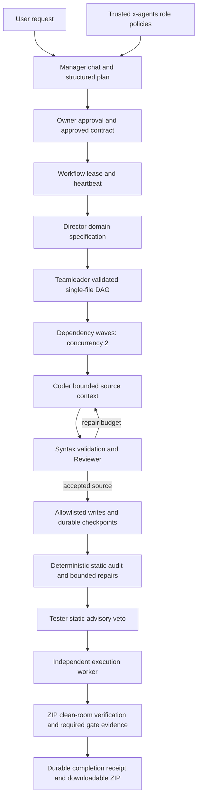

# XFactor: actual multi-agent architecture, 22 October 2026

Baseline: `4273484`, also verified at origin/main. Existing user deletion of `surec-raporu.md` is excluded. Initial frontend/healthz/readyz probes returned 200; unauthenticated worker returned 401. No production restart or LLM request was performed.

## Conclusion supported by the initial investigation

The evidence does not justify replacing the six-role architecture. It shows incomplete instruction integration, obsolete master-document descriptions, and concrete implementation failures at filesystem, prompt and concurrent-update boundaries. The independent worker/receipt gate must remain the authority for completion. Agent approval is advisory evidence of source review, not proof of executed tests.



This diagram is a control-flow summary, not a claim that every Markdown policy is enforced. Domains/teamleaders are traversed sequentially; parallelism applies within DAG waves. Filesystem operations are executed by the backend, not autonomous shell-capable role processes.

## Detailed evidence

- [Markdown inventory and actual reader/prompt/test mapping](x-agents-markdown-inventory-2026-10-22.md).
- [Workflow contracts, recovery, ownership and observability](x-agents-workflow-2026-10-22.md).
- [Trust boundary and isolated exploit reproductions](x-agents-trust-2026-10-22.md).
- [Prioritized remediation plan](../superpowers/plans/2026-10-22-agent-architecture-audit.md).

These reports describe the inspected baseline; later remediation does not erase the original evidence. Line references in baseline reports refer to `4273484` unless explicitly updated.

## Proven findings and treatment

| Priority | Baseline finding and effect | Treatment / verification |
|---|---|---|
| P1 | `codeGenerator.writeGeneratedFiles` checks parent paths but follows a linked final file; external sentinel changed in an isolated reproduction. Coder-copy paths have only lexical containment. | Reject unsafe destination chains, validate every copy before content writes, prevent leaf following; isolated sentinel tests for source/copy destinations. |
| P1 | Generated reports/errors/logs, titles and plan summaries are interpolated into the chat system message. | Move bounded runtime context into a labeled user-data message; inspect actual initial and repair message arrays without paid calls. This proves message authority, not guaranteed model compliance. |
| P2 | Master constitution reaches only chat, truncated at 3000 of 10716 characters; all production roles omit it. | Share complete master/role composition with explicit precedence; update contradictory obsolete master statements; assert complete document inclusion for every role/chat. |
| P2 | Concurrent `checkTodoItem` read/modify/write loses a successful task completion. | Serialize per TODO path; concurrent two-task test and error-recovery test. Checkpoints remain authoritative; Markdown visibility still matters. |
| P2 | Ownership keys are case-sensitive on Windows and recognize only direct ordered dependencies. | Canonical keys on Windows, transitive reachability; reject unordered owners and accept ordered chains. |
| P2 | Tester semantic veto stores repair issues but generation completion can bypass generation again on resume. | Investigate isolated end-to-end reproduction before modifying recovery; do not invent successful repair from issue presence. |
| P2 | Production appears not to populate `contract_tasks` / `requirement_task_links`, although impact APIs read them. | Confirm against complete import/call chain and add actual-workflow persistence regression before changing projections. |
| P2 | Unknown requirement IDs may be reassigned to unrelated approved IDs during normalization. | Validate exact scope-preservation behavior with isolated schema tests before selecting compatibility change. |

## Documented behavior versus actual behavior

The master originally describes 1–2 files per task; schemas enforce exactly one. It describes local compiler/build steps and Tester-produced README followed by completion; current production requires independent worker acceptance and centrally generated delivery documentation. It describes resume based on `isTaskCompleted`; current checkpoints bind contract, scope, dependency inputs, output hashes and policy versions. The five root protocol Markdown files are human reference templates; runtime serializers are inline in `fileProtocol.js`, and role models receive composed strings rather than opening their own folders.

Role Markdown loads at import time and remains cached for production. Manager chat rereads its policy on each construction. Trusted-document read failure is fatal; there is no fallback to generated project docs. A Markdown instruction is not executable enforcement: path checks, output schemas, DAG validation, leases, checkpoint hashes and evidence gates implement the actual boundaries.

## Risks and design choices, separate from demonstrated bugs

- Model prompt injection cannot be eliminated by delimiters. Separating message authority and bounding generated context reduces accidental promotion; code-enforced approval, file and evidence boundaries remain necessary.
- `local-trusted` worker executes code as its OS user and is not an OS security sandbox. Docker is an optional stronger execution profile, not the default workflow assumed by this audit.
- Bounded Coder context (default 96 KiB), manifest field/link truncation and serial domain traversal are design choices with explicit completeness/performance tradeoffs, not failures by themselves.
- Source inspection cannot establish product runtime quality. No real user project or accepted hotel ZIP is executed in this work.
- Graphify combines AST-derived edges and manually declared architectural edges. Existing `reads`/`loads` graph relationships do not prove complete master-policy propagation or runtime behavior; call sites and tests above supply that evidence.

## Implemented remediation

The targeted changes retain the role/DAG/worker architecture:

Current master-policy call chain (after remediation):

```text
agents/{manager,director,teamleader,coder,reviewer,tester}.js:4/7
  → agentLoader.loadAgentSystemPrompt(role):24
  → loadOrkestrasyonTalimatnamesi():17 + loadAgentPrompt(role):7
  → agentPaths.readAgentDocument():17 (fixed trusted root)
  → cached role SYSTEM_PROMPT → agents/index.getAgent():55
  → workflow.callAgentLLM():451 → system policy + user task
  → llmTaskRetry.runLLMTaskWithRetry():70
  → llm.generateLLMResponse():120 → configured provider adapter

projectRoutes.buildManagerChatSystemPrompt():202
  → same full loadAgentSystemPrompt('manager') → system message
projectRoutes chat handler:402
  → buildManagerChatContext → separate user data message
  → managerResponder (default generateLLMResponse); same split on repair
```

The current line references above complement the explicitly pre-remediation
inventory, which preserves the evidence for the original truncation and
missing production-policy inheritance.

- `loadAgentSystemPrompt(role)` composes complete master and role policies for all six production roles and Manager chat. The master is now v5, with exact single-file tasks, static QA versus worker acceptance, and current checkpoint semantics. Five protocol templates remain explicitly human references.
- Generated source and coder-copy writes preflight all existing path components, reject symlinks/junctions, stage exclusively and rename. Existing final-file links are never opened for truncation. Concurrent hostile directory swaps remain an OS/filesystem limitation.
- `buildManagerChatContext` supplies bounded, redacted runtime data as a user message in initial and repair calls. System instructions contain no generated report/title/error/log content. Report paths reject linked ancestry, reads are bounded, and the final context remains valid JSON.
- TODO check/uncheck operations serialize per absolute path in the backend process. Windows ownership keys fold case; all owners must be ordered by transitive DAG reachability. Scope normalization preserves invalid IDs for rejection and no longer invents valid tasks/requirement assignments through the Teamleader parser.
- Mock role selection reads the trusted specialization marker, so shared master mentions of other roles cannot change Coder into Reviewer.
- `executeTesterAdvisoryRepairs` routes open same-contract static issues to unambiguous existing allowlisted files, records a durable input/issue retry budget before provider access, and requires fresh static/Tester/worker acceptance. Unmapped targets, unchanged outputs and exhausted budgets stop with an actionable revision error. Existing checkpoints and source fixes survive resume; no patch alone resolves a repair issue.
- `projectContractTasks` validates the current approved contract and workflow lease inside a transaction, materializes scoped task/dependency/requirement links, preserves historical evidence, and runs from actual planning/resume paths. Checkpoint lookups translate projected task IDs to execution task identity and specification hash, avoiding cross-team/contract leakage. No production-wide historical backfill was performed.

Independent review caught and corrected the mock-role regression, the parser's earlier synthetic-ID bypass, report-directory alias reads, projected/execution checkpoint identity mismatch, and the multi-target repair-budget boundary.

A late-provider cancellation regression also demonstrated that a returned patch
could be written after pause. Advisory repairs now recheck cancellation after
the provider response and before commit, and reassert the lease through the
fenced workflow writer before changing source bytes. Already-paid attempts
retain their retry record even when canceled. Foreign-contract retry entries
do not consume the current contract's budget.

## Verification and limits

- Frontend: 118 unit tests passed (13 files), production build passed.
- Execution worker unit suite: 155 tests passed, zero failed/skipped. This is distinct from real generated-product acceptance.
- Native worker integration: 3 tests passed, zero failed/skipped, using a temporary fixture with real SQLite/API and Chromium journeys; negative cases reject failing/empty test evidence. Existing production worker and user projects were not used as fixtures.
- Final backend run: **146 suites passed, 0 failed** (283.45 seconds), using `node backend/tests/test_runner.js` with its isolated storage roots. P8.3/P8.4 Docker checks were explicitly skipped because Docker was unavailable; the separate opt-in Docker artifact acceptance suite was not run. The first broad development run included newly added RED-stage regressions; a subsequent broad run exposed the transient HTTP failure and server leak described below. Neither failed run is represented as a passing result.
- Final focused cancellation/checkpoint/repair run: 5 suites passed, 0 failed. Final P3 diagnostic repetitions: five suites passed, 64/64 checks each, with unchanged assertions.
- Graph regenerated with `npm run graph`: **462 files, 2836 nodes, 7208 edges**. Source-extraction tests passed; generated JSON was parsed and checked for dangling endpoints and complete six-role master-policy edges. Static and manually declared graph edges retain their documented interpretation limits.
- Frontend commands: `npm --prefix frontend run test:unit`, `npm --prefix frontend run build`. Worker commands: `npm --prefix execution test`; `EXECUTION_WORKER_LOCAL_INTEGRATION=1 node --test execution/tests/localRoundtrip.integration.test.js`. All completed with exit code 0. Logs remain in the ignored `.tmp/agent-audit-*` workspace files.
- Docker acceptance and a new paid end-to-end generation were not run. No user project, accepted hotel ZIP, credential or completion receipt was modified.
- `local-trusted` retains OS-user authority. Prompt separation does not prove injection immunity. Multi-process hostile filesystem swaps and broader semantic model accuracy remain outside these tests.
- Instruction-file validation enforces the trusted path, regular-file/size constraints and minimum text length; it is not a semantic Markdown policy validator. A sufficiently long contradictory or meaningless document can still load. Explicit policy precedence and behavioral regressions cover the inspected rules, not every future operator edit.
- The existing task checkpoint schema still uses local task IDs; impact queries also constrain the original task specification hash. Separate teams with byte-identical task specifications and IDs are indistinguishable in this historical checkpoint model. A namespace migration would require separate compatibility design; this audit does not rewrite historical checkpoints.

### Added behavioral evidence

| Boundary | Regression suite |
|---|---|
| Complete master + complete role + explicit precedence in all six prompts and Manager chat | `backend/tests/test_docs_agent_sync.js` |
| Runtime values absent from system authority; initial and repair calls carry data separately; bounded reports and linked ancestry | `test_manager_error_telemetry.js`, `test_manager_chat_failures.js` |
| Source/coder-copy leaves, directories, project roots and internal linked ancestors rejected without modifying external sentinels | `test_symlink_isolation.js` |
| Strict parser-to-approved-scope path, Windows case identity, transitive/all-pair ownership | `test_agent_contract_schemas.js` |
| Parallel TODO completions, ordered check/uncheck and mutation-queue recovery | `test_p0_c_workflow_integration.js` |
| Shared master cannot select another mock role; user text cannot forge system role | `test_llm_runtime_controls.js` |
| Actual generation projection; advisory repair routing/budget/cancellation; checkpoint/source preservation; current versus old-contract issues | `test_generation_resume.js` |
| Transaction rollback, lease/current-contract fencing, scoped projection and exact raw checkpoint mapping through real impact/preview HTTP routes | `test_p3_observability.js` |

Paths without a directory in this table are under `backend/tests/`. Test storage
is isolated by `test_runner.js` (DB, projects, artifacts and trash), including
tests that start loopback HTTP servers. The P3 HTTP helper now always closes its
server and reports the underlying transport cause. A generic intermittent fetch
failure in an earlier full run was not reproduced in five 64/64 isolated repeats;
its original transport cause remains unknown. No assertion retry was added.
