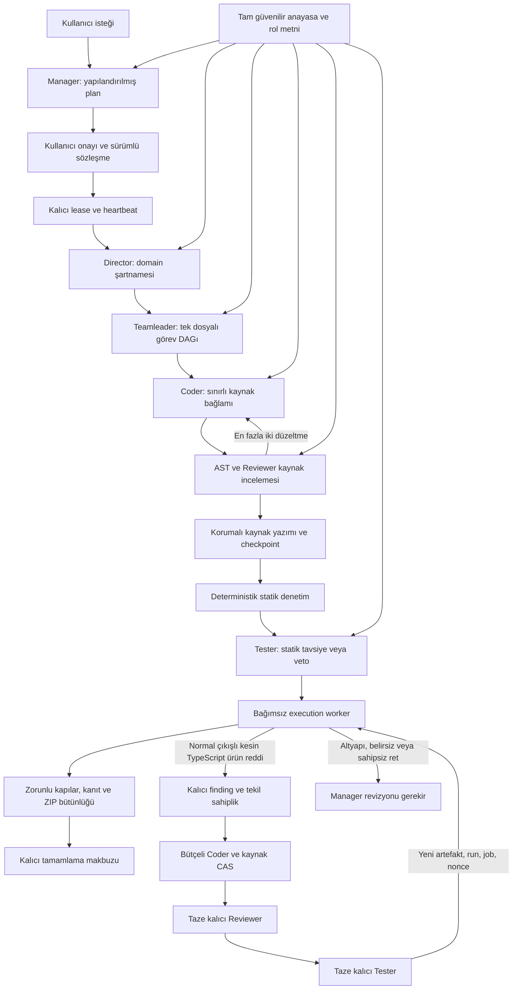

# XFactor mimari inceleme ve açık işlerin kapanış kaydı

Bu kayıt `b8799ef` sonrasındaki `codex/agent-architecture-completion` çalışmasına aittir. İlk inceleme raporları tarihsel kanıttır; oradaki eski hatalar güncel hata listesi olarak okunmamalıdır. Bu dosyada **bekliyor** yazan iş tamamlanmış değildir.

## Kapsam ve karar

Hedef altı rolü yeniden tasarlamak değil, belgelenmiş düzenin gerçek backend tarafından tutarlı uygulanmasını sağlamaktır. Mevcut bulgular talimat yükleme, dosya yazımı, görev kimliği, kurtarma ve onarım bağlantılarındaki uygulama eksiklerini gösteriyor. Modelin kaynak incelemesi, bağımsız worker'ın çalıştırdığı testler ve kalıcı kabul kanıtı ayrı tutulur.

İlk sorunun kanıta dayalı cevabı: burada üretilen hatalar, altı rol ve bağımsız worker ayrımının zorunlu olarak yanlış olduğunu göstermiyor; belgelenen yetki ve kurtarma düzeninin bazı backend yollarında eksik uygulanmasını gösteriyor. Örneğin güvenli protokol okuyucusu var olsa bile kurtarma servisi onu atlayabiliyor; nitelikli checkpoint kimliği var olsa bile log kurtarma yerel ID ile kayıtları birleştirebiliyor. Bunlar uygulama düzeltmesi gerektirir. Ayrı süreç olmanın OS izolasyonu sağlamaması, aynı SQLite'a bağlı tek-node sınırı, bağlam bütçeleri ve çoklu dosya/crash sınırları ise ayrıca belirtilen tasarım/işletim tercihleri ve risklerdir. Her olası ürün hatasının bu incelemeyle ortadan kalktığı sonucu çıkarılmaz.

Plan: [onaylanan uygulama sırası](../superpowers/plans/2026-10-22-agent-architecture-completion.md).

## Gerçek mimari ve rol sözleşmeleri

Backend altı LLM rolünü çağırır; modeller dosya veya kabuk aracı kullanmaz. Backend prompt hazırlama, şema doğrulama, DAG yürütme, dosya yazımı, checkpoint ve durum kayıtlarının sahibidir. Domain ve takımlar sıralıdır; bir takımın bağımsız DAG görevleri en fazla ikili dalgalarda yürütülür. Ayrı execution worker gerçek bağımlılık/build/runtime/API/tarayıcı denetimlerini yapar. `local-trusted` profil ayrı süreçtir, OS sandbox değildir.

Bu şema ana kontrol akışıdır; her ret veya hata için otomatik onarım garantisi değildir. Worker onarımı yalnız kaynak ve sahiplik kanıtı kesin olan TypeScript ürün bulgularında otomatik ilerler. Her Coder/inceleme/worker çağrısından önce kalıcı rezervasyon ve bütçe uygulanır; belirsiz tüketilmiş sonuçlar Manager revizyonu gerektirir. Issue'lar patch ile değil, yeni bağımsız kanıtın kaynak/kontrat/receipt eşleştirmesiyle kapanır.

| Rol | Girdi -> çıktı | Yetki / tamamlanma |
|---|---|---|
| Manager | Sohbet/kullanıcı isteği -> domains, requirements, management, browser sözleşmesi içeren plan | Planlama/revizyon önerir; üretim ve kabul yetkisi kullanıcı onayı ve backend kurallarıyla sınırlıdır |
| Director | Domain, ana şartname -> altTalimatname ve teamleaders | Domain kapsamı doğrulanmış JSON; protokol yazımını backend yapar |
| Teamleader | Misyon, alt şartname, onaylı requirements, kaynak/görev ipuçları -> tasks | Tek hedef, requirement bağlantısı, geçerli yerel DAG ve kapsam doğrulaması gerekir |
| Coder | Görev, tek hedef, bounded kaynak/dependency bağlamı -> summary/files | Yalnız onaylı hedef içeriği üretir; yazım, kota, path ve lease yetkisi backend'dedir |
| Reviewer | Yeni kaynak, görev, referans bağlamı -> approved/summary/feedback/issues/suggestions | AST ret modelle aşılamaz; ilk çıktı + en fazla iki düzeltme. Kaynak onayı runtime kanıtı değildir |
| Tester | Manifesto, kabul metni, deterministik denetim özeti -> approved/summary/issues | Statik veto verebilir; gerçek komut/test çalıştırmaz. Model onayı deterministik ret veya worker kapısını aşamaz |
| Bağımsız worker | Kimlik/hash bağlı prepare_dependencies veya verify_artifact işi + onaylı sözleşme/ZIP -> çalıştırılmış check kayıtları | Tüm kimlik alanları ve kapı kanıtları doğrulanır; yalnız geçerli kalıcı kanıt ve makbuz completed yetkisi verir |

LLM rol JSON şemaları `agents/schemas.js` ve role özel normalizasyonlardır; bütün rollere ortak bir `schemaVersion` zarfı yoktur. Worker protokolü `version:1`, checkpoint kalite kapısı `1.0.0`, aktif kalite politikası `2.0`, proje sözleşmesi ise revision/hash kullanır. Bu ayrı sürüm alanları bilinçli olarak aynı şey gibi sunulmaz. Genel şema sürümü eklemek tek başına bir hatayı gidermez; gerçek zorlanan sınırlar ve uyumluluk testleri esastır.

Rol çıktıları elle yazılmış doğrulayıcı ve normalleştiricilerle işlenir; bütün bilinmeyen alanları reddeden ortak, katı bir JSON Schema zarfı değildir. Director metni varsayılan takım bilgisiyle normalleştirilebilir; Reviewer/Tester kararları normalize edilir ve issue varsa onay düşürülür. Bir validator'ın bulunması her çağrı yolunda çalıştığı anlamına gelmez. Sözleşme/onay, hedef dosya, DAG, yazım ve kabul sınırları ayrıca backend tarafından zorlanır. Anayasanın v5 belge sürümü, checkpoint kimlik sürümü 0/1 ve DB migration 17 de yukarıdaki protokol/kalite sürümlerinden ayrıdır. Bu esnek parse tasarımı tek başına yeni bir kabul bypass'ı olarak kanıtlanmış değildir.

Proje durumu, workflow attempt durumu ve verification run sonucu aynı enum değildir. Onay transaction'ı `contract_approved` geçişini de doğrular ve proje `implementing` olarak kaydedilir; lease girişimi `running` adını kullanır. Statik/Tester reddi `verification_failed` kaydeder. Worker reddi CLI'dan başarısız sonuç olarak döndüğünde workflow istisna yolu projeyi `paused` yapabilir; başarısız doğrulama koşusu tarihsel `failed` olarak kalır. Kalite Paneli bu güncel proje durumunu geçmiş koşu sonucundan ayırır.

Başarılı doğrulamada `verificationCli` mevcut durumdan `implementation_finished`/`verification_pending`/`verification_running` ve `build_verified` -> `runtime_verified` -> `acceptance_verified` -> `artifact_verified` geçişlerini uygun sırayla uygular; bunlar her worker komutunun ayrı canlı durum yayını değildir. Son `completed`, bağımsız koşu kanıtı, zorunlu kapılar ve receipt denetimini yapan `completeVerifiedProject` yetkisindedir. Geç sonuçların kimlik/lease/signal kontrolü ara kanıt ve checkpoint yazımında da zorunludur.

## Bulgu sınıflandırması ve çözüm sırası

| Kimlik / tür | Öncelik ve etki | Çözüm / doğrulama | Durum |
|---|---|---|---|
| C1 — kanıtlanmış hata | P1: lease devri veya iptal sonrası eski süreç kaynak yazabiliyor | SQLite ile son senkron commit'i lease/iptal değişimleriyle serialize etmek; iki süreçli gerçek stage/commit testi | Uygulandı; Görev 1–2 birleşik bağımsız incelemesi PASS |
| C1b — kanıtlanmış hata | P1: protokol Markdown okuyucu/yazıcısı linked leaf üzerinden proje dışı veriyi okuyabiliyor ve üzerine yazabiliyor | Bütün protokol I/O sınırlarını korumak; bağımsız read/write sentinel regresyonları | Uygulandı; symlink 15/15, sıfır atlama. Bağımsız inceleme ve düzeltme sonrası yeniden inceleme PASS |
| C1c — kanıtlanmış kurtarma boşluğu | P1: reconciliation servisi korumalı protokol okuyucusunu atlayarak linked metadata içeriğini sohbet/görev kaydına taşıyabiliyor | Aynı root/ancestor/leaf ve boyut sınırını bütün metadata kurtarma okuyucularında uygulamak; gerçek kurtarma fonksiyonlarıyla dış sentinel regresyonu | Uygulandı; 7 kurtarma testi ve bağımsız 4 süitlik yeniden inceleme PASS; tam 148 süitlik dal regresyonu geçti |
| C2 — kanıtlanmış hata | P1: geç worker sonucu superseded sözleşmeye ara doğrulama kanıtı kaydedebiliyor | Her persistence transaction'ında güncel sözleşme/signal/lease kontrolü; final makbuzun zaten korunduğu ayrımını korumak | Uygulandı; odaklı testler ve birleşik bağımsız inceleme PASS |
| C2b — kanıtlanmış hata | P2: eski sözleşmede incelenmiş kaynak, geç checkpoint yazımında yeni sözleşmeye etiketlenebiliyor | Yakalanmış sözleşme kimliği + checkpoint transaction'ında hash/revision/iptal kontrolü; gerçek workflow'da kaynak yazımından sonra sözleşme değiştiren test | 23 Ekim: 3 süit geçti; bağımsız yeniden inceleme PASS |
| C3 — kanıtlanmış hata | P1: kurtarma yolu onaylı sözleşme olmadan üretime ulaşabiliyor | Engine girişinde onay ve authoritative plan zorunluluğu; sıfır provider/source/receipt negatif testi | Uygulandı; engine/HTTP regresyonları ve bağımsız inceleme PASS |
| C4 — kaynakla doğrulanan hata | P2: eski iptal hafızası yeni Resume'u iptal ediyor; eski finally yeni controller'ı silebiliyor | Attempt/controller sahipliğine bağlı kayıt/temizlik; gerçek hemen-resume testi | Uygulandı; gerçek HTTP pause/resume testi ve bağımsız inceleme PASS |
| C5 — kanıtlanmış hata | P2: aynı yerel ID ve aynı spec farklı takımlar arasında checkpoint aidiyetini ayırt etmiyor | Tam nitelikli görev kimliği; konservatif eski kayıt uyumu ve impact/preview testi | Uygulandı; 9 odaklı süit ve son düzeltmeler için 3 süit geçti. Bağımsız inceleme ve yeniden inceleme PASS |
| C5b — kanıtlanmış kurtarma boşluğu | P2: log kurtarma iki takımın aynı yerel görev ID'sinden yalnız birini geri getiriyor | TODO ve dizin taramalarında tam domain/takım/görev node kimliğiyle tekilleştirmek; iki takım ve idempotence testi | Uygulandı; TODO ve dizin tarama/idempotence regresyonları ve bağımsız yeniden inceleme PASS; tam 148 süitlik dal regresyonu geçti |
| C6 — kanıtlanmış hata | P2: reconcile gerçek iç içe görev/TODO yolunu hedeflemiyor; sıra bozulduğunda kardeş checkbox değişebiliyor | Açık hiyerarşi/sahiplik ile yalnız ilgili kayıtların güncellenmesi; yarım kaydın tamamlanması | Uygulandı; davranış RED/GREEN. Bağımsız yeniden inceleme PASS |
| C7 — kaynakla doğrulanan boşluk | P2: worker reddi gerçek diagnostic ile sorumlu Coder onarımına bağlanmıyor | Kalıcı sınırlı finding, deterministik sahiplik, bütçeli onarım, taze worker kanıtı | TypeScript ürün reddi için uygulandı; 32/32 ve bağımsız spec/kalite PASS. İki ardışık onarım -> kanonik kabul ayrıca doğrulandı; diğer/belirsiz retler revizyon gerektirir |
| C8 — belge/UX farkı | P2: statik Tester sonucu kabul testi veya yanlış durum adıyla anlatılıyor; kalite geçmişi güncel durumdan ayrı görünmüyor | Sohbet/panel/rehber etiketlerini gerçek state ve kanıt kaynağıyla eşlemek | Panel `05580db`, 37 test + bağımsız onay; kılavuz düzeldi; runtime mesajları Görev 2'de |
| C9 — kanıtlanmış tekrar | P3: görev ve HTTP katmanı retry çarpımı | Görev katmanı `maxTransportAttempts:1` geçirir; gerçek adaptör istek sayısı testi, parse hatasında retry yok | `7c4f864`; 2 odaklı süit geçti, bağımsız spec/kalite incelemesi onayladı |
| C10 — kaynakla doğrulanan harita/belge hatası | P3: Graphify yardımcı modülleri kayıtlı ajan gibi, tarihsel/operasyon belgelerini anayasanın tanımladığı politika gibi gösteriyor; rehber yanlış onay durumu ve paket sürümü sabitlemesi anlatıyor | Curated kenarları gerçek altı rolle sınırlamak; onay/import/rol/versiyon anlatımını kodla eşlemek; son JSON ve kaynak kontrolü | Üretici/belgeler düzeltildi; JSON/uç/politika kenarı ve iki görsel harita doğrulandı |
| R1 — işletim sistemi riski | Hostile süreç pathname tabanlı kontrolle syscall arasında ancestor değiştirebilir | Mevcut link reddi test edilir; tam düşmanca izolasyon için OS handle-relative API veya izole worker kullanımı gerekir | Açıkça belirtilen sınır; mutlak koruma iddiası yok |
| R2 — model/talimat riski | Prompt injection veya anlamsız ama uzun Markdown model kararını etkileyebilir | Trusted loader ve user-data ayrımı, code-enforced scope/acceptance; semantik bağışıklık iddiası yok | Sınır + mevcut mekanik korumalar |
| R3 — düşük öncelikli gözlemlenebilirlik eksikliği | P3: parser'ın tanıdığı altyapı retleri kalıcı özet satırında genel `ambiguous` sınıfıyla saklanır | Sonraki iyileştirme: blocker başına sınıfı özet/persistence boyunca korumak ve producer -> DB assertion eklemek | Otomatik onarım her iki sınıfta da durur; kabul bypass'ı değildir. Çözüm önerisi kaydedildi; davranış politikası değiştirilmedi |
| D1 — tasarım tercihi | Bounded kaynak bağlamı, seri domain/TL, yerel güvenilir worker profili; sıralı ortak dosya yazarları bağımsız checkpoint tutar | Kapasite/performans ve OS yetkisi belgelenir. Sonraki görev aynı dosyayı değiştirirse öncekinin output CAS'i geçersiz olabilir ve resume yeniden üretim gerektirebilir; nitelikli kimlik küresel ortak-dosya scheduler'ı değildir | Korunuyor; yanlış kanıt paylaşarak çağrı azaltılmıyor |
| D2 — crash sınırı | SQLite transaction filesystem çoklu dosya rollback'i veya fsync garantisi vermez | Kısmi commit hata olarak bildirilir; checkpoint verilmez; UUID stage'leri ZIP/kaynak bağlamından dışlanır; resume hash doğrular | Görev 1'de tanımlandı; kaynak fence ve tam dal regresyonuyla doğrulandı |

## İlk isteğin kapsam matrisi

| İstenen inceleme / davranış | Kaynak veya tarihsel kanıt | Bu dalın kapanış ölçütü | Durum |
|---|---|---|---|
| README, kullanıcı kılavuzu, OPERATIONS ve güncel mimari belgeleri | Kök belgeler; önceki Markdown/workflow raporları | Güncel davranışla karşılaştırma, eski iddiaları düzeltme | İncelendi ve kodla karşılaştırıldı; güncel iddialar düzeltildi; tam dal regresyonu geçti |
| x-agents altındaki tüm Markdown ve ana orkestrasyon dosyası | `agents/agentLoader.js`, `agentPaths.js`, rol modülleri | Dosya bazında güncel okuyucu/aşama/mesaj/tamlık/cache/hata/enforcement/test tablosu | 13 dosyanın tamamı, loader/cache/hata ve gerçek mesaj assertion kapsamı kaydedildi; tam dal regresyonu geçti |
| Graphify JSON, rapor ve görsel haritaların kodla doğrulanması | `graphify-out/`, `GRAPH_REPORT.md`, graph üreticisi | Son kaynakla yeniden üretim; uç noktalar ve politika kenarları doğrulaması | 2.978 düğüm/7.687 ilişki yeniden üretildi; JSON/uç/rol kenarı ve iki Chromium görünümü doğrulandı |
| Git geçmişi ve mevcut değişiklikler | `4273484` -> `b8799ef`; yeni çalışma dalı | Başlangıç/son SHA ve kapsam dışı kullanıcı değişikliği kaydı | Baseline b8799ef, önceki çalışma commitleri ve kullanıcı silmesi ayrıldı; son commit kapsamı teslim kaydında |
| Orkestrasyon gerçek import/çağrı zinciri | Önceki ana rapor; loader -> registry -> workflow -> retry -> adaptör | Yeni kaynak referansları ve tüm altı rol/sohbet davranış testi | Gerçek import/çağrı zinciri ve altı rol/sohbet assertion kapsamı doğrulandı; güncel satır ankrajları kontrol edildi |
| Okunmayan veya etkisiz belgeler | Beş insan protokol şablonu | Çalışma zamanı okuyucusu olmadığı açık; gerçek serializer/test referansı | Beş tüketilmeyen şablon ve insan rehberleri açıkça listelendi; serializer/prompt tüketimi ayrıldı |
| Manager -> Director -> Teamleader -> Coder -> Reviewer -> Tester -> worker | Önceki workflow raporu | Gerçek kontrol akışı ve her rolün girdi/çıktı/yetki/bitiş koşulu | Girdi/çıktı/yetki/bitiş ve onarım akışı kaydedildi; bağımsız worker kanıtı model tavsiyesinden ayrıldı |
| Plan onayı ve üretime geçiş | `projectRoutes`, `projectContract`, workflow | Onaysız/eski sözleşme ile üretim veya kabul engeli | Engine/HTTP onaysız ve eski sözleşme negatifleri, lease/fence ve geç sonuç regresyonları geçti |
| JSON şemaları ve sözleşme sürümleri | `agents/schemas`, worker protokolü, policy ve checkpoint sürümü | Ayrı sürüm alanları ve doğrulama yerleri açık | Esnek parser sınırı ve ayrı belge/protokol/policy/checkpoint/DB/sözleşme sürümleri kaynakla doğrulandı |
| DAG, sahiplik, eşzamanlı görevler | `dag.js`, `schemas.js`, `taskProjection.js` | Windows alias/transitive kuralları korunur; takım kimlikleri çakışmaz | Yerel DAG/transitive sahiplik, platform alias kuralları ve sözleşme/takım kimliği incelendi; tam dal regresyonu geçti |
| Lease, heartbeat, iptal, pause/resume, restart | `workflowAttempts`, cancellation, workflow | İki süreçli yazım fence'i ve geç sonuç testleri | İki süreçli stage/commit, iptal/devir/geç sonuç ve gerçek HTTP pause/resume regresyonları geçti |
| Checkpoint geçerliliği ve eski çıktı | checkpoint repository/helper, resumeStage | Aynı yerel ID/aynı spec farklı takımda paylaşılmaz; uyumlu ve konservatif eski kayıt yolu | Migration/reopen, konservatif legacy, iki takım/impact/preview/resume ve version çakışması regresyonları geçti |
| Reviewer/Tester bulgularının onarıma aktarılması | selfCorrection ve mevcut bounded advisory repairs | Sahiplik/kapsam/bütçe korunur; değiştirilmiş kaynak yeniden incelenir | Normal düzeltme ve advisory bütçeleri; worker onarımında kaynak bağlı taze kalıcı Reviewer/Tester ve ret/kurtarma testleri geçti |
| Bağımsız worker hatalarının sorumlu Coder'a aktarılması | Worker -> artifactVerifier -> verificationCli -> workflow | Kalıcı gerçek diagnostic, deterministik sahiplik, bounded onarım, yeni worker kanıtı | Kesin TypeScript ürün bulgusu -> tek sahipli bounded Coder -> yeni kanıt -> kanonik kabul bağlantısı test edildi; belirsiz ret revizyon gerektirir |
| Sohbet ve kalite paneli tutarlılığı | workflow mesajları, kalite API/paneli | Statik inceleme/runtime ayrımı; gerçek durum adı | Güncel durum/geçmiş koşu ve statik/runtime ayrımı düzeltildi; frontend120/build, chat/API ve tam backend regresyonları geçti |
| Tekrarlanan işler ve gereksiz LLM çağrıları | Generation marker, checkpoint ve repair ledger | Resume/aynı girdi call-count testleri; zorunlu kalite kapıları korunur | Gerçek adaptör request-count, checkpoint resume ve kalıcı repair/validation/worker rezervasyonu call-count regresyonları geçti |
| Platform/proje talimat ayrımı ve talimat önceliği | Sabit loader, user-data context, şema/yazım sınırları | Güvenilmeyen içerik system rolüne terfi etmez; davranış testleri | Sabit güvenilir loader ve ayrı user verisi; gerçek message-array ve boundary testleri geçti |
| Path traversal, symlink, okuma/yazma sınırı | codeGenerator, agentPaths, proje yolları | Dış sentinel korunur; tüm normal/repair/scaffold yazımları izlenir | Kaynak/protokol/kurtarma okuyucu-yazıcı sınırları, dış sentinel, root/ancestor/leaf/size ve iki süreçli source fence doğrulandı |
| Prompt injection ve aşırı yetki | Önceki trust raporu; local-trusted yürütme profili | Kanıtlanan koruma ile OS/model sınırı ayrılır; mutlak bağışıklık iddiası yok | Mekanik mesaj/yazım/kanıt korumaları ile model/OS riskleri ayrıldı; genel bağışıklık iddiası yok |
| Güvenlik/kalite kurallarının kodla zorlanması | Schema, lease, checkpoint, worker receipt ve mandatory gates | Hangi kural mekanik, hangisi prompt/tasarım açıkça listelenir | Prompt ilkeleri ile mekanik şema/onay/lease/checkpoint/ownership/worker receipt yetkisi ayrı kaydedildi ve test kapsamı gösterildi |
| Somut çıktı: gerçek mimari ve akış şeması | Önceki ana rapor | Son kodu anlatan güncel şema | Güncel Mermaid ana/onarım akışı ve rol sözleşme tablosu hazır |
| Somut çıktı: belge -> okuyucu -> ajan -> kural -> test | Önceki Markdown envanteri | Güncel dosya bazlı tablo | Güncel dosya bazlı okuyucu/aşama/rol/tamlık/cache/hata/enforcement/test envanteri hazır; kaynak ankrajları kontrol edildi |
| Somut çıktı: belgelenen/çalışan farkları | Önceki raporlar ve kullanıcı kılavuzu | Kapatılan ve kalan farkların ayrı listesi | C bulgularında eski/gerçek davranış ve düzeltmeler; R/D satırlarında kalan risk/tasarım sınırları ayrıldı |
| Somut çıktı: hata/risk/tasarım ayrımı | Önceki ana/trust/workflow raporları | Her bulgu için etki/öncelik/çözüm/test/sonuç | C/R/D sınıfları, etki/öncelik/çözüm/test ve düşük öncelikli sınıflandırma iyileştirme önerisi kaydedildi |
| Somut çıktı: uygulama planı ve doğrulama | Onaylanan 7 görevli plan | Her görev için doğrulanmış kapanış veya somut kısıt/çözüm | Onaylı plan ve son inceleme takip düzeltmeleri işlendi; final bağımsız dal incelemesi/commit kapısı ayrıca izleniyor |

## Doğrulama günlüğü

- Başlangıç: `main` üzerindeki `b8799ef`; yalnız `surec-raporu.md` kullanıcı silinmesi vardı. Çalışma dalı oluşturuldu.
- Sandbox içindeki ilk odaklı koşu geçici klasör rename işlemlerinde `EPERM` aldı; başarı kabul edilmedi. Kısıt dışındaki koşu sırasında eklenen iki süreçli RED regresyonları eski işlemin hem lease devrinden hem iptalden sonra yazabildiğini gösterdi (`committed:true`). Bu koşu temiz baseline veya final başarı değildir.
- İlk odaklı aşamalarda genel doğrulama henüz yoktu; aşağıdaki son tam koşu bunun güncel sonucudur. Üretim servisi yeniden başlatılmadı; kullanıcı projesi veya kabul edilmiş ZIP çalıştırılmadı. Üretim devreye alma kabulü bu dalın kapsamı dışındadır.
- Retry regresyonu gerçek görev -> adaptör -> fake HTTP zincirinde önce **3 yerine 9 istek** ile başarısız oldu. `XFACTOR_TEST_RUNNER_FILES=test_llm_task_retry.js,test_llm_runtime_controls.js node backend/tests/test_runner.js` düzeltmeden sonra **2 süit geçti, 0 başarısız** (6.63 s). OpenAI/Anthropic/Google için hata sınırı ve üçüncü istekte başarılı kurtarma ölçüldü; hiçbir gerçek sağlayıcı çağrısı yapılmadı. Loglar `.tmp/architecture-completion-retry-red.log` ve `-green.log`; bağımsız inceleme spec/quality PASS. Commit `7c4f864`.
- Protokol sınırı: `XFACTOR_TEST_RUNNER_FILES=test_symlink_isolation.js node backend/tests/test_runner.js` izinli izole koşuda **10 geçti, 2 başarısız, 0 atlanan**. Yeni `readDurum` ve `writeDurum` linked-leaf senaryoları ayrı ayrı RED; source writer ve HTTP dosya API'si eski testleri geçti. Bu koşu başarı değildir; log `.tmp/architecture-completion-protocol-red.log`. Üretim verisi kullanılmadı.
- Kalite paneli: eski verified koşu korunurken güncel failed/paused durumunu ayıran regresyon önce eksik durum bölgesiyle RED oldu. Son `npm --prefix frontend run test:unit -- src/components/__tests__/DashboardView.test.jsx src/components/__tests__/P8UiStatus.test.jsx` koşusu **37 test geçti** (2 dosya, 18.18 s). Gerçek App -> panel prop bağlantısı ve bu durumda ZIP indirme yetkisinin verilmemesi de render testinde denetlendi. Bağımsız spec/quality PASS; commit `05580db`.
- 23 Ekim tam frontend doğrulaması: `npm --prefix frontend run test:unit` **120/120 test, 13/13 dosya** (101.87 s); `npm --prefix frontend run build` **exit 0** (42.62 s). Loglar `.tmp/architecture-completion-frontend-full.log` ve `-frontend-build.log`. Bu koşulardan sonra frontend kaynağı değiştirilmedi.
- Görev 1–2: kaynak fence, ara kanıt geçerliliği, onaysız üretim, iptal/controller sahipliği ve hata yayılımı odaklı regresyonlarla doğrulandı. Son durum koşusu `XFACTOR_TEST_RUNNER_FILES=test_generation_resume.js,test_p1_2_pause_resume_lease.js,test_p7_approve_state.js,test_project_action_chat_audit.js,test_workflow_attempts.js,test_workflow_failure_chat_event.js node backend/tests/test_runner.js` için altı süit geçti (35.50 s); ayrıntılar `.superpowers/sdd/2026-10-22-agent-architecture-completion/task-2-current-green.log` kaydındadır. Bu ara koşudan sonra son tam 148 süitlik regresyon da geçti.
- Checkpoint sözleşme yarışı: doğrudan repository ve gerçek `executeProjectTasks` akışında kaynak yazımından sonra sözleşme değiştiren iki test önce RED oldu. Yakalanmış sözleşme kimliği ve transaction içi hash/revision/signal kontrolü sonrasında `test_p0_c_checkpoint_repository.js`, `test_generation_resume.js`, `test_p9_lease_fencing.js` **3 süit geçti** (40.10 s; sırasıyla 3, 19, 26 test). Loglar `.tmp/architecture-completion-checkpoint-contract-red.log` ve `-green.log`; birleşik Görev 1–2 bağımsız incelemesi PASS. Mock provider ve fetch engeli kullanıldı; ücretli sağlayıcı çağrısı yapılmadı.
- Protokol düzeltmesinin ilk doğrulaması on farklı süitin birleşimini kapsar; symlink süiti **15/15 ve sıfır atlama**. Bağımsız incelemede bulunan iki TODO tutarlılık eksikliği ayrıca **10 geçti/4 başarısız** davranış RED koşusuyla üretildi. Son `test_p0_c_workflow_integration.js,test_symlink_isolation.js,test_deep_verification.js,test_backend.js` koşusu **4 süit geçti** (16, 15, 17, 29 test); düzeltmenin bağımsız yeniden incelemesi PASS. Loglar `.tmp/architecture-completion-protocol-review-red.log` ve `-final.log`. İlk nested RED eski/yeni API uyuşmazlığında durduğu için hedef davranışın RED kanıtı sayılmaz; eski API ile yeniden kurulan `.tmp/architecture-completion-protocol-original-api-red.log` gerçek eski nested durum hatasını ayrıca gösterir.
- Görev kimliği: aynı yerel ID ve byte-identical görev iki takım için başlangıçta UNIQUE çakışmasıyla RED oldu. Nitelikli kimlik, konservatif legacy aidiyeti, migration/reopen, gerçek iki takımlı workflow ve gerçek impact/preview HTTP testlerini içeren **9 süit geçti** (50.00 s). Bağımsız incelemenin bulduğu eski identity-version yenilemesi ve tek kullanımlık dependency iterator hataları ayrıca **4 geçti/2 başarısız** RED ile doğrulandı; düzeltmeden sonra checkpoint/resume/selective **3 süit geçti** (9.74 s). Bağımsız yeniden inceleme iki yönlü version çakışması, tarihsel snapshot korunması, generator canonicalization ve takım izolasyonunu kendi in-memory DB probe'larıyla da doğruladı. Loglar `.tmp/architecture-completion-identity-green.log`, `-review-red.log`, `-review-green.log`. Son tam 148 süitlik regresyon da geçti.
- Worker onarımının ara pozitif koşusu: `.tmp/architecture-completion-worker-resume-green.log` **6/6 test geçti**. Gerçek workflow, repository, verification CLI ve artifact verifier kullanılır; LLM ve worker transport'u kimliği koruyan sahte fixture'lardır. Test gerçek kullanıcı projesi üretimi veya gerçek derleyici/worker çalıştırma kanıtı değildir. Kalıcı ret -> normal Resume -> tek sahipli Coder -> taze statik inceleme -> yeni artefakt/run/job/nonce -> kanıta bağlı issue çözümü -> kanonik tamamlanma bağlantısını doğrular. Bu ilk ara koşu tek başına kapanış değildi; sonraki 32 test ve bağımsız ikinci-onarım kabul probe’u Görev 5’in nihai kapsamını doğruladı.
- 24 Ekim güncel politika/harita kaynak kontrolü: `test_docs_agent_sync.js,test_agent_document_boundary.js,test_agent_contract_schemas.js,test_graphify.js` seçimiyle **4 süit geçti, 0 başarısız** (87.19 s). Tam anayasa/rol kompozisyonu, gerçek Manager sohbet kompozisyonu, güvenilir dosya sınırları, şema/assignment assertion'ları ve Graphify kaynak çıkarımı çalıştırıldı. Log `.tmp/architecture-completion-policy-current-green.log`; bu sonuç son Graphify çıktısının henüz üretildiği veya worker onarımının tamamlandığı anlamına gelmez.
- 24 Ekim tam worker birim koşusu: `node scripts/test-worker.mjs` **155/155 test, 0 hata, 0 atlama** (156.10 s), `.tmp/architecture-completion-worker-full-elevated.log`. Önceki sandbox koşusu Chromium cache erişimi ve geçici JSON rename `EPERM` nedeniyle başarısızdı; takılan yalnız o koşuya ait üç süreç tam komut/parent kimlikleri doğrulanıp kapatıldı. Başarı sonucu aynı izole testlerin izinli koşusuna aittir.
- 24 Ekim ilk native entegrasyon denemesi **başarısızdır**: `EXECUTION_WORKER_LOCAL_INTEGRATION=1 node --test execution/tests/localRoundtrip.integration.test.js`, Chromium readiness launch aşamasında 30 saniye timeout; `.tmp/architecture-completion-native-integration.log`. Gerçek ürün kapılarına ulaşmadığı için runtime kabul kanıtı değildir. Daha sonraki seri tekrar aynı limitlerle geçti; iki koşu ayrı kayıtlıdır.
- 24 Ekim Docker kontrolü: `docker info --format '{{.ServerVersion}}'` exit 1; `dockerDesktopLinuxEngine` named pipe bulunamadı. Docker motoru başlatılmadı; Docker entegrasyonu geçmiş sayılmaz.
- Aynı `test_backend.js` değiştirilmeden ve 120 saniye sınırı korunarak tek başına yeniden çalıştırıldı: **29/29 test**, bir süit geçti (15.51 s), `.tmp/architecture-completion-backend-timeout-diagnostic.log`. İlk zaman aşımı bu koşuda üretilemedi; neden kesinleştirilmeden kod hatası veya giderilmiş ürün hatası diye sunulmaz. Daha sonraki son tam 148 süitlik koşu da geçti.
- Native seri tekrar koşusu: aynı komut ve limitlerle **3 test geçti, 0 hata, 0 atlama** (262.71 s), `.tmp/architecture-completion-native-serial.log`. Gerçek kimlik doğrulamalı HTTP prepare/verify, bağımlılık/build, SQLite yazma/okuma, API izinleri ve Chromium'da manager/viewer için pozitif/negatif dört yolculuk çalıştı; başarısız ve sıfır testli uygulamalar completed olamadı, geçici iş alanları temizlendi. Fixture JavaScript'tir: `typecheck` kapısının açık NOT_APPLICABLE/skipped sonucu doğrulanır; bu koşu gerçek TypeScript derleyici başarısı veya canlı üretilmiş kullanıcı projesi kabulü değildir. Worker onarımının gerçek workflow/verifier + fake transport regresyonlarından ayrı yürütme kanıtıdır.

## Son doğrulama özeti — 24 Ekim 2026

| Koşu | Sonuç | Kapsam / açık sınır |
|---|---|---|
| Tam backend: `node backend/tests/test_runner.js` | **148 süit geçti, 0 başarısız; 595.20 s** | Yeni kurtarma ve worker onarım süitleri dahil. P8.3/P8.4 Docker kontrolleri daemon yokluğunda açık SKIP; Docker başarısı değildir |
| Worker birim: `node scripts/test-worker.mjs` | **155 test geçti, 0 hata/atlama; 156.10 s** | Gerçek yerel alt süreç/iptal/temizlik ve worker API/protokol testleri; Docker integration komutu değildir |
| Frontend unit / build | **120 test, 13 dosya; build exit 0** | 23 Ekim koşusu; frontend kaynağı bundan sonra değişmedi |
| Native integration | **3 test geçti, 0 hata/atlama; 262.71 s** | Gerçek geçici HTTP/SQLite/API/Chromium fixture; JS için typecheck açık skipped/NOT_APPLICABLE, gerçek TypeScript başarı kanıtı değil |
| Graphify üretim + JSON/uç/politika kenarları | **2.978 düğüm, 7.687 ilişki; kontroller geçti** | Tüm uçlar ve curated dosyalar mevcut; registry/defines tam altı rol; statik harita runtime kanıtı değil |
| İki görsel harita | **Chromium'da render/arama/kenar seçimi geçti; 0 page error** | Anayasa seçimi/SVG ve yeni workerRepairs dosya araması çalıştı; ekran görüntüleri ayrıca incelendi |
| Son kurtarma bağımsız yeniden incelemesi | **4 süit geçti; 39.88 s** | 7 boundary, 2 dev fallback, 23 chat audit ve 2 migration kontrolü. İki son dal bulgusu kapandı |

Tam backend logu `.tmp/architecture-completion-backend-final.log`; önceki 144/147 koşu ve sandbox hataları bu sonuçla karıştırılmamalıdır. Diğer ham kayıtlar `.tmp/architecture-completion-worker-full-elevated.log`, `-frontend-full.log`, `-frontend-build.log`, `-native-serial.log`, `-graph-generation.log`, `-graph-validation.log`, `-graph-ui.log` dosyalarındadır; tümünde ortak `architecture-completion` öneki kullanılır. Grafik ekranları `.tmp/architecture-completion-graph.png` ve `-tree.png` olarak kaydedildi. Kapanıştaki bağımsız dal kararı ve commit kapsamı, aşağıdaki son devir kapısında ayrıca doğrulanır.

## Devreye alma ve devir sınırı

Bu dalın teslimi kod, belgeler, test kanıtı ve gözden geçirilebilir commit'lerdir. Main birleştirmesi, üretim servisi başlatma/yeniden başlatma ve deploy bu çalışmada yapılmaz. Operatör uygulama öncesinde mevcut yedekleme prosedürünü kullanmalı; üretim rollerinin yeni prompt'ları ancak planlı backend yeniden başlatmasında yüklediğini ve güncel migration'ın o veritabanına uygulanacağını dikkate almalıdır. Yerel testlerin geçmesi üretim veritabanının taşındığı anlamına gelmez.

Tam backend/worker/native fixture ve frontend sonuçları, ortam atlamaları, son Graphify ve kapsam matrisi bu raporda kayıtlıdır. Bağımsız son dal incelemesi **spec PASS / quality PASS**, engelleyici bulgu yok: 66 dondurulmuş dosya hash'i, 25 kapsam satırı, diff ve harita kontrolleri doğrulandı; iki kurtarma bulgusu bağımsız yeniden incelemeyle kapandı. İnceleyenin kendi 4 süitlik koşusu, koordinatörün tam koşularından ayrı kaydedildi. Karar kodun bu dalda gözden geçirilebilir teslimine aittir; üretim kabulü değildir. Son devir kapısı yalnız çalışma dosyalarının commit edilmesidir. Kullanıcının `surec-raporu.md` silmesi commit dışında korunur.
