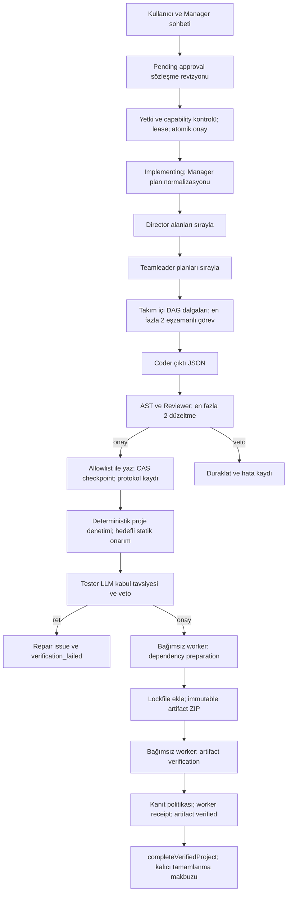

# Ajan sözleşmeleri ve gerçek workflow incelemesi — 22 Ekim 2026

Bu rapor kaynak kodu üzerinden yapılan bağımsız incelemedir. Üretim veritabanı, kullanıcı projeleri, kabul edilmiş ZIP ve çalışan servisler değiştirilmedi; LLM çağrısı yapılmadı. Aşağıdaki satırlar düzeltme öncesi inceleme anındaki kaynak satırlarıdır. Bu rapordaki davranışlar otomatik olarak önerilen yeni tasarım anlamına gelmez.

## Uygulanan hedefli düzeltmeler ve doğrulama

İncelemeden sonra W1–W4 düzeltildi: TODO check/uncheck işlemleri aynı dosyanın çözülmüş yolu üzerinde sıralanıyor; başarısız mutasyon kuyruğu kilitlemiyor. DAG sahipliği Windows yol kimliğini ve her sahip çifti için transitive bağımlılığı kullanıyor. Bilinmeyen ID korunarak scope validator'a ulaşıyor; eksik atama ve boş cevap için onaylı görev uydurulmuyor. Gerçek `parseTeamleaderResponse → normalizeTeamleaderTasks → validate` zincirinde de eksik ID korunuyor: approved liste verilmeden önce çalışan parser artık REQ-1 veya varsayılan görev sentezlemiyor. Eski yardımcı kullanımın fallback davranışı yalnız koddan açık `allowLegacyFallback: true` seçeneğiyle ve approved liste yokken kullanılabilir; üretim parser'ı bu seçeneği kullanmaz.

Regresyonlar önce başarısız çalıştırıldı: Windows alias, transitive sıralama, eşzamanlı TODO completion, check/uncheck sırası ve bilinmeyen requirement yeniden ataması ayrı hatalar verdi. Düzeltmelerden sonra izole runner ile `test_agent_contract_schemas.js`, `test_p0_c_workflow_integration.js`, `test_generation_resume.js`, `test_p9_checkpoint_dependencies.js`, `test_p2_repair_allowlist.js`: **5 süit geçti, 0 başarısız** (toplam 35 test/grup, 28,72 saniye). Sandbox içindeki geniş koşuda geçici dosya rename işlemlerine EPERM geldi; aynı izole koşu onaylı sandbox dışı çalıştırmada geçti. TODO hata kurtarma testindeki EIO logu kasıtlı hata enjeksiyonudur. Değişen dört kod/test dosyasında `git diff --check` temiz. Tam repo doğrulaması ana çalışmanın sorumluluğundadır.

Entegrasyon incelemesinde iki ek regresyon da önce RED, sonra GREEN ile doğrulandı: gerçek Teamleader parser zinciri eksik atamayı yeniden yaratabiliyordu; ortak anayasa her rolü andığı için mock LLM bütün rollere Reviewer cevabı veriyordu. Mock seçim artık yalnız system mesajındaki açık rol uzmanlaştırma başlığını kullanır; kullanıcı/proje metni rol seçemez. Eski birleşmemiş system Coder/Reviewer istemleri desteklenir. `test_agent_contract_schemas.js`, `test_llm_runtime_controls.js`, `test_p1_4_file_ownership.js`, `test_workflow_state_initialization.js`, `test_manager_management_discovery.js`: **5 süit geçti, 0 başarısız**, 16,38 saniye. LLM transport testleri sahte fetch kullanır; ücretli çağrı yapılmaz. Mock Coder/Reviewer dışındaki rollerde geçerli üretim veya kalite onayı uydurulmaz.

## Gerçek akış

Roller ayrı otonom işletim sistemi süreçleri değildir. `AGENT_REGISTRY` (`backend/agents/index.js`) istem kurucu/ayrıştırıcı çiftlerini tanımlar; merkezi `executeProjectTasks` çağrıları ve disk yazımlarını yönetir. Bağımsız worker ise ayrı HTTP iş yürütücüsüdür. “Agent = klasör” protokol klasörlerini ifade eder; altı rol için altı gerçek sandbox sağlamaz.

## Rol sözleşmeleri

| Rol | Gerçek girdi / çıktı | Yetki ve tamamlanma şartı | Kaynak / mevcut test |
|---|---|---|---|
| Manager | Sohbet geçmişi, kullanıcı isteği → normalize edilmiş mimari plan; requirements, domains, management ve browser sözleşmesi | Sohbet aşamasında plan revizyonu üretir; kullanıcı onayı olmadan normal HTTP üretimi başlamaz. Workflow eski plan eksikse approved contract'tan geri yükler; ayrıca legacy Manager yeniden planlama yolu vardır. | `manager.js:5,21`; `schemas.js:256,417`; `projectRoutes.js:638-751`; `workflow.js:719-744`; `test_p0_a_contract_flow.js`, `test_project_action_chat_audit.js` |
| Director | Domain adı/açıklaması, ana talimatname → `altTalimatname`, teamleaders | Çıktı normalize/doğrulanır, plan cache'e yazılır. Protokolü ve scaffold'u merkezi backend yazar. | `director.js:5,17`; `schemas.js:585,623`; `workflow.js:774-813` |
| Teamleader | Misyon, alt talimatname, approved requirements, mevcut kaynak ve görev ipuçları → tasks | Tam olarak bir target file, requirement ataması, geçerli yerel DAG; domain/runtime coverage zorlanır. Cache yeniden doğrulanır; geçersiz cache yalnız ilgili takım için kaldırılır. | `teamleader.js:5,31`; `schemas.js:648,719,814`; `director.js:27,70,84,134`; `workflow.js:823-890`; `test_generation_resume.js` |
| Coder | Atomik görev ve `buildCoderProjectContext` → summary/files JSON | LLM doğrudan filesystem aracı kullanmaz. Backend kota, path, protected protocol ve hedef allowlist kurallarıyla yazar; beklenen dosyanın boş olmaması kontrol edilir. | `coder.js:6,20`; `schemas.js:742`; `workflow.js:986-1094`; `codeGenerator.js:272-364`; `test_p2_repair_allowlist.js` |
| Reviewer | Görev açıklaması, hedef dosyalar, Coder içeriği, proje bağlamı → approved/summary/feedback | Babel AST hatası LLM Reviewer yerine doğrudan ret üretir. En fazla iki Coder düzeltmesi ve üç inceleme; ret sonunda kaynak yayımlanmaz, görev veto edilir. Onay yalnız model/statik inceleme onayıdır. | `selfCorrection.js:15-159`; `reviewer.js:5,26`; `schemas.js:779,795`; `workflow.js:1006-1046` |
| Tester | Proje şartnamesi, kaynaktan türetilen manifest, deterministik denetim → advisory approved/summary/issues | `approved:false` veto eder; deterministik başarısızlık LLM onayıyla aşılamaz. Gerçek build/runtime kanıtı henüz yoktur. RAPOR ve README'yi merkezi backend üretir. | `tester.js:1178,1235`; `workflow.js:1227-1393,1440-1450`; `test_workflow_failure_chat_event.js` |
| Bağımsız worker | Sürüm 1 kimlikli `prepare_dependencies` veya `verify_artifact` işi, hash bağlı girdiler ve approved contract → çalıştırılmış kapı sonuçları | Worker sonucu bütün kimlik alanlarıyla eşleşmeli; mandatory kapılar ve kalıcı kanıtlar sağlanmadan completed yok. Yerel profil ayrı süreçtir fakat OS sandbox izolasyonu iddia etmez. | `executionClient.js`; `execution/protocol.js:14-36`; `execution/server.js`; `execution/jobExecutor.js`; `artifactVerifier.js:164-200,341-399`; `verificationCli.js:87-131`; `test_p5_execution_boundary.js`, `test_p9_lease_fencing.js` |

LLM rol çıktı sözleşmeleri çalışma zamanı normalizasyon ve doğrulama fonksiyonlarıdır; bütün roller için ortak bir `schemaVersion` zarfı uygulanmıyor. Buna karşılık worker iş protokolü `version === 1`, checkpoint `gate_version === '1.0.0'`, proje sözleşmesi revision ve hash alanları taşıyor. Bunlar farklı sürümleme alanlarıdır.

## Onay, DAG, lease ve kurtarma

- **Onay:** `projectRoutes.js:669-684` capability doğrulaması; `686` lease; `707-727` aynı transaction'da sözleşme onayı, `contract_approved → implementing`, yeni workflow cache'i ve sohbet action çifti; `743` arka plan yürütme. Tekrarlı isteklerde mevcut attempt yayınlanır. Normal kullanıcı giriş noktası böylece onay kapısını uygular.
- **DAG sınırı:** `workflow.js:774,816` domain ve takım döngüleri seri. `907-918` yalnız bir Teamleader'ın DAG dalgaları paralel, limit iki. Takımlar arası küresel DAG yok; takım dışı dependency ID yerel DAG doğrulamasında reddedilir. Ortak dosya sahipliği kontrolü de takım içinde yapılır.
- **Heartbeat:** workflow `687-693` her 5 saniye heartbeat yeniler, yenileme başarısızsa `LEASE_LOST` abort eder. `workflowAttempts.js` varsayılan freshness TTL 30 saniye; acquire transaction'ı eski attempt'i terminalize edip yenisini alır. State, checkpoint, log ve doğrulama kayıtlarında owner/attempt fencing vardır.
- **Pause:** HTTP `projectRoutes.js:1295-1329` paused state ve action mesajlarını transaction ile yazar, ardından aktif abort signal'ını iptal eder. Belgede anlatıldığı gibi daima mevcut dalganın tamamlanmasını beklemiyor. `cancellation.js` kayıt öncesi abort yarışını 30 saniyelik recent abort hafızasıyla yakalar. Bu hafıza süreç içidir.
- **Resume:** `projectRoutes.js:1195-1272` yeni lease alır, error alanlarını temizler, implementing'e geçer ve workflow'u çağırır. Onay cache'i değişmez. `computePlanHash` tüm planı bağlar; revizyon değişince director/teamleader/dependency/generation cache'i temizlenir (`workflow.js:81-90,132-137`).
- **Görev checkpoint'i:** görev spec hash'i, dependency dosya içerik hash'i, çıktı hash'i, approved contract kimliği ve gate version tekrar denetlenir. Kaynak çıktının varlığı ve doluluğu da doğrulanır (`checkpointHelper.js:39-191`; `fileProtocol.js:385-409`). Checkpoint DB okunamaması cache miss sayılmaz. Checkpoint durable olmadan completion olayı yayınlanmaz (`workflow.js:1106-1140`).
- **Generation marker:** `workflow.js:1204-1207` bütün üretim bittikten sonra ancak Tester'dan önce yazılır. Marker yalnız contract/plan kimliğini bağlar, kaynak byte'larını bağlamaz; yeniden kabul/worker denetimleri çalışır (`resumeStage.js:25-40`). Bu, elle düzeltilmiş kaynağı tekrar üretmemek için açık tasarım tercihidir; aşağıdaki otomatik onarım eksikliğiyle karıştırılmamalı.
- **Dependency marker:** eski workflow'larda kaynak envanterinin hash'i ve contract kimliğiyle doğrulanır; generationCompletion alanı mevcut olduğunda bu eski shortcut devre dışıdır (`workflow.js:704-712`).
- **Worker yeniden başlatma:** `execution/jobStore.js:13-34` yarıda kalmış işi `failed_interrupted` yapar; aynı işi başarıyla bitmiş gibi geri kullanmaz. Worker server shutdown aktif işleri iptal eder (`execution/server.js:267-270`). Bu incelemede üretim restart denemesi yapılmadı.
- **Kanıt zinciri:** `prepareDependencies` → digest doğrulanmış lockfile → ZIP ve hash kontrolü → yeni nonce/jobId/runId'li verification (`workflow.js:1490-1574`). Worker kimliği client ve verifier'da denetlenir. `verifyArtifactAndProject` önce authoritative run/artifact bağını doğrular, ardından state zincirini ilerletip `completeVerifiedProject` çağırır (`verificationCli.js:87-131`). LLM onayı bu fonksiyona alternatif değildir.

## Kanıtlanmış bulgular

### W1 — P1: Windows'ta aynı fiziksel dosya iki bağımsız göreve atanabiliyor

`schemas.js:904` normalize edilen yolu case-sensitive Map anahtarı olarak kullanıyor. `src/App.tsx` ve `src/app.tsx` Windows'ta aynı dosya iken iki bağımsız görev geçerli kabul ediliyor. Workflow bu görevleri aynı dalgada yürütebilir (`907-918`) ve iki sonuç aynı fiziksel hedefe yazılır (`1064`). Son yazan kazanır; Reviewer ve checkpoint çıktısının hangi kaynakla eşleştiği belirsizleşir.

**Çalıştırılan salt fonksiyon reproduksiyonu:** `validateTaskDependencies([{id:'a',targetFiles:['src/App.tsx'],dependencies:[]},{id:'b',targetFiles:['src/app.tsx'],dependencies:[]}])` sonucu `{"valid":true,"errors":[]}`.

**Düzeltme:** dosya kimliğini platformun filesystem semantiğiyle kanonikleştir; bütün sahip çiftleri için dependency ulaşılabilirliğini kontrol et. **Regresyon:** Windows case alias bağımsız görevlerde ret, ardışık görevlerde deterministik kabul; Linux case-sensitive davranışı açık politika ile korunmalı.

### W2 — P2: Paralel görevler ortak TODO güncellemesini kaybediyor

`fileProtocol.js:318-322` ortak TODO için kilitsiz read/replace/write yapıyor; gerçek paralel Coder tamamlamaları `workflow.js:1133` aynı Teamleader TODO'sunu güncelliyor.

**Çalıştırılan izole reproduksiyon:** geçici SQLite/projects/artifacts/trash kökleri `setupIsolatedTestDb` ile kuruldu; `- [ ] task-alpha\n- [ ] task-beta\n` üzerinde `Promise.all([checkTodoItem(todo,'task-alpha'),checkTodoItem(todo,'task-beta')])` çağrıldı. İki Promise de tamamlandı, sonuç `- [x] task-alpha\n- [ ] task-beta\n` oldu. Gerçek proje/veritabanı/artifact kullanılmadı; geçici kök temizlendi.

**Etki:** disk protokolü ve DB checkpoint/başarı logu çelişir. **Düzeltme:** aynı dosya mutasyonlarını serialize et veya dalga koordinatöründe sonuçları tek güncellemede birleştir. **Regresyon:** eşzamanlı check/check, check/uncheck; hata halinde sessiz başarı iddiası yapılmamalı.

### W3 — P2: Transitive bağımlılık yanlış dosya çakışması olarak reddediliyor

`schemas.js:908-911` aynı dosya sahipleri arasında yalnız doğrudan bağımlılığa bakıyor. A ve C aynı dosyaya sahip, B farklı dosyaya sahip ve A → B → C ise A ve C paralel olamaz; buna rağmen çakışma reddi veriliyor.

**Çalıştırılan reproduksiyon:** A=`src/a.ts`, deps=[]; B=`src/b.ts`, deps=['a']; C=`src/a.ts`, deps=['b']; `validateTaskDependencies` sonucu `valid:false`, “Bağımsız görevler arasında dosya sahipliği çakışması” oldu.

**Düzeltme:** DAG ulaşılabilirliği kullan; aynı dosyanın bütün sahip çiftlerini karşılaştır. **Regresyon:** transitive ardışık sahipler kabul, ortak bir önceki sahibine bağımlı iki paralel kardeş ret.

### W4 — P1: Bilinmeyen requirement ataması onaylı gereksinimmiş gibi yeniden etiketleniyor

Gerçek plan yolu önce `normalizeTeamleaderTasks` sonra `validatePlanTasks` çağırıyor (`workflow.js:825-835`). Normalizer `schemas.js:695-699` bütün requirement ID'leri bilinmiyorsa bunları `approvedList[idx % approvedList.length]` ile değiştiriyor. Böylece scope validator'ın bilinmeyen gereksinim reddi (`director.js:49-55`) devreye giremiyor.

**Çalıştırılan reproduksiyon:** approved requirements `[REQ-1]`, task requirementIds `[REQ-NOT-APPROVED]` → normalize edilmiş `[REQ-1]`, ardından scope sonucu `passed:true`. Bu, anlamsal olarak talep dışı özelliğin kesinlikle üretildiğini kanıtlamaz; kodun izlenebilirlik iddiasının kanıtsız bir atama ile kabul edildiğini kanıtlar.

**Düzeltme:** bilinmeyen ID'yi koruyup doğrulamada reddet; eksik atamada yeniden planlama iste. **Regresyon:** normalizer + gerçek candidate validator zinciri bilinmeyen/tamamen eksik atamayı reddetmeli; eski desteklenen veri biçimleri açık migration kuralıyla ele alınmalı.

### W5 — P2: Requirement impact/preview görev indeksleri üretim workflow'una bağlanmamış

Üretim kodunda `contract_tasks` veya `requirement_task_links` içine yazan bir çağrı bulunmuyor: tüm backend aramasında DDL, okuyucular ve yalnız test fixture INSERT'leri var. Teamleader task listesi `workflow_state` içine yazılıyor (`workflow.js:889-890`); checkpoint ayrıca kaydediliyor (`1106-1120`). Buna karşılık gerçek impact endpoint'i `projectRoutes.js:1031-1036`, preview `1134,1143` bu boş indeksi sorguluyor. Dolayısıyla normal üretimle oluşmuş görevler impact çıktısına giremiyor.

`test_p3_observability.js:793-803` tabloları elle doldurduğu için endpoint algoritmasını doğruluyor, gerçek planlama bağlantısını doğrulamıyor. Dosya/check traceability linkleri ayrı akıştır ve bu görev indeksi boşluğunu otomatik kapatmaz.

**Düzeltme:** doğrulanmış Teamleader planını aynı transaction'da contract/task/requirement indeksine kaydet; takım ad alanı ve plan revizyonu değişimlerini açık ele al. **Regresyon:** mocked LLM'li gerçek planlama → requirement impact/preview; fixture olarak `contract_tasks` doldurulmasın.

## Kaynakla doğrulanan eksikler ve doğrulanmamış riskler

| Bulgu | Sınıf / etki | Kanıt ve doğrulama yöntemi |
|---|---|---|
| Tester/worker başarısızlığı otomatik olarak sorumlu Coder onarımına geri gitmiyor | Kaynakla doğrulanan workflow eksikliği; P2. Statik AST/import onarımından farklıdır. | Generation marker Tester'dan önce kaydediliyor; resume marker varsa Coder kısmını atlıyor (`745,772,1204`). Tester sorunları yalnız repair_issues'a yazılıyor (`1311-1332`). Worker reddi exception ile pause'a gidiyor (`1573-1574,1589-1624`). Kullanıcının kaynağı düzeltmesi veya planı revize etmesi mümkün; “sistem her hatayı kendisi tamir eder” sonucu çıkarılamaz. Mocked Tester/worker red sonrası ikinci resume'da kaynağın değişmesini ve ilgili sorunun Coder prompt'una aktarılmasını isteyen bir entegrasyon testi gereklidir. |
| Filesystem yazımları lease-fenced transaction'a dahil değil | Yarış riski; P1 inceleme adayı, bu oturumda uçtan uca yeniden üretilmedi. | DB/log/checkpoint fencing var; `codeGenerator.js:349,355` dosya yazımında attempt/owner yok. Bir süreç lease kaybettiğini heartbeat'ten önce öğrenirse kaynak yazıp sonra checkpoint'te reddedilebilir. İki süreçli deterministik bariyer testiyle stale attempt'in hiç kaynak değiştiremediği gösterilmeli. |
| Cache reconciliation gerçek iç içe görev klasörünü hedeflemiyor | Kaynakla doğrulanan protokol tutarsızlığı; P2. | Gerçek coderDir `manager/<domain>.director/<tl>/<task>` (`workflow.js:925`). `reconcileTaskCache` yalnız kök/domain/coder varyantlarını tarıyor (`fileProtocol.js:350-368`), gerçek takım TODO'sunu da taramıyor. Checkpoint doğrulaması yanlış completion'ı önler; disk DURUM/TODO bir sonraki denemede eski kalabilir. Gerçek hiyerarşide test gerekli. |
| Aynı task ID farklı Teamleader'da tekrar edebiliyor | Tasarım/performans riski; P2 inceleme adayı. | DAG doğrulaması takım içi; checkpoint lookup yalnız projectId/taskId (`checkpointRepository.js:130-137`, `fileProtocol.js:387`). Spec hash yanlış checkpoint kabulünü genelde engeller, fakat en son diğer takım checkpoint'i seçilip gereksiz yeniden üretim olabilir. Tam nitelikli görev kimliğiyle entegrasyon testi gerekli. |
| Pause ve bazı kalite ret sohbetleri durum adını yanlış anlatıyor | Kaynakla doğrulanan UX farkı; P2. | Tester ret state'i `verification_failed` (`workflow.js:1346-1370`) fakat sohbet “güvenli modda duraklatıldı” (`1385`) diyor. Resume bu durumdan ayrıca paused üzerinden geçer (`projectRoutes.js:1225-1236`). Worker/gate başarısı yalnız final completion mesajında ilan edilir (`1576-1581`); Tester start/finish mesajları “kabul testleri” diyerek statik/model değerlendirmesini runtime ile karıştırabiliyor. |

## Belge ile çalışan mimari farkları

`x-agents/ORKESTRASYON-TALIMATNAMESI.md` girişindeki v4 anlatımı ile §§0,2,3,4 gerçek worker mimarisini tam yansıtmıyor:

1. Belgede `pending_approval → running`; kod `contract_approved → implementing` ve daha sonra kanıtlı verification state zinciri kullanıyor.
2. Belgede 1–2 hedef dosya; validator tam olarak **bir** hedef dosya istiyor (`schemas.js:733`).
3. Belgede buildValidator/tsc/Prisma/framework build Tester'dan önce ve otomatik repair'e bağlı; güncel workflow statik denetim + Tester'dan sonra bağımsız worker'a gönderiyor. `buildValidator.js` dosyasının bulunması çağrı zincirinde çalıştığını kanıtlamaz; `workflow.js` bu dosyayı import etmiyor.
4. Belgede roller protokol Markdown'larından koordinasyon sağlıyor; yürütmenin asıl görev/veri aktarımı DB workflow cache'i, in-memory JSON ve prompt argümanlarıyla. Markdown protokol dosyaları izleme/raporlama görünümüdür. Disk TODO sonuçları normal akışın görev spec kaynağı değil.
5. Belgede pause mevcut dalganın bitmesini bekliyor; kod aktif signal'ı iptal ediyor.
6. Belgede Tester compiler kanıtına bakıp README/RAPOR üretir; güncel kod Tester'a runtime kanıtı verilmediğini açık yazar (`tester.js:1216-1218`), belgeleri backend üretir.
7. `docs/OPERATIONS.md:154` worker evidence ve download kapısını doğru ayırıyor. Graphify raporu da mimari kenarların açıklamalı, runtime çıkarımlarının sınırlı olduğunu açık belirtiyor (`graphify-out/GRAPH_REPORT.md` “Yorum sınırları”). Harita kenarı bu eksik bağlantıların çalıştığının kanıtı değildir.

## Uygulama ve doğrulama sırası

1. W1 ve W4: kaynak sahipliği/atama bütünlüğü için önce başarısız regresyon testleri, sonra sınırlı validator düzeltmesi. Scope hatalarında model onayıyla devam edilmemeli.
2. W2 ve W3: aynı dosya mutasyonlarını serialize et; DAG ulaşılabilirliğini doğru kullan. Gerçek dalga/takım TODO entegrasyonu doğrulansın.
3. W5: görev indeksini kaydetme kararını task namespace ve revizyon ömrüyle birlikte uygula; sadece endpoint fixture testleri yeterli değil.
4. Worker ve Tester retlerinin onarıma aktarımı: ayrı hedefli tasarım; kanıt kapılarını gevşetmeden issue → requirement/task/file eşleştirmesi, sınırlı onarım bütçesi ve yeni artifact/run kimliği tanımlansın.
5. Filesystem lease fencing ve gerçek hiyerarşi reconciliation için izole iki süreç/barrier testleri. Üretim restart veya gerçek kullanıcı artifact'ı gerekmiyor.
6. Değişiklikten sonra seçili regresyon testleri, backend tüm test envanteri, frontend test/build; ilgili orkestrasyon/operasyon belgeleri ve Graphify güncellensin. Bu bağımsız incelemede tam test süiti yeniden çalıştırılmadı; yalnız yukarıda belirtilen saf fonksiyon/izole TODO reproduksiyonları yürütüldü.

## Değerlendirme

Kanıtlar altı rol fikrinin baştan yanlış olduğunu göstermiyor. Merkezi backend'in belgeyle farklılaşması, scope normalizasyonunun doğrulamayı aşması, dosya sahipliği ve ortak protokol dosyası eşzamanlılığı, ayrıca görev indeksine eksik bağlantı somut uygulama sorunlarıdır. Bağımsız worker ve kalıcı completion evidence mimarisi ise LLM onayını gerçek çalışma kanıtından ayıran mevcut güçlü sınırdır.
