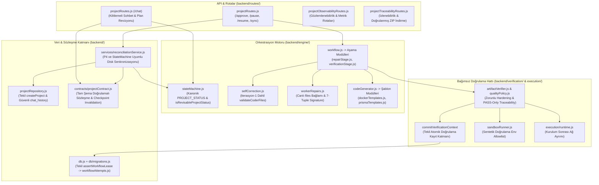

# XFactor Mimari İyileştirme ve Mantıksal Hata Giderme Yol Haritası (A'dan Z'ye Uygulama Kılavuzu)

> **BELGE KİMLİĞİ VE AMACI**
> - **Hedef Kitle:** Yeni bir terminalde / ayrı bir oturumda sıfır ön bağlamla (cold-start) görevlendirilecek **Orta Seviye (Mid-Level) Kodlama Ajanları / Yazılım Mühendisleri**.
> - **Denetleyen Otorite:** Kıdemli Sistem Mimarı & Senior Yazılımcı AI Asistanı (Ana Mimari Denetim Oturumu).
> - **Kapsam:** XFactor platformunun 4 ana katmanında (`Orkestrasyon Motoru & DAG`, `Doğrulama & Execution Worker`, `Veri/Sözleşme/API & Uzlaştırma`, `Ajanlar/LLM & Frontend`) doğrudan kaynak kod denetimi ile tespit edilen **28 kanıtlı bulgunun (`ENG-1..8`, `VER-1..5`, `DAT-1..6`, `AGT-1..5`, `FE-1..4`)** sıfır teknik borç ve tam kanıtlı TDD disipliniyle çözülmesi.

---

## 0. Sıfırdan Başlayan Ajan İçin 5 Dakikalık XFactor Mimari Rehberi (Cold-Start Onboarding)

Bu belgeyi yeni bir oturumda açtıysanız ve XFactor kod tabanına daha önce hiç dokunmadıysanız, **kod yazmaya başlamadan önce** bu bölümü ve aşağıdaki 4 temel dosyayı okuyarak mimariyi zihninize oturtun:

### 0.1. İlk Okunacak 4 Referans Dosya (Zorunlu Oryantasyon)
1. `README.md` — Platformun 5 çekirdek garantisi (`P1–P5`), servis topolojisi ve komutlar.
2. `docs/kullanici-kilavuzu.md` — Kullanıcı akışları, çalışma profilleri (`local-trusted` vs `docker`), kalite kapıları ve API uç noktaları.
3. `graphify-out/GRAPH_REPORT.md` — Sistemdeki modül bağımlılıkları, God Nodes (Tanrı Modüller) ve mimari topoloji.
4. `graphify-out/graphify-bilgi-notu.md` — Son mimari fazların (`P0`–`P9` ve `Faz 1`–`Faz 4`) tarihsel özeti ve kuralları.

### 0.2. Dört Çalışma Zamanı Yüzeyi (4 Runtime Surfaces)
XFactor tek bir monolit değildir; birbirinden izole **4 çalışma zamanı yüzeyinden** oluşur:
1. **`backend/` (Denetim Düzlemi & Orkestratör — Port `8000`):**
   - Express 4 + WebSocket (`ws`) sunucusu (`backend/server.js`), SQLite WAL veritabanı (`backend/db.js`), 6 ajan hiyerarşisi (`backend/agents/`), DAG orkestrasyon motoru (`backend/engine/workflow.js`) ve bağımsız doğrulama koordinatörü (`backend/verification/`).
   - **ÖNEMLİ:** `backend/` üretilen müşteri kodunu (`projects/<id>`) **asla kendi süreci içinde çalıştırmaz**.
2. **`execution/` (İzole Doğrulama Worker Servisi — Port `8099`):**
   - `execution/server.js` ve `execution/runtime.js` altında çalışan ayrık HTTP worker servisi.
   - Backend'den `POST /v1/jobs` ile gelen `prepare_dependencies` (`npm install --package-lock-only`) ve `verify_artifact` (18 kalite kapısı: temiz kurulum, Prisma DB doğrulaması, TypeScript, build, API sözleşmesi, tarayıcı/Playwright yolculuğu) işlerini geçici temiz dizinde veya Docker konteynerinde çalıştırır ve imzalı kanıt (`stdoutDigest`, `stderrDigest`, `exitCode`, `startedAt`, `endedAt`) döner.
3. **`frontend/` (React 18 + Vite + ReactFlow Komuta Merkezi — Port `5173`):**
   - `frontend/src/App.jsx` merkezli kullanıcı arayüzü: Manager sohbeti (`ChatView.jsx`), canlı 6-ajan DAG grafiği (`DAGFlowView.jsx` + `utils/dagLayout.js`), canlı süreç logları (`LogsView.jsx`) ve 18 kalite kapısı kanıt paneli (`DashboardView.jsx`).
4. **`llm-yonetimi/` (Bağımsız Çoklu-Sağlayıcı LLM Paket Katmanı):**
   - OpenAI, Anthropic, Google Gemini, DeepSeek, Kimi, Qwen, Zhipu, OpenRouter ve Ollama çağrılarını, zaman aşımlarını ve hata sınıflandırmasını yöneten iç paket (`backend/llm.js` tarafından kullanılır).

### 0.3. Altı Ajan Hiyerarşisi ve Protokol Dosyaları (`x-agents/`)
Tüm ajanlar ortak anayasayı (`x-agents/ORKESTRASYON-TALIMATNAMESI.md`) ve kendi rol dosyalarını (`x-agents/<rol>.md`) `backend/agents/agentLoader.js` üzerinden okur:
- **1. Manager (`backend/agents/manager.js`):** Kullanıcıyla `/api/projects/:id/chat` üzerinden konuşur; gereksinimleri (`requirements`), domainleri (`domains`), yönetim/RBAC matrisini (`management`) ve servis manifestosunu (`service_manifest`) içeren **Mimari Planı (`project_contracts`)** üretir.
- **2. Director (`backend/agents/director.js`):** Onaylanan sözleşmedeki her bir domain (`backend`, `frontend`, `db` vb.) için `ALT-TALIMATNAME.md` ve alt takım liderlerini (`teamleaders`) belirler.
- **3. Teamleader (`backend/agents/teamleader.js`):** Her alt takım için atomik görevleri (`tasks`), bağımlılıkları (`dependencies`), hedef dosyaları (`targetFiles`) ve gereksinim bağlarını (`requirementIds`) içeren DAG görev listesini (`TODO.md`) üretir.
- **4. Coder (`backend/agents/coder.js`):** Yalnızca görevde izin verilen `targetFiles` dosyalarını JSON şemasında (`{ files: [{ path, content }] }`) üretir.
- **5. Reviewer (`backend/agents/reviewer.js`):** `selfCorrection.js` döngüsü içinde Coder'ın ürettiği dosyaları AST/sözdizimi ve kapsam açısından denetler; hata varsa Coder'a geri gönderir (en fazla 3 iterasyon).
- **6. Tester (`backend/agents/tester.js`):** Tüm DAG dalgaları bittiğinde deterministik kaynak denetimi (`runDeterministicProjectAudit`) ve statik kalite incelemesi yapar. **Unutmayın:** Tester onayı yalnızca tavsiye (`advisory`) niteliğindedir; projeyi yalnızca bağımsız `execution/` worker kanıtı tamamlayabilir!

### 0.4. Kanonik Proje Durum Makinesi (`backend/engine/stateMachine.js`)
`projects.status` sütunu **yalnızca** `PROJECT_STATUS` içindeki şu **16 kanonik değeri** alabilir (`'in_progress'` gibi bir durum **YOKTUR**!) ve geçişler `canTransitionProject(fromStatus, toStatus)` ile denetlenir:
1. `'planning'` (İlk oluşturma / Manager ile sohbet aşaması)
2. `'pending_approval'` (Manager plan üretti, kullanıcı onayı `/approve` bekleniyor)
3. `'contract_approved'` (Sözleşme onaylandı, yürütme başlayacak)
4. `'implementing'` (DAG görevleri yürütülüyor)
5. `'implementation_finished'` (Kod üretimi bitti, doğrulama aşamasına geçiliyor)
6. `'verification_pending'` (Bağımsız worker doğrulaması sırada)
7. `'verification_running'` (Worker doğrulaması çalışıyor)
8. `'verification_failed'` (Statik denetim veya bağımsız worker kapısı başarısız oldu)
9. `'build_verified'` (Derleme doğrulandı)
10. `'runtime_verified'` (Çalışma zamanı doğrulandı)
11. `'acceptance_verified'` (Kabul kriterleri doğrulandı)
12. `'artifact_verified'` (ZIP artefaktı doğrulandı)
13. `'completed'` (**Yalnızca** `completeVerifiedProject` ile geçerli `completion_receipts` ve doğrulanmış `artifacts` kaydı oluştuğunda!)
14. `'paused'` / `'failed'` / `'capability_blocked'` (Duraklatılmış / Hata / Yetenek Engeli)

### 0.5. Temel SQLite Tabloları (`backend/db.js`)
- `projects`: Proje üst verisi (`id`, `title`, `status`, `plan_json`, `workflow_state`, `revision`, `last_error`).
- `project_contracts`: Sürümlü mimari sözleşmeler (`id`, `project_id`, `revision`, `status: 'draft'|'approved'|'superseded'`, `contract_json`, `contract_hash`).
- `requirements`, `contract_tasks`, `requirement_task_links`, `requirement_file_links`: Sözleşmeden izdüşürülen (`taskProjection.js`) izlenebilirlik tabloları.
- `workflow_attempts`: Tek-yazar kira (lease) ve heartbeat tablosu (`id`, `project_id`, `status: 'running'|'completed'|'paused'|'failed'|'aborted'|'stale_terminated'`, `lease_owner`, `heartbeat_epoch`).
- `task_checkpoints`: Tamamlanan görevlerin sözleşme ve girdi/çıktı özetleriyle kenetlenmiş (`contract_id`, `plan_hash`, `task_spec_hash`, `input_hash`, `output_hash`, `status: 'completed'|'invalidated'`, `invalidated_at`) kayıtları.
- `verification_runs`, `verification_checks`, `requirement_check_links`: Bağımsız doğrulama koşuları, 18 kalite kapısı sonuçları ve gereksinim kanıt bağları.
- `artifacts`, `completion_receipts`: Doğrulanmış temiz-oda ZIP paketleri ve proje tamamlama makbuzları.
- `repair_issues`: Worker veya Tester tarafından açılan hedefli onarım bulguları.
- `chat_history`, `project_logs`: Sohbet geçmişi ve canlı DAG/süreç telemetri logları.

---

## 1. Alt Ajanlar İçin Kesin Çalışma Anayasası ve Test Mimarisi (Zorunlu Kurallar)

Bu yol haritasını uygulayan ajan **aşağıdaki 7 temel kurala ve Bölüm 1.1'deki Test Koşucu Kurallarına kayıtsız şartsız uymak zorundadır**. Kurallardan herhangi birinin ihlali durumunda faz raporu Kıdemli Mimar tarafından **REDDEDİLECEKTİR**.

### Kural 1: Geriye Dönük Uyumluluk Yasağı (Temiz Mimari İlkesi)
- Eski, bozuk veya yarı-geçerli veri yapılarını (`status = 'in_progress'`, makbuzsuz `status = 'completed'`, `requirements` dizisi olmayan sözleşmeler, `status = 'completed'` kalmış ama `invalidated_at` dolu checkpoint'ler) desteklemek için **asla fallback/shim/legacy dalı bırakmayın**.
- Tek bir kanonik şema ve tek bir otorite fonksiyon kullanın.

### Kural 2: Git Dal (Branch) ve Atomik Commit Stratejisi
- Tüm geliştirmeler `main` dalından açılacak **`arch/roadmap-2026-10`** dalında yapılacaktır.
- Her görev (`Görev X.Y`) tamamlanıp testleri geçtiğinde **atomik bir Conventional Commit** oluşturulacaktır:
  - Örnek: `fix(reconciliation): enforce valid state machine, receipt-backed completion, and contract schema on rehydrate [DAT-1]`
- Kullanıcı ve Kıdemli Mimar faz raporunu onaylamadan `main` dalına merge yapılmayacaktır.

### Kural 3: Önce Kırılan Test (TDD) ve Kanıt Zorunluluğu
Her bir görev (`Görev X.Y`) için uygulama sırası **değiştirilemez**:
1. **Önce Kırılan Test (Red):** İlgili bulguyu yeniden üreten bir birim/entegrasyon testi yazın, çalıştırın ve **hatalı çıktıyı (`FAIL`)** kaydedin.
2. **Minimal ve Temiz Düzeltme (Green):** Yalnızca belirtilen hedef dosyalarda mimari düzeltmeyi uygulayın.
3. **Doğrulama (Verify):** Yeni testin (`PASS`) ve ilgili modül test paketinin geçtiğini kanıtlayın.
4. **Tam Regresyon:** Faz sonlarında tüm platform testlerini çalıştırın:
   ```powershell
   npm --prefix backend test
   npm --prefix execution test
   npm --prefix frontend run test:unit
   npm --prefix frontend run build
   ```

### Kural 4: Platformun 5 Çekirdek Değişmezini (P1–P5) Koruma
Yapacağınız hiçbir değişiklik şu 5 sistem garantisini zayıflatamaz:
- **P1 (Kanıt Otoritesi):** Yalnızca izole worker (`execution/` veya `qualityPolicy.js` / `artifactVerifier.js`) tarafından üretilen makine kanıtları (`exitCode`, `startedAt`, `endedAt`, `stdoutDigest`, `stderrDigest`) kabul kapılarını geçirebilir. Ajan öz-raporları (`Tester`, `Reviewer`) yalnızca tavsiye niteliğindedir.
- **P2 (Sözleşme-Kenetli Checkpoint):** Her `task_checkpoints` kaydı `contract_id`, `plan_hash`, `task_spec_hash`, `input_hash`, `output_hash` ve `gate_version` ile kenetlidir.
- **P3 (Tek-Yazar Lease & Fencing):** Tüm durum, sözleşme, checkpoint ve doğrulama yazmaları aktif `workflow_attempts` lease'i (`assertWorkflowLease` / `commitVerificationContext`) altında yapılmalıdır.
- **P4 (Atomik Tamamlama Makbuzu):** Bir proje yalnızca `completeVerifiedProject` üzerinden, geçerli bir `completion_receipts` satırı ve `status = 'verified'` ZIP artefaktı ile `'completed'` durumuna geçebilir.
- **P5 (Fail-Closed Kalite Kapıları):** Zorunlu bir kapı `BLOCKED`, `FAIL` veya `skipped` ise proje **asla** doğrulanmış sayılamaz.

### Kural 5: Faz Sonu E2E Referans Proje Kabul Testi
Her fazın sonunda, birim testlerine ek olarak standart referans tam-yığın doğrulama simülasyonu çalıştırılmalıdır:
```powershell
$env:XFACTOR_TEST_RUNNER_FILES="test_e2e_simulation.js,test_p9_verification_pipeline.js,test_p9_artifact_pipeline.js,test_workflow_dev_fallback.js,test_graphify.js,test_p9_runner_inventory.js"; npm --prefix backend test; Remove-Item Env:\XFACTOR_TEST_RUNNER_FILES
npm run test:local-worker
```
- **Beklenen Kanıt:** Tüm zorunlu doğrulama kapılarının (`package_json`, `lockfile`, `ast_import_inventory`, `clean_install`, `typecheck`, `framework_build`, `database_verification`, `api_contract`, `smoke_gate`, `browser_journey`, `requirement_traceability`, `security_baseline`, `placeholder_check`, `contamination_check`, `domain_entity_check`, `readme_check`) `PASS` vermesi ve `completion_receipts` kaydının oluşması.

### Kural 6: Graphify Bilgi Grafiği Güncelleme Kuralı
- `graphify-out/graphify-rules.md` uyarınca; yeni dosya eklendiğinde, dosya silindiğinde/bölündüğünde veya modüller arası import/export yapısı değiştiğinde (`özellikle yeni test dosyaları eklendiğinde ve Faz 4'te`), bilgi grafiğini **elle düzenlemeyin**, resmi üretici scripti çalıştırın:
  ```powershell
  npm --prefix backend run graph
  ```
- Bu komut `backend/scripts/generate_graph.js` dosyasını çalıştırarak `graphify-out/graph.json`, `graphify-out/graph.html`, `graphify-out/GRAPH_TREE.html` ve `graphify-out/GRAPH_REPORT.md` dosyalarını AST ve `testInventory.js` üzerinden otomatik günceller. Ardından `graphify-out/graphify-bilgi-notu.md` dosyasına ilgili fazın özetini ekleyin.

### Kural 7: Faz Sonu Raporlama ve "DUR" Kapısı (Gate Loop)
- Her fazın (`Faz 1`, `Faz 2`, `Faz 3`, `Faz 4`) sonunda `docs/roadmap-reports/faz-N-rapor.md` dosyasını **Bölüm 8'deki zorunlu şablona göre** oluşturun.
- Raporu oluşturduktan sonra **KESİNLİKLE BİR SONRAKİ FAZA GEÇMEYİN!**
- Kullanıcıya raporu Kıdemli Mimar oturumuna götürmesini söyleyin ve onay gelene kadar bekleyin.

---

### 1.1. XFactor Test Mimarisi, `testInventory.js` Kuralı ve Hazır TDD Test Şablonları (ÇOK KRİTİK!)

> [!IMPORTANT]
> **`backend/tests/` İçinde Test Çalıştırma ve Yeni Test Ekleme Kuralları:**
> 1. **Asla çıplak `node --test backend/tests/...` çalıştırmayın!**
>    Backend testleri `backend/tests/preloadDatabase.js` tarafından yüklenen izole geçici ortam değişkenlerine (`DB_PATH`, `PROJECTS_ROOT`, `ARTIFACTS_ROOT`, `TRASH_ROOT`, `LLM_CONFIG_PATH`) ihtiyaç duyar. Bu değişkenleri `backend/tests/test_runner.js` her test dosyası için otomatik oluşturur.
> 2. **Tek bir backend test dosyasını (veya birkaçını) hızlıca çalıştırmak için her zaman şu PowerShell komutunu kullanın:**
>    ```powershell
>    $env:XFACTOR_TEST_RUNNER_FILES="test_project_state_rehydration.js"; npm --prefix backend test; Remove-Item Env:\XFACTOR_TEST_RUNNER_FILES
>    ```
> 3. **`backend/tests/testInventory.js` Kayıt Zorunluluğu:**
>    `backend/tests/test_runner.js` (ve `test_p9_runner_inventory.js`), `backend/tests/` klasöründeki `test_*.js` dosyalarını `backend/tests/testInventory.js` içindeki `names` listesiyle **birebir** karşılaştırır (`assertCompleteTestInventory`).
>    - Eğer `backend/tests/` altında yeni bir test dosyası oluşturursanız:
>      a) Dosya adı **mutlaka `test_*.js`** formatında olmalıdır (örn. `test_roadmap_faz1_invariants.js`).
>      b) Dosya adını **mutlaka `backend/tests/testInventory.js` içindeki `names` listesine eklemelisiniz!** Aksi halde `npm --prefix backend test` anında `Test inventory mismatch: unclassified=...` hatası fırlatır!
> 4. **`execution/` Testlerini Çalıştırma:**
>    Execution worker testleri `execution/tests/*.test.js` altındadır (`scripts/test-worker.mjs` ile çalışır):
>    ```powershell
>    npm --prefix execution test
>    ```
> 5. **`frontend/` Testlerini Çalıştırma:**
>    Frontend birim testleri `Vitest` (`jsdom`) ile çalışır (`frontend/src/**/*.test.{js,jsx}`):
>    ```powershell
>    npm --prefix frontend run test:unit
>    ```

#### Şablon A — Backend Birim/Entegrasyon Test Şablonu (`backend/tests/test_*.js`)
`backend/tests/test_runner.js` her testi `--import ./preloadDatabase.js` ile başlattığı için `db.js` zaten izole bir geçici SQLite dosyasına bağlıdır. Testlerinizi şu iki standart kalıptan biriyle yazabilirsiniz:

```js
// Kalıp 1: createTestHarness ile (önerilen standart XFactor kalıbı)
import assert from 'node:assert/strict';
import { createTestHarness } from './testHarness.js';
import { db } from '../db.js';

const { runAsyncTest, finish } = createTestHarness();

await runAsyncTest('Açıklayıcı test başlığı', async () => {
    // db zaten preloadDatabase.js tarafından geçici DB_PATH üzerinde başlatılmıştır
    assert.ok(db);
});

finish();
```

#### Şablon B — Frontend Birim Test Şablonu (`frontend/src/**/*.test.jsx`)
```js
import { describe, it, expect, vi } from 'vitest';
import { render, screen } from '@testing-library/react';
```

---

## 2. Mimari Durum ve Hedef Topoloji Diyagramı



---

## 3. Faz 0: Ön Hazırlık, Çalışma Ağacı Temizliği ve Baseline Alımı

### Görev 0.1 — Git Çalışma Ağacı Kontrolü, Dal Açılışı ve Baseline Test Koşusu
- **Adım 1 (Çalışma Ağacı Kontrolü):**
  ```powershell
  git status --short
  ```
  - Çalışma ağacında `D surec-raporu.md` veya `?? docs/mermaid-diagram.png` gibi commitlenmemiş değişiklikler varsa, **kullanıcıya bu dosyaların korunup korunmayacağını sorun** (veya kullanıcı talimatına göre `git checkout -- surec-raporu.md` ile geri yükleyin).
- **Adım 2 (Dal Oluşturma):**
  ```powershell
  git checkout -b arch/roadmap-2026-10
  ```
- **Adım 3 (Baseline Testlerinin Çalıştırılması):**
  ```powershell
  npm --prefix backend test
  npm --prefix execution test
  npm --prefix frontend run test:unit
  npm --prefix frontend run build
  ```
- **Adım 4 (Rapor Klasörünün Hazırlanması):**
  - `docs/roadmap-reports/` klasörünü oluşturun (`Faz 1` sonunda ilk rapor buraya yazılacaktır).

---

## 4. Faz 1: Kritik Veri Bütünlüğü, Durum Makinesi ve Fail-Closed Doğrulama Hattı (`DAT-1..5`, `VER-1..5`)

> **Faz 1 Hedefi:** Veritabanı durum makinesi, sözleşme şeması, disk uzlaştırması (`reconciliationService.js`) ve bağımsız doğrulama kapılarındaki (`artifactVerifier.js`, `qualityPolicy.js`, `runChecks.js`, `sandboxRunner.js`, `execution/runtime.js`) tüm kritik mantık hatalarını ve fail-closed ihlallerini gidermek.

---

### Görev 1.1 (`DAT-1`) — Diskten Durum Kurtarma (`rehydrateProjectStateFromDisk`) ve Sözleşme Şeması Değişmezlerinin Zorunlu Kılınması
- **Ciddiyet:** Kritik | **Kategori:** Durum Makinesi & Fail-Closed İhlali
- **Hedef Dosyalar:**
  - `backend/services/reconciliationService.js` (Satır `118-133`, `379-518`)
  - `backend/projectRepository.js` (Satır `755-768`)
  - `backend/tests/test_project_state_rehydration.js` (Satır `124-160`, `340-385`, `460-520`)
- **Mevcut Hata (Kök Neden):**
  1. `reconciliationService.js:384-386` içinde:
     ```js
     let status = detectProjectStatusFromDisk(projectDir, stateJson, durumMd);
     if (status !== 'completed' && tasks.length > 0) {
         status = 'in_progress';
     }
     ```
     satırı, `PROJECT_STATUS` (`backend/engine/stateMachine.js:1-18`) içinde **var olmayan** `'in_progress'` değerini doğrudan `projects.status` sütununa yazar (`L486-497`). Ayrıca `existingRow` `null` olduğunda (`L486-496`), `L459`'daki `const safeStatus = existingRow.status === 'in_progress' ? 'paused' : ...` iyileştirmesi hiç çalışmaz ve DB'ye doğrudan `'in_progress'` yazılır! Bu projeye daha sonra dokunulduğunda `isValidProjectStatus('in_progress')` `false` döndüğü için proje kilitlenir.
  2. `reconciliationService.js:118-133` (`detectProjectStatusFromDisk`), diskteki `DURUM.md` (`TAMAMLANDI`) veya `state.json` (`status === 'completed'`) dosyasına güvenerek, veritabanında geçerli bir `completion_receipts` kaydı veya doğrulanmış artefakt olup olmadığına bakmaksızın projeyi `'completed'` olarak yazar (`L486-497`). Bu P4 (`completeVerifiedProject`) değişmezinin doğrudan ihlalidir.
  3. `reconciliationService.js:392-398`, `509-514` ve `projectRepository.js:759-767`, `project_contracts` tablosuna ham `INSERT` ile `requirements` dizisi olmayan bir `plan` yazar:
     ```js
     const plan = stateJson?.plan || {
         summary: summary || title,
         talimatname: talimatname || '',
         domains: Array.from(domainsSet)
     };
     ```
     Daha sonra `taskProjection.js:31` (`if (!Array.isArray(contract.requirements))`) çalıştığında `Cannot project tasks: contract.requirements is missing or not an array` hatasıyla çöker.
- **Uygulanacak Mimari Düzeltme (Önce / Sonra Kod Blokları):**
  1. **`backend/services/reconciliationService.js:383-405`:**
     - `'in_progress'` atamasını kaldırın; görevleri olan ama tamamlanmamış projeler için kanonik durum `'paused'` olmalıdır.
     - Diskte `'completed'` tespit edilse bile, veritabanında `completion_receipts` + `artifacts (status = 'verified')` kaydı yoksa durumu `'paused'` olarak düşürün.
     - Üretilen `plan` nesnesinin her zaman geçerli bir `requirements` dizisine (`Array.isArray(plan.requirements) && plan.requirements.length > 0`) ve `domains: Array.from(domainsSet)` alanına sahip olmasını sağlayın:
     ```js
     // SONRA (backend/services/reconciliationService.js:383-412):
     let status = detectProjectStatusFromDisk(projectDir, stateJson, durumMd);
     if (status === 'in_progress' || (status !== 'completed' && tasks.length > 0)) {
         status = 'paused';
     }
     if (status === 'completed') {
         const hasVerifiedReceipt = Boolean(db.prepare(`
             SELECT cr.id
             FROM completion_receipts cr
             JOIN artifacts a ON a.id = cr.artifact_id
             WHERE cr.project_id = ? AND a.project_id = ? AND a.status = 'verified'
             LIMIT 1
         `).get(projectId, projectId));
         if (!hasVerifiedReceipt) {
             status = tasks.length > 0 ? 'paused' : 'planning';
         }
     }

     const defaultRequirement = {
         id: 'REQ-1',
         statement: (summary || title || 'Recovered project requirement').slice(0, 500),
         mandatory: true,
         kind: 'functional',
         priority: 'high',
         acceptance: ['Recovered disk project state is consistent']
     };
     const basePlan = stateJson?.plan && typeof stateJson.plan === 'object' ? stateJson.plan : {};
     const plan = {
         ...basePlan,
         summary: basePlan.summary || summary || title,
         talimatname: basePlan.talimatname || talimatname || '',
         domains: Array.isArray(basePlan.domains) && basePlan.domains.length > 0
             ? basePlan.domains
             : Array.from(domainsSet),
         requirements: Array.isArray(basePlan.requirements) && basePlan.requirements.length > 0
             ? basePlan.requirements
             : [defaultRequirement]
     };
     ```
  2. **`backend/projectRepository.js:755-768` (`saveProjectState` içindeki legacy contract import bloğu):**
     - `planToCheck` nesnesini `project_contracts` tablosuna yazmadan önce `requirements` dizisi yoksa varsayılan `REQ-1` öğesini ekleyin ki `projectContractTasks` hiçbir zaman çökmesin.
- **Mevcut Test Hizalama Notu (`test_project_state_rehydration.js`):**
  - `backend/tests/test_project_state_rehydration.js` içindeki **Test 1 (`L133`)** ve **Test 5B (`L351`, `L374`)** daha önce diskte `DURUM.md: TAMAMLANDI` yazan makbuzsuz bir projenin `'completed'` olarak rehydrate edildiğini varsayıyordu (`assert.strictEqual(project.status, 'completed')`).
  - P4 değişmezi (`completeVerifiedProject` ve `completion_receipts` olmadan `'completed'` olamaz) gereği:
    - Makbuzsuz disk projelerinin `'paused'` olarak kurtarıldığını doğrulayacak şekilde `test_project_state_rehydration.js` içindeki ilgili beklentileri güncelleyin **ve** geçerli `completion_receipts` + `artifacts (status='verified')` kaydı olan bir projenin `'completed'` olarak korunduğunu doğrulayan yeni bir test senaryosu ekleyin!
- **TDD Doğrulama Adımları:**
  - **Test Dosyası:** `backend/tests/test_project_state_rehydration.js`
  - **Önce Kırılan Testler:**
    1. Diskte `GOREVLER.json` içinde görevleri olan tamamlanmamış ve DB'de henüz satırı olmayan (`existingRow === null`) bir proje klasörü `rehydrateProjectStateFromDisk` ile senkronize edildiğinde `projects.status` değerinin `'in_progress'` değil `'paused'` (`isValidProjectStatus(status) === true`) olduğunu doğrula.
    2. Diskte `DURUM.md` içinde `TAMAMLANDI` yazan ancak `completion_receipts` satırı olmayan bir projenin senkronizasyon sonrasında `projects.status === 'paused'` olduğunu; geçerli `completion_receipts` + `verified` artefaktı varsa `'completed'` olduğunu doğrula.
    3. Rehydrate edilen projenin `project_contracts` kaydı üzerinde `projectContractTasks(JSON.parse(contract.contract_json))` çağrıldığında hata fırlatmadığını (`Array.isArray(contract.requirements) === true`) doğrula.
  - **Çalıştırılacak Komut:**
    ```powershell
    $env:XFACTOR_TEST_RUNNER_FILES="test_project_state_rehydration.js,test_p7_reconciliation.js,test_reconciliation_boundary.js"; npm --prefix backend test; Remove-Item Env:\XFACTOR_TEST_RUNNER_FILES
    ```
- **Commit Mesajı:** `fix(reconciliation): enforce valid state machine, receipt-backed completion, and contract schema on rehydrate [DAT-1]`

---

### Görev 1.2 (`DAT-2`) — `/chat` Rotasında Durum Geçişi Hizalaması (`implementation_finished -> pending_approval`), Atomik Plan Revizyonu ve Eşzamanlı Sohbet Kilidi
- **Ciddiyet:** Yüksek | **Kategori:** Durum Makinesi & Yarış Durumu
- **Hedef Dosyalar:**
  - `backend/engine/stateMachine.js` (Satır `20-72`)
  - `backend/routes/projectRoutes.js` (Satır `380-547`)
- **Mevcut Hata (Kök Neden):**
  1. `projectRoutes.js:485-493` içindeki `revisableStatuses` kümesi `PROJECT_STATUS.IMPLEMENTATION_FINISHED` durumunu içerir. Ancak `stateMachine.js:34-38` içindeki `STATE_TRANSITIONS[PROJECT_STATUS.IMPLEMENTATION_FINISHED]` kümesinde `PROJECT_STATUS.PENDING_APPROVAL` **yoktur** (`new Set([VERIFICATION_PENDING, PAUSED, FAILED])`).
  2. Bu yüzden `implementation_finished` durumundaki bir projede kullanıcı `/chat` üzerinden plan revizyonu istediğinde, `L519`'da `createContractRevision` yeni sözleşmeyi DB'ye yazar, hemen ardından `L530`'daki `writeProjectState(id, freshState)` **`Illegal project transition: implementation_finished -> pending_approval`** hatası fırlatarak HTTP 500 döner ve DB'yi tutarsız bırakır!
  3. Ayrıca `/chat` rotasında proje bazlı eşzamanlılık kilidi yoktur; Manager LLM yanıtı beklenirken (10–120 sn) aynı projeye gelen ikinci `/chat` isteği yarış durumu (race condition) yaratır.
- **Uygulanacak Mimari Düzeltme (Önce / Sonra Kod Blokları):**
  1. **`backend/engine/stateMachine.js`:**
     - `STATE_TRANSITIONS[PROJECT_STATUS.IMPLEMENTATION_FINISHED]` kümesine `PROJECT_STATUS.PENDING_APPROVAL` ekleyin.
     - Revizyon yapılabilir durumları tek bir merkezden yöneten `isRevisableProjectStatus(status)` fonksiyonunu dışa aktarın:
     ```js
     [PROJECT_STATUS.IMPLEMENTATION_FINISHED]: new Set([
         PROJECT_STATUS.PENDING_APPROVAL,
         PROJECT_STATUS.VERIFICATION_PENDING,
         PROJECT_STATUS.PAUSED,
         PROJECT_STATUS.FAILED,
     ]),
     ```
     ```js
     export const REVISABLE_PROJECT_STATUSES = Object.freeze(new Set([
         PROJECT_STATUS.PLANNING,
         PROJECT_STATUS.PENDING_APPROVAL,
         PROJECT_STATUS.PAUSED,
         PROJECT_STATUS.FAILED,
         PROJECT_STATUS.VERIFICATION_FAILED,
         PROJECT_STATUS.IMPLEMENTATION_FINISHED,
         PROJECT_STATUS.COMPLETED,
     ]));

     export function isRevisableProjectStatus(status) {
         return REVISABLE_PROJECT_STATUSES.has(status);
     }
     ```
  2. **`backend/routes/projectRoutes.js` (`/chat` rotası):**
     - Router kapsamına `const activeChatRequests = new Set();` ekleyin.
     - `/chat` başında `if (activeChatRequests.has(id)) return res.status(409).json({ error: 'Bu proje için devam eden bir Manager sohbet isteği var.', code: 'CHAT_ALREADY_IN_PROGRESS' });` kontrolü yapın ve `try { activeChatRequests.add(id); ... } finally { activeChatRequests.delete(id); }` içine alın.
     - Yerel `revisableStatuses` kümesini kaldırıp `isRevisableProjectStatus(freshState.status) && canTransitionProject(freshState.status, PROJECT_STATUS.PENDING_APPROVAL)` kullanın.
- **TDD Doğrulama Adımları:**
  - **Test Dosyası:** `backend/tests/test_manager_chat_failures.js` ve `backend/tests/test_p0_a_state_transitions.js`
  - **Önce Kırılan Testler:**
    1. `implementation_finished` durumundaki bir projede `canTransitionProject('implementation_finished', 'pending_approval') === true` olduğunu ve `/chat` üzerinden yeni bir plan üretildiğinde HTTP 200 döndüğünü, `projects.status === 'pending_approval'` olduğunu doğrula.
    2. Aynı `projectId` için ilk `/chat` LLM çağrısı tamamlanmadan gönderilen eşzamanlı ikinci `/chat` çağrısının `409` (`CHAT_ALREADY_IN_PROGRESS`) döndürdüğünü doğrula.
  - **Çalıştırılacak Komut:**
    ```powershell
    $env:XFACTOR_TEST_RUNNER_FILES="test_p0_a_state_transitions.js,test_manager_chat_failures.js,test_p1_9_optimistic_revision.js"; npm --prefix backend test; Remove-Item Env:\XFACTOR_TEST_RUNNER_FILES
    ```
- **Commit Mesajı:** `fix(chat): align revisable state transitions and guard concurrent chat requests [DAT-2]`

---

### Görev 1.3 (`DAT-3`) — `saveProjectState` İçindeki `COUNT(*)` Ofsetli `chat_history` Yazımının Kaldırılması
- **Ciddiyet:** Yüksek | **Kategori:** Veri Bütünlüğü / Çift Yazıcı Anti-Deseni
- **Hedef Dosyalar:**
  - `backend/projectRepository.js` (Satır `168-179`, `769-778`)
- **Mevcut Hata (Kök Neden):**
  - `getProject(projectId)` (`L168-179`), `chat_history` tablosunda hiç satır yokken bellekteki `state.chatHistory` dizisine sentetik bir karşılama mesajı (`id: 0`) ekler (`DB count = 0`, `state.chatHistory.length = 1`).
  - `saveProjectState` (`L769-778`) ise `existingCount = SELECT COUNT(*) FROM chat_history` alıp `for (let i = existingCount; i < chatsToSave.length; i++)` döngüsüyle farkı DB'ye yazar.
  - Eşzamanlı olarak `appendProjectChatMessage` veya `appendProjectActionMessages` kullanıldığında `existingCount` kayar; sentetik mesaj (`id: 0`) DB'ye kopyalanır veya gerçek mesajlar mükerrer/eksik yazılır.
- **Uygulanacak Mimari Düzeltme (Önce / Sonra Kod Blokları):**
  1. `backend/projectRepository.js:168-179` içinde sentetik karşılama mesajına `synthetic: true` işareti koyun:
     ```js
     chatHistory.push({
         id: 0,
         synthetic: true,
         role: 'model',
         parts: [{ text: `Merhaba Boss! "${row.title}" projesi için hazırım. Nasıl bir mimari ve özellik seti kurgulayalım?` }],
         timestamp: formatDBDate(row.created_at),
         created_at: row.created_at
     });
     ```
  2. `backend/projectRepository.js:769-778` içindeki `existingCount` ofset döngüsünü kaldırıp yalnızca kalıcılaştırılmamış (`!chat.synthetic && (chat.id === undefined || chat.id === null)`) mesajları yazın ve yazdıktan sonra `chat.id = Number(info.lastInsertRowid)` atayın:
     ```js
     const chatsToSave = Array.isArray(state.chatHistory) ? state.chatHistory : [];
     const insertChat = db.prepare('INSERT INTO chat_history (project_id, role, text_content, created_at) VALUES (?, ?, ?, ?)');
     for (const chat of chatsToSave) {
         if (!chat || chat.synthetic || (chat.id !== undefined && chat.id !== null)) continue;
         const text = chat?.parts?.[0]?.text || '';
         const createdAt = chat.created_at || now;
         const info = insertChat.run(projectId, chat.role || 'user', text, createdAt);
         chat.id = Number(info.lastInsertRowid);
     }
     ```
- **TDD Doğrulama Adımları:**
  - **Test Dosyası:** `backend/tests/test_project_repository.js`
  - **Önce Kırılan Test:** `chat_history` tablosu boş olan bir projede `const state = getProject(id); saveProjectState(id, state);` çağrıldığında `chat_history` tablosuna sentetik karşılama mesajının kopyalanmadığını (`COUNT(*) === 0`) ve `appendProjectChatMessage` sonrasında eski `state` ile `saveProjectState` çağrılsa bile mükerrer satır oluşmadığını doğrula.
  - **Çalıştırılacak Komut:**
    ```powershell
    $env:XFACTOR_TEST_RUNNER_FILES="test_project_repository.js,test_project_action_chat_audit.js"; npm --prefix backend test; Remove-Item Env:\XFACTOR_TEST_RUNNER_FILES
    ```
- **Commit Mesajı:** `fix(repository): prevent duplicate or offset-corrupted chat_history writes in saveProjectState [DAT-3]`

---

### Görev 1.4 (`DAT-4` & `DAT-5`) — Checkpoint Invalidation Tutarlılığı (`status = 'invalidated'`) ve Tekil Proje Oluşturma Yolu
- **Ciddiyet:** Orta | **Kategori:** Mantıksal Hata & Mimari Tutarlılık
- **Hedef Dosyalar:**
  - `backend/contracts/projectContract.js` (Satır `117-123`)
  - `backend/routes/projectRoutes.js` (Satır `1036`, `1130`)
  - `backend/auth.js` (Satır `403-423`)
  - `backend/projectRepository.js` (Satır `696-725`)
- **Mevcut Hata (Kök Neden):**
  1. `projectContract.js:117-123` (`invalidateProjectCheckpoints`), `task_checkpoints` tablosunda yalnızca `SET invalidated_at = ?` yapar, ancak `status` sütununu `'invalidated'` yapmaz (`status = 'completed'` kalır!).
  2. `projectRoutes.js:1036` (`/requirements/:reqId/impact`) ve `L1130` (`/rebuild-preview`), `WHERE project_id = ? AND contract_id = ? AND status = 'completed'` sorgusunu `AND invalidated_at IS NULL` olmadan çalıştırdığı için geçersiz kılınmış checkpoint'leri hâlâ geçerli sayar!
  3. `auth.js:403-423` içindeki `createProjectForUser`, `projectRepository.js:createProject` fonksiyonunu bypass ederek disk klasörü ve başlangıç sohbet mesajı olmayan eksik projeler oluşturur.
- **Uygulanacak Mimari Düzeltme:**
  1. `backend/contracts/projectContract.js:117-123` içindeki `invalidateProjectCheckpoints(projectId, reason = 'CONTRACT_SUPERSEDED')` fonksiyonunu şu şekilde güncelleyin:
     ```js
     export function invalidateProjectCheckpoints(projectId, reason = 'CONTRACT_SUPERSEDED') {
         db.prepare(`
             UPDATE task_checkpoints
             SET status = 'invalidated', invalidation_reason = ?, invalidated_at = ?
             WHERE project_id = ? AND invalidated_at IS NULL
         `).run(reason, new Date().toISOString(), projectId);
     }
     ```
  2. `backend/routes/projectRoutes.js:1036` ve `L1130` sorgularına `AND invalidated_at IS NULL` koşulu ekleyin.
  3. `backend/projectRepository.js:696` içindeki `createProject(input, options = {})` fonksiyonuna `ownerUserId` desteği ekleyin (`const ownerUserId = (typeof input === 'object' && input?.ownerUserId) || options.ownerUserId || 'legacy-local-owner';`) ve `backend/auth.js:403-423` içindeki `createProjectForUser(userId, { id, title })` fonksiyonunun doğrudan `createProject({ id, title, ownerUserId: userId })` çağırmasını sağlayın.
- **TDD Doğrulama Adımları:**
  - **Test Dosyası:** `backend/tests/test_p0_c_checkpoint_repository.js` ve `backend/tests/test_p1_8_create_delete_boundary.js`
  - **Önce Kırılan Testler:**
    1. `invalidateProjectCheckpoints(projectId)` çağrıldıktan sonra `task_checkpoints` kayıtlarının `status === 'invalidated'` ve `invalidation_reason === 'CONTRACT_SUPERSEDED'` olduğunu doğrula.
    2. `createProjectForUser(userId, { title })` ile oluşturulan projenin disk dizininin ve başlangıç `chat_history` kaydının oluştuğunu doğrula.
  - **Çalıştırılacak Komut:**
    ```powershell
    $env:XFACTOR_TEST_RUNNER_FILES="test_p0_c_checkpoint_repository.js,test_p1_8_create_delete_boundary.js,test_backend.js"; npm --prefix backend test; Remove-Item Env:\XFACTOR_TEST_RUNNER_FILES
    ```
- **Commit Mesajı:** `fix(contracts,auth): set invalidated status on checkpoints and unify project creation [DAT-4, DAT-5]`

---

### Görev 1.5 (`VER-1`, `VER-2`, `VER-5`) — Bağımsız Doğrulama Hattında Fail-Closed Kanıt Denetimi, Zorunlu Hardening Kapıları ve Atomik Kayıt Katmanı
- **Ciddiyet:** Kritik | **Kategori:** Fail-Closed İhlali & Veri Bütünlüğü
- **Hedef Dosyalar:**
  - `backend/verification/artifactVerifier.js` (Satır `305-420`)
  - `backend/verification/runChecks.js` (Satır `98-120`)
  - `backend/verification/qualityPolicy.js` (Satır `110-165`, `350-490`)
  - `backend/verification/devVerificationRunner.js` (Satır `170-237`)
- **Mevcut Hata (Kök Neden):**
  1. `artifactVerifier.js:309-313`: `workerResult.checks` içinde `domain_entity_check`, `placeholder_check`, `contamination_check` veya `security_baseline` isimli bir girdi varsa `existingGateNames.has(name)` `true` döner ve backend kendi yetkili `captureHardeningGate` kontrollerini **atlar**!
  2. `artifactVerifier.js:362-366`: Worker'dan gelen kontrolde `startedAt`, `endedAt`, `stdoutDigest` veya `stderrDigest` eksikse `BLOCKED` yapmak yerine backend'de sahte zaman/digest üreterek `PASS` kabul eder!
  3. `artifactVerifier.js:315-340` (`requirement_traceability`): `'skipped'` durumundaki zorunlu kapıları `allPassedSoFar = true` sayar ve hiçbir gereksinim bağlantısı (`requirementIds`) kontrol etmez.
  4. `runChecks.js:103-108` (`requirement_traceability`): `allChecks.flatMap(c => c.requirementIds || [])` ile gereksinim ID'lerini toplarken kontrolün `status === 'PASS'` olup olmadığına **hiç bakmaz** (`FAIL` veya `BLOCKED` kontrollerin `requirementIds` listesini de kapsanmış sayar!).
  5. `artifactVerifier.js:373-380`: Her bir check ve requirement linkini döngü içinde ayrı bir transaction ile yazar ve başarısızlıkta `task_checkpoints` tablosunu invalidate etmez. `devVerificationRunner.js:170-237` ise `FAIL`/`BLOCKED` kontrolleri bile tüm gereksinimlere bağlar.
- **Uygulanacak Mimari Düzeltme (Önce / Sonra Kod Blokları):**
  1. **`backend/verification/runChecks.js:103-108`:**
     `coveredIds` yalnızca `c.status === 'PASS' || c.status === 'passed'` olan kontrollerin `requirementIds` değerlerinden oluşturulmalıdır:
     ```js
     const passingChecks = allChecks.filter(c => c.status === 'PASS' || c.status === 'passed');
     const coveredIds = new Set(passingChecks.flatMap(c => c.requirementIds || []));
     ```
  2. **`backend/verification/artifactVerifier.js:305-345`:**
     - Backend hardening kapıları (`domain_entity_check`, `placeholder_check`, `contamination_check`, `security_baseline`) her zaman backend'de çalıştırılmalı; `workerChecks` içinde aynı isimde girdi varsa filtrelenip backend'in yetkili sonucuyla değiştirilmelidir:
     ```js
     const AUTHORITATIVE_BACKEND_GATES = new Set([
         'domain_entity_check',
         'placeholder_check',
         'contamination_check',
         'security_baseline'
     ]);
     const filteredWorkerChecks = workerChecks.filter(c => !AUTHORITATIVE_BACKEND_GATES.has(c?.name || c?.gate_name));
     const checks = [
         ...filteredWorkerChecks,
         await captureHardeningGate('domain_entity_check', () => verifyDomainEntities(extractedDir, contract)),
         await captureHardeningGate('placeholder_check', () => verifyNoPlaceholders(extractedDir)),
         await captureHardeningGate('contamination_check', () => verifyNoContamination(extractedDir, contract)),
         await captureHardeningGate('security_baseline', () => verifySecurityBaseline(extractedDir, contract))
     ];
     ```
  3. **`backend/verification/artifactVerifier.js:350-415`:**
     - Sahte `startedAt`/`endedAt`/`stdoutDigest`/`stderrDigest` üretimini kaldırın; kanıt alanlarından biri eksikse kontrolün durumunu `'BLOCKED'` yapın (`exit_code: -1`, `reason: 'Missing mandatory execution evidence digest or timestamps'`).
     - Tüm `verification_checks`, `requirement_check_links` (yalnızca `normalizedStatus === 'PASS'` olanlar için!), `verification_runs` durumu ve başarısızlık durumunda `task_checkpoints` invalidasyonunu (`SET status = 'invalidated', invalidation_reason = 'VERIFICATION_FAILED', invalidated_at = ?`) **tek bir `commitVerificationContext` çağrısı içinde atomik olarak** yazın.
  4. **`backend/verification/devVerificationRunner.js:207-215`:**
     - `requirement_check_links` tablosuna yalnızca `check.status === 'PASS'` olan kontroller için kayıt ekleyin ve tüm DB yazmalarını tek bir `BEGIN IMMEDIATE ... COMMIT` transaction bloğuna alın.
- **TDD Doğrulama Adımları:**
  - **Test Dosyası:** `backend/tests/test_p1_c_artifact_verifier.js` ve `backend/tests/test_p9_verification_pipeline.js`
  - **Önce Kırılan Testler:**
    1. `runWorkerChecks` içinde `api_contract` kontrolü `FAIL` olup `requirementIds: ['REQ-1']` taşıdığında `requirement_traceability` kapısının `FAIL` döndüğünü doğrula.
    2. `verifyArtifact` çağrısına worker'dan sahte `{ name: 'security_baseline', status: 'passed' }` veya eksik `stdoutDigest` taşıyan bir kontrol verildiğinde, sahte `security_baseline`'ın ezildiğini ve eksik kanıtlı kontrolün `BLOCKED` olduğunu doğrula.
    3. `verifyArtifact` başarısız olduğunda ilgili sözleşmenin `task_checkpoints` kayıtlarının `status = 'invalidated'` olarak işaretlendiğini doğrula.
  - **Çalıştırılacak Komut:**
    ```powershell
    $env:XFACTOR_TEST_RUNNER_FILES="test_p1_c_artifact_verifier.js,test_p9_verification_pipeline.js,test_p1_b_quality_policy_evidence.js"; npm --prefix backend test; Remove-Item Env:\XFACTOR_TEST_RUNNER_FILES
    ```
- **Commit Mesajı:** `fix(verification): enforce fail-closed evidence, authoritative hardening gates, and atomic persistence [VER-1, VER-2, VER-5]`

---

### Görev 1.6 (`VER-3` & `VER-4`) — `sandboxRunner.js` Sentetik Doğrulama Env Allowlist'i ve `execution/runtime.js` Kurulum Sonrası Ağ Ayrımı
- **Ciddiyet:** Yüksek / Orta | **Kategori:** Mantıksal Hata & Sandbox İzolasyonu
- **Hedef Dosyalar:**
  - `backend/verification/sandboxRunner.js` (Satır `13-34`, `85-100`)
  - `execution/runtime.js` (Satır `230-285`)
- **Mevcut Hata (Kök Neden):**
  1. `buildVerifier.js:374-380`, `framework_build` sırasında Next.js/Auth derlemesinin çökmemesi için `options.env` içinde sentetik `AUTH_SECRET`, `NEXTAUTH_SECRET` ve `NEXTAUTH_URL` geçirir. Ancak `sandboxRunner.js:90`, `options.env` üzerinde `scrubEnvironmentVariables` çalıştırır ve `SENSITIVE_KEY_PATTERN` (`SECRET|AUTH`) bu üç değişkeni de siler!
  2. `execution/runtime.js:230-245`, `verify_artifact` sırasında konteyneri `names.install` ağına bağlar ancak kurulum bittikten sonra ağı ayırmaz.
- **Uygulanacak Mimari Düzeltme:**
  1. `backend/verification/sandboxRunner.js` içinde doğrulama kapılarının açıkça `options.env` üzerinden geçirdiği sentetik/ephemeral değerleri koruyacak bir doğrulama ekleyin:
     ```js
     const EPHEMERAL_VERIFICATION_ENV_ALLOWLIST = Object.freeze({
         AUTH_SECRET: 'verification-only-ephemeral-secret-not-for-production',
         NEXTAUTH_SECRET: 'verification-only-ephemeral-secret-not-for-production',
         NEXTAUTH_URL: 'http://localhost:3000'
     });
     ```
     `scrubEnvironmentVariables(process.env)` host ortamındaki tüm sırları silmeye devam etmeli; `options.env` içinden gelen anahtarlar ise eğer `EPHEMERAL_VERIFICATION_ENV_ALLOWLIST[key] === value` ise korunmalı, gerçek sır taşıyorsa yine silinmelidir!
  2. `execution/runtime.js` içinde kurulum sonrası veya `disconnectInstallNetworkAfterInstall` seçeneği aktifken `docker(['network', 'disconnect', '-f', names.install, names.container])` yardımcısını destekleyin.
- **TDD Doğrulama Adımları:**
  - **Test Dosyası:** `backend/tests/test_subprocess_sandbox.js`, `backend/tests/test_build_verifier.js` ve `execution/tests/runtime.test.js`
  - **Önce Kırılan Test:** `verifyFrameworkBuild` (veya `runInSandbox` ile sentetik `AUTH_SECRET: 'verification-only-ephemeral-secret-not-for-production'`) çağrıldığında sandbox adaptörüne `AUTH_SECRET`, `NEXTAUTH_SECRET` ve `NEXTAUTH_URL` değerlerinin silinmeden ulaştığını, ancak gerçek bir `AUTH_SECRET: 'my-real-prod-secret'` veya `OPENAI_API_KEY` geçirildiğinde silindiğini doğrula.
  - **Çalıştırılacak Komut:**
    ```powershell
    $env:XFACTOR_TEST_RUNNER_FILES="test_subprocess_sandbox.js,test_build_verifier.js"; npm --prefix backend test; Remove-Item Env:\XFACTOR_TEST_RUNNER_FILES
    npm --prefix execution test
    ```
- **Commit Mesajı:** `fix(sandbox,execution): preserve synthetic build verification env vars and tighten runtime network lifecycle [VER-3, VER-4]`

---

### 🛑 FAZ 1 KABUL KAPISI VE DURMA NOKTASI
1. Faz 1 içindeki tüm görevlerin (`1.1` – `1.6`) birim testlerini ve tam regresyon paketini çalıştırın:
   ```powershell
   npm --prefix backend test
   npm --prefix execution test
   npm --prefix frontend run test:unit
   npm --prefix frontend run build
   ```
2. Referans E2E senaryosunu (Kural 5) doğrulayın:
   ```powershell
   $env:XFACTOR_TEST_RUNNER_FILES="test_e2e_simulation.js,test_p9_verification_pipeline.js,test_p9_artifact_pipeline.js,test_workflow_dev_fallback.js"; npm --prefix backend test; Remove-Item Env:\XFACTOR_TEST_RUNNER_FILES
   npm run test:local-worker
   ```
3. **`docs/roadmap-reports/faz-1-rapor.md`** dosyasını Bölüm 8'deki şablona göre eksiksiz kanıtlarla oluşturun.
4. **DURUN!** Faz 2'ye geçmeyin. Kullanıcıya `docs/roadmap-reports/faz-1-rapor.md` raporunu Kıdemli Mimar oturumuna iletmesini söyleyin.

---

## 5. Faz 2: Orkestrasyon Motoru, Lease Yaşam Döngüsü, Ajan/LLM Çalışma Zamanı ve Kod Üretimi (`ENG-1..7`, `AGT-1..5`)

> **Faz 2 Hedefi:** `workflow.js`, `selfCorrection.js`, `workerRepairs.js`, `codeGenerator.js`, `readmeGenerator.js`, `llm.js`, `schemas.js`, `director.js` ve `tester.js` içindeki tüm orkestrasyon, lease yönetimi, LLM kesilme (truncation) ve kod üretim hatalarını gidermek.

---

### Görev 2.1 (`ENG-1` & `ENG-3`) — `workflow.js` ve `selfCorrection.js` İçinde `callAgent` Enjeksiyon Bütünlüğü ve 1. İterasyon `validateCoderFiles` Zorunluluğu
- **Ciddiyet:** Yüksek | **Kategori:** Mantıksal Hata & Fail-Closed İhlali
- **Hedef Dosyalar:**
  - `backend/engine/workflow.js` (Satır `752-756`, `931`, `1013`, `1151`, `1161`, `1398`, `1418`)
  - `backend/engine/selfCorrection.js` (Satır `41-130`)
- **Mevcut Hata (Kök Neden):**
  1. `executeProjectTasks` (`workflow.js:752`) `const callAgent = services.callAgent ?? callAgentLLM;` alır ancak Director (`L931`), Teamleader (`L1013`), Coder (`L1151`), `executeTesterAdvisoryRepairs` (`L1398`) ve `executeStaticRepairLoop` (`L1418`) doğrudan `callAgentLLM` (veya `runLLMTaskWithRetry`) çağırır. `executeCorrectionLoop` (`selfCorrection.js:41`) ise `callAgent` parametresi hiç almaz.
  2. `workflow.js:1151` içinde Coder'ın ilk yanıtı `coder.parseResponse(rawResponse)` ile ayrıştırılırken `targetFiles` geçirilmez; `selfCorrection.js:41-90` içinde de 1. iterasyonda sözdizimi doğruysa ve Reviewer onaylarsa `validateCoderFiles(currentOutput, targetFiles)` **hiç çağrılmaz** (yalnızca `iteration > 1` olduğunda `L126`'da çağrılır).
- **Uygulanacak Mimari Düzeltme (Önce / Sonra Kod Blokları):**
  1. **`backend/engine/selfCorrection.js`:**
     - `executeCorrectionLoop` parametrelerine `callAgent = null` ekleyin.
     - `while (iteration < maxIterations)` döngüsünün en başında (`iteration === 1` dahil!), `checkSyntax` öncesinde `validateCoderFiles(currentOutput, targetFiles)` kontrolünü çalıştırın:
     ```js
     let scopeError = null;
     try {
         validateCoderFiles(currentOutput, targetFiles);
     } catch (err) {
         scopeError = err.message;
     }
     const { passed: rawSyntaxPassed, errors: rawSyntaxErrors } = checkSyntax(currentOutput.files);
     const syntaxPassed = !scopeError && rawSyntaxPassed;
     const syntaxErrors = scopeError ? [scopeError, ...rawSyntaxErrors] : rawSyntaxErrors;
     ```
     - `selfCorrection.js` içindeki Reviewer ve Coder yeniden deneme çağrılarında eğer `callAgent` fonksiyonu verilmişse onu kullanın, verilmemişse mevcut `runLLMTaskWithRetry` yolunu çalıştırın.
  2. **`backend/engine/workflow.js`:**
     - `L931` (Director), `L1013` (Teamleader) ve `L1151` (Coder) noktalarında `services.callAgent` enjekte edilmişse `callAgent` üzerinden çağrı yapın; `L1398` (`executeTesterAdvisoryRepairs`) ve `L1418` (`executeStaticRepairLoop`) çağrılarında `callAgent: callAgentLLM` yerine `callAgent` geçirin; `L1161` (`executeCorrectionLoop`) çağrısına `callAgent` parametresini iletin.
- **TDD Doğrulama Adımları:**
  - **Test Dosyası:** `backend/tests/test_runtime_verification.js` ve `backend/tests/test_p0_c_workflow_integration.js`
  - **Önce Kırılan Testler:**
    1. `executeCorrectionLoop` çağrısına `targetFiles: ['src/Expected.jsx']` ve `initialCoderOutput: { files: [{ path: 'src/Wrong.jsx', content: 'export const x = 1;' }] }` verildiğinde, Reviewer `approved: true` dönse bile 1. iterasyonda kapsam dışı dosyanın reddedilip 2. iterasyonda Coder'dan `src/Expected.jsx` istendiğini doğrula.
    2. `executeProjectTasks` çağrısına özel `services.callAgent` verildiğinde tüm ajan çağrılarının bu fonksiyon üzerinden geçtiğini doğrula.
  - **Çalıştırılacak Komut:**
    ```powershell
    $env:XFACTOR_TEST_RUNNER_FILES="test_runtime_verification.js,test_p0_c_workflow_integration.js"; npm --prefix backend test; Remove-Item Env:\XFACTOR_TEST_RUNNER_FILES
    ```
- **Commit Mesajı:** `fix(engine): enforce targetFiles validation on iteration 1 and propagate injected callAgent everywhere [ENG-1, ENG-3]`

---

### Görev 2.2 (`ENG-2`, `ENG-6`, `ENG-7`) — `checkPause` ve Erken Çıkış Lease Yönetimi, Kesilen Attempt'lerin `'completed'` Yazılmasının Önlenmesi, Sözleşme Sıralaması ve `runWithConcurrency`
- **Ciddiyet:** Yüksek | **Kategori:** Durum Makinesi & Lease Yaşam Döngüsü
- **Hedef Dosyalar:**
  - `backend/engine/workflow.js` (Satır `326-346`, `419-453`, `820`, `880`, `919`, `961`, `1063`, `1349`, `1533-1536`, `1697-1702`, `1828-1836`, `1913-1920`)
- **Mevcut Hata (Kök Neden):**
  1. `workflow.js:880`: `await checkPause(projectId, abortController.signal);` dönüş değeri kontrol edilmez; sinyal abort edilmişse bile `L881-918` arasındaki yazmalar çalışır.
  2. `workflow.js:820`: `let terminalStatus = 'completed';` olarak başlar. Herhangi bir `if (!isExecutionActive(await checkPause(...))) return;` noktasında çalışma `'PAUSED'` dışındaki bir nedenle (`'SHUTDOWN'`, `'USER_CANCELLED'` veya dış durum değişimi) erken döndüğünde `finally` bloğu (`L1916`) `releaseWorkflowLease(attemptId, 'completed', ...)` çağırarak yarıda kesilen attempt'i `'completed'` olarak kaydeder!
  3. `workflow.js:1533-1536`: Onaylı sözleşme sorgusunda `ORDER BY revision DESC LIMIT 1` eksiktir.
  4. `workflow.js:345`: `runWithConcurrency` sonunda `results.filter(r => r !== undefined)` dizi indeks hizalamasını bozar.
- **Uygulanacak Mimari Düzeltme (Önce / Sonra Kod Blokları):**
  1. **`backend/engine/workflow.js:820` ve `1829`:**
     - Başlangıçta `let terminalStatus = 'aborted';` olarak başlatın!
     - Yalnızca tüm doğrulama kapıları ve `verifyProject` (`completion.completed === true`) başarıyla geçildikten sonra (`L1829` civarında) `terminalStatus = 'completed';` yapın.
     - Her `checkPause` erken çıkış noktasında (`L880`, `L919`, `L961`, `L1063`, `L1349`, `L1697`, `L1702`):
       ```js
       const pauseStatus = await checkPause(projectId, abortController.signal);
       if (!isExecutionActive(pauseStatus)) {
           terminalStatus = (pauseStatus === 'paused' || abortController.signal.reason === 'PAUSED') ? 'paused' : 'aborted';
           return;
       }
       ```
     - *(Önemli Uyumluluk Notu: `test_p1_2_pause_resume_lease.js` içindeki Test 2, `checkPause(project.id, controller.signal)` fonksiyonunun 2 argümanla çağrıldığında `dbEvents` üzerinde resume beklemesini ve `abort` geldiğinde `'paused'` dönmesini doğrudan test eder. Bu nedenle `checkPause` fonksiyonunun mevcut imzasını ve `dbEvents` davranışını koruyun!)*
  2. **`backend/engine/workflow.js:1533-1536`:**
     ```js
     const latestContract = db.prepare(`
         SELECT id FROM project_contracts
         WHERE project_id = ? AND status = 'approved'
         ORDER BY revision DESC LIMIT 1
     `).get(projectId);
     ```
  3. **`backend/engine/workflow.js:345` (`runWithConcurrency`):**
     `return results.filter(r => r !== undefined);` satırını `return results;` olarak değiştirin.
- **TDD Doğrulama Adımları:**
  - **Test Dosyası:** `backend/tests/test_p1_2_pause_resume_lease.js` ve `backend/tests/test_concurrency_pool.js`
  - **Önce Kırılan Testler:**
    1. Görev yürütülürken `abortProjectExecution(projectId, 'SHUTDOWN')` tetiklendiğinde, `workflow_attempts` tablosundaki kaydın asla `'completed'` olmadığını (`'aborted'` olduğunu) ve `'PAUSED'` ile durdurulduğunda `'paused'` olduğunu doğrula.
    2. `runWithConcurrency([1, 2, 3], 2, async (x) => x === 2 ? undefined : x * 10)` çağrıldığında sonucun `[10, undefined, 30]` (`length === 3`) olduğunu doğrula.
  - **Çalıştırılacak Komut:**
    ```powershell
    $env:XFACTOR_TEST_RUNNER_FILES="test_p1_2_pause_resume_lease.js,test_p1_1_abort_signal.js,test_concurrency_pool.js"; npm --prefix backend test; Remove-Item Env:\XFACTOR_TEST_RUNNER_FILES
    ```
- **Commit Mesajı:** `fix(workflow): prevent false completed lease release on early exit and fix pause/concurrency handling [ENG-2, ENG-6, ENG-7]`

---

### Görev 2.3 (`ENG-4`) — `workerRepairs.js` İçinde `inputSignature` Üzerine Yazma Hatasının ve Bayat `files` Bağlamının Düzeltilmesi
- **Ciddiyet:** Orta | **Kategori:** Mantıksal Hata
- **Hedef Dosyalar:**
  - `backend/engine/workerRepairs.js` (Satır `174-240`)
- **Mevcut Hata (Kök Neden):**
  1. `L176`'da `group.reservation.inputSignature` 7-elemanlı dizi (`contract.contract_hash` dahil) ile hesaplanır, ancak `L192`'de `contract.contract_hash` içermeyen 6-elemanlı dizi ile üzerine yazılır.
  2. `for (const group of groups)` döngüsünde önceki grup bir dosyayı onarıp diske yazdığında (`writeSafeFile` L221), sonraki grubun `buildCoderProjectContext(files, ...)` çağrısına (`L188`) eski `files` dizisi verilir.
- **Uygulanacak Mimari Düzeltme:**
  1. `backend/engine/workerRepairs.js:192-194`'teki mükerrer `group.reservation.inputSignature = ...` atamasını silin.
  2. `backend/engine/workerRepairs.js:221`'deki `writeSafeFile` sonrasında bellekteki `files` dizisinde ilgili dosyanın `content` alanını güncelleyin:
     ```js
     const existingIdx = files.findIndex(f => f?.path === group.target);
     if (existingIdx >= 0) {
         files[existingIdx] = { ...files[existingIdx], path: group.target, content: nextContent };
     } else {
         files.push({ path: group.target, content: nextContent });
     }
     ```
- **TDD Doğrulama Adımları:**
  - **Test Dosyası:** `backend/tests/test_worker_repairs.js`
  - **Önce Kırılan Test:** İki dosyayı sırayla onaran `executeWorkerRepairs` çağrısında kaydedilen `inputSignature` değerinin 7-elemanlı (`contract.contract_hash` içeren) özetle eşleştiğini ve 2. dosyanın onarım bağlamının 1. dosyanın yeni içeriğini gördüğünü doğrula.
  - **Çalıştırılacak Komut:**
    ```powershell
    $env:XFACTOR_TEST_RUNNER_FILES="test_worker_repairs.js"; npm --prefix backend test; Remove-Item Env:\XFACTOR_TEST_RUNNER_FILES
    ```
- **Commit Mesajı:** `fix(repairs): preserve contract_hash in inputSignature and refresh in-memory files between repair groups [ENG-4]`

---

### Görev 2.4 (`ENG-5`) — Split Vite React + Express API + Prisma SQLite Yığını İçin Tam-Yığın `Dockerfile` ve README Docker Bölümü Üretimi
- **Ciddiyet:** Yüksek | **Kategori:** Mantıksal Hata (Kod Üretimi)
- **Hedef Dosyalar:**
  - `backend/engine/codeGenerator.js` (Satır `1045-1120`)
  - `backend/engine/readmeGenerator.js` (Satır `199-214`)
- **Mevcut Hata (Kök Neden):**
  - `codeGenerator.js:1052-1053`: `hasVite && hasExpressApi` durumunda `isNext` ve `isExpressOnly` `false` olduğu için `else` dalına (`L1101`) düşer ve yalnızca `vite preview` çalıştıran, Prisma ve Express API'yi tamamen yok sayan bozuk bir `Dockerfile` üretir.
  - `readmeGenerator.js:199`: `if (hasDocker && !mixedServices)` koşulu nedeniyle `mixedServices` (Vite + Express) projelerinde README'ye Docker kurulum adımlarını yazmaz.
- **Uygulanacak Mimari Düzeltme:**
  1. `backend/engine/codeGenerator.js:1046-1119` içinde `else if (hasVite && hasExpressApi)` dalı ekleyin:
     ```js
     } else if (hasVite && hasExpressApi) {
         dockerfileLines = [
             'FROM node:22-alpine AS builder',
             'WORKDIR /app',
             'COPY package*.json ./',
             'RUN npm ci && mkdir -p node_modules',
             'COPY . .',
             hasPrisma ? 'RUN npx prisma generate' : '',
             'RUN npm run build',
             '',
             'FROM node:22-alpine AS runner',
             'WORKDIR /app',
             'ENV NODE_ENV=production PORT=3000',
             hasPrisma ? 'ENV DATABASE_URL=file:/data/app.db' : '',
             'COPY --from=builder /app ./',
             hasPrisma ? 'RUN mkdir -p /data' : '',
             hasPrisma ? 'VOLUME ["/data"]' : '',
             'EXPOSE 3000 4173',
             hasPrisma ? 'CMD ["sh", "-c", "npx prisma db push && npm start"]' : 'CMD ["npm", "start"]',
             ''
         ];
     ```
  2. `backend/engine/readmeGenerator.js:199` içinde `if (hasDocker && !mixedServices)` koşulunu `if (hasDocker)` olarak güncelleyin.
- **TDD Doğrulama Adımları:**
  - **Test Dosyası:** `backend/tests/test_generated_docker_artifact.js` ve `backend/tests/test_p2_readme.js`
  - **Önce Kırılan Test:** `hasVite && hasExpressApi && hasPrisma` olan bir proje envanteriyle `ensureProjectScaffold` ve `generateProjectReadme` çağrıldığında `Dockerfile` içinde `npx prisma generate`, `/data` ve `npm start` komutlarının yer aldığını ve README'de Docker bölümünün bulunduğunu doğrula.
  - **Çalıştırılacak Komut:**
    ```powershell
    $env:XFACTOR_TEST_RUNNER_FILES="test_generated_docker_artifact.js,test_p2_readme.js"; npm --prefix backend test; Remove-Item Env:\XFACTOR_TEST_RUNNER_FILES
    ```
- **Commit Mesajı:** `fix(codegen): generate full-stack Dockerfile and README Docker section for Vite+Express+Prisma projects [ENG-5]`

---

### Görev 2.5 (`AGT-1` & `AGT-3`) — `schemas.js` Kaçış Dizisi / Dosya Çıkarıcı Hatalarının ve `director.js` Bozuk JSON Yutulmasının Düzeltilmesi
- **Ciddiyet:** Yüksek / Orta | **Kategori:** Mantıksal Hata & Fail-Closed İhlali
- **Hedef Dosyalar:**
  - `backend/agents/schemas.js` (Satır `14-17`, `43-187`)
  - `backend/agents/director.js` (Satır `17-25`)
- **Mevcut Hata (Kök Neden):**
  1. `schemas.js:14-17` (`sanitizeEscapeSequences`): `raw.replace(/\\(?!["\\/bfnrt]|u[0-9a-fA-F]{4})/g, '\\\\')` ifadesi, JSON içinde zaten doğru kaçışlanmış olan `\\d` (iki ters bölü + `d`) dizisindeki ikinci ters bölüyü tekrar ikiye katlayarak `\\\d` yapar ve geçerli JSON'u bozar!
  2. `schemas.js:122` (`extractCoderFilesFromText`): `rawText.split(/"path"\s*:\s*["'`]/)` ifadesi, üretilen kodun kendi içinde `"path": "/api/..."` geçtiğinde kodu ortasından böler ve sahte dosya yolu üretir.
  3. `director.js:17-25` (`parseDirectorResponse`): `try { data = extractAndParseJSON(rawText); } catch { data = { altTalimatname: rawText }; }` yüzünden Director LLM çağrısı JSON yerine düz metin veya hata döndürdüğünde hata fırlatılmaz, sahte teamleader uydurulur ve `runLLMTaskWithRetry` yeniden deneme yapamaz.
- **Uygulanacak Mimari Düzeltme:**
  1. `backend/agents/schemas.js:14-17` (`sanitizeEscapeSequences`):
     ```js
     function sanitizeEscapeSequences(raw) {
         if (typeof raw !== 'string') return '';
         return raw.replace(/\\\\|\\(?!["\\/bfnrt]|u[0-9a-fA-F]{4})/g, (match) => match === '\\\\' ? '\\\\' : '\\\\');
     }
     ```
     *(Sol-sağ eşleşmede `\\\\` önce yakalanıp olduğu gibi bırakıldığında, ardışık iki ters bölü tek atom olarak tüketilir ve ikinci ters bölü `d` ile eşleşmez!)*
  2. `backend/agents/schemas.js:116-187` (`extractCoderFilesFromText`):
     Rastgele `"path":` üzerinden `split` yapmak yerine yalnızca dosya nesnesi başlangıcı olan `\{\s*"path"\s*:\s*["'`]([^"'`\r\n]+)["'`]\s*,\s*"content"\s*:\s*(["'`])` regex eşleşmeleri üzerinden blokları ayırın.
  3. `backend/agents/director.js:17-25` (`parseDirectorResponse`):
     `try / catch` bloğunu kaldırın; `const data = extractAndParseJSON(rawText);` doğrudan çağrılmalı ve geçersiz JSON geldiğinde hata fırlatarak `runLLMTaskWithRetry` mekanizmasını tetiklemelidir.
- **TDD Doğrulama Adımları:**
  - **Test Dosyası:** `backend/tests/test_agent_contract_schemas.js`
  - **Önce Kırılan Testler:**
    1. `extractAndParseJSON('{"files":[{"path":"src/a.js","content":"const re = new RegExp(\\"\\\\d+\\");\\nconst x = \x27\\q\x27;"}]}')` çağrıldığında hem `\\d+` kaçışının korunduğunu hem de geçersiz `\q` kaçışının onarıldığını doğrula.
    2. İçeriğinde `const route = { "path": "/api/rooms", "method": "GET" };` bulunan kesilmiş bir Coder çıktısında `extractCoderFilesFromText`'in `/api/rooms` adında sahte dosya üretmediğini doğrula.
    3. `director.parseResponse('Düz metin yanıtı')` çağrıldığında hata fırlattığını doğrula.
  - **Çalıştırılacak Komut:**
    ```powershell
    $env:XFACTOR_TEST_RUNNER_FILES="test_agent_contract_schemas.js"; npm --prefix backend test; Remove-Item Env:\XFACTOR_TEST_RUNNER_FILES
    ```
- **Commit Mesajı:** `fix(agents): preserve valid double-backslash escapes, harden file extraction, and fail-closed on invalid Director JSON [AGT-1, AGT-3]`

---

### Görev 2.6 (`AGT-2` & `AGT-5`) — Tüm Ajanlarda Token Kesilmesi (`LLM_TRUNCATED`) Denetimi, Google REST Boş Yanıt Hatası ve `dotenv.config()` Temizliği
- **Ciddiyet:** Yüksek | **Kategori:** Fail-Closed İhlali & Performans
- **Hedef Dosyalar:**
  - `backend/llm.js` (Satır `121`, `263-266`, `315-334`, `349`, `409-412`)
  - `llm-yonetimi/src/runtime.js` (Satır `84-92`)
- **Mevcut Hata (Kök Neden):**
  1. Hem `backend/llm.js` hem `llm-yonetimi/src/runtime.js` içinde yanıtın token sınırında kesilmesi (`finishReason === 'MAX_TOKENS'`, `stop_reason === 'max_tokens'`, `finish_reason === 'length'`) yalnızca `options.purpose === 'manager'` ise `LLM_TRUNCATED` fırlatır! Director, Teamleader, Coder, Reviewer ve Tester yanıtları token sınırında kesildiğinde yarım yanıt normalmiş gibi döndürülür.
  2. `backend/llm.js:319-334` (Google REST bloğu) içinde `textPart` boş/undefined geldiğinde hata fırlatılmaz; kod Google `if` bloğundan çıkıp `L359`'daki OpenAI bloğuna düşer ve boş `baseURL` yüzünden sahte `Ağ/DNS Hatası` fırlatır!
  3. `backend/llm.js:121` her LLM çağrısında diskten senkron `dotenv.config()` çalıştırır.
- **Uygulanacak Mimari Düzeltme:**
  1. `backend/llm.js` (`L263-266`, `L315-318`, `L349`, `L409-412`) ve `llm-yonetimi/src/runtime.js` (`L85-87`) içinde `options.purpose === 'manager'` kısıtlamasını kaldırıp `options.allowTruncated !== true` koşuluna bağlayın (tüm ajan rollerinde kesilmiş yanıt `LLM_TRUNCATED` fırlatsın).
  2. `backend/llm.js:323` sonrasında `throw Object.assign(new Error('GOOGLE API boş içerik döndürdü.'), { code: 'LLM_EMPTY_RESPONSE' });` ekleyerek Google bloğundan OpenAI bloğuna düşüşü engelleyin.
  3. `backend/llm.js:121` satırındaki `dotenv.config()` çağrısını kaldırın.
- **TDD Doğrulama Adımları:**
  - **Test Dosyası:** `backend/tests/test_cancellation_and_deadlines.js` (veya `backend/tests/test_manager_error_telemetry.js`)
  - **Önce Kırılan Testler:**
    1. `purpose: 'coder'` olan bir LLM çağrısında sağlayıcı `finish_reason: 'length'` veya `finishReason: 'MAX_TOKENS'` döndürdüğünde `error.code === 'LLM_TRUNCATED'` fırlatıldığını doğrula.
    2. Google REST sağlayıcısı `200 OK` ve `{ candidates: [{ content: { parts: [] } }] }` döndürdüğünde OpenAI bloğuna düşmeden `LLM_EMPTY_RESPONSE` fırlatıldığını doğrula.
  - **Çalıştırılacak Komut:**
    ```powershell
    $env:XFACTOR_TEST_RUNNER_FILES="test_cancellation_and_deadlines.js,test_manager_error_telemetry.js"; npm --prefix backend test; Remove-Item Env:\XFACTOR_TEST_RUNNER_FILES
    ```
- **Commit Mesajı:** `fix(llm): reject truncated responses across all agent roles and prevent Google REST fallthrough [AGT-2, AGT-5]`

---

### Görev 2.7 (`AGT-4`) — `tester.js:runDeterministicProjectAudit` İçinde `$executeraw` Düzeltmesi ve AST Tabanlı Import Denetimi
- **Ciddiyet:** Orta | **Kategori:** Mantıksal Hata
- **Hedef Dosyalar:**
  - `backend/agents/tester.js` (Satır `825-841`, `918-988`)
- **Mevcut Hata (Kök Neden):**
  1. `tester.js:830`: `usedModel` `.toLowerCase()` ile küçük harfe çevrilmişken `usedModel !== '$executeRaw'` (büyük `R`) ile karşılaştırıldığı için `prisma.$executeRaw` çağrıları her zaman "tanımsız Prisma modeli" hatası üretir.
  2. `tester.js:920`: Dosyaların Babel AST'si zaten `scriptParseCache` içinde hazır olmasına rağmen, import taraması `/(?:import\s+(?:[\s\S]*?from\s+)?|require\s*\(\s*)['"]([^'"]+)['"]/g` regex'i ile yapılır; yorum satırlarında veya çok satırlı metinlerde geçen `import ... from '...'` ifadeleri yanlış pozitif üretir.
- **Uygulanacak Mimari Düzeltme:**
  1. `backend/agents/tester.js:830` içinde `usedModel !== '$executeraw' && usedModel !== '$queryraw' && usedModel !== '$transaction' && usedModel !== '$connect' && usedModel !== '$disconnect'` olarak güncelleyin.
  2. `backend/agents/tester.js:918-988` arasındaki import taramasında, `getScriptParseRecord(file, scriptParseCache)` ile alınan `record?.ast` mevcutsa `walkAst` kullanarak yalnızca gerçek AST düğümlerinden (`ImportDeclaration`, `ExportNamedDeclaration`, `ExportAllDeclaration` ve `CallExpression[callee.name="require"]`) modül isimlerini toplayın.
- **TDD Doğrulama Adımları:**
  - **Test Dosyası:** `backend/tests/test_quality_gate.js`
  - **Önce Kırılan Test:** İçinde `// Note: do not import something from 'missing-pkg'` yorumu ve `await prisma.$executeRaw(...)` çağrısı bulunan geçerli bir dosyada `runDeterministicProjectAudit` fonksiyonunun `passed: true` ve `issues: []` döndürdüğünü doğrula.
  - **Çalıştırılacak Komut:**
    ```powershell
    $env:XFACTOR_TEST_RUNNER_FILES="test_quality_gate.js"; npm --prefix backend test; Remove-Item Env:\XFACTOR_TEST_RUNNER_FILES
    ```
- **Commit Mesajı:** `fix(tester): use Babel AST for import audit and fix $executeRaw case mismatch [AGT-4]`

---

### 🛑 FAZ 2 KABUL KAPISI VE DURMA NOKTASI
1. Faz 2 içindeki tüm görevlerin (`2.1` – `2.7`) birim testlerini ve tam regresyon paketini çalıştırın:
   ```powershell
   npm --prefix backend test
   npm --prefix execution test
   npm --prefix frontend run test:unit
   npm --prefix frontend run build
   ```
2. Referans E2E senaryosunu (Kural 5) doğrulayın:
   ```powershell
   $env:XFACTOR_TEST_RUNNER_FILES="test_e2e_simulation.js,test_p9_verification_pipeline.js,test_p9_artifact_pipeline.js,test_workflow_dev_fallback.js"; npm --prefix backend test; Remove-Item Env:\XFACTOR_TEST_RUNNER_FILES
   npm run test:local-worker
   ```
3. **`docs/roadmap-reports/faz-2-rapor.md`** dosyasını Bölüm 8'deki şablona göre oluşturun.
4. **DURUN!** Faz 3'e geçmeyin. Kullanıcıya `docs/roadmap-reports/faz-2-rapor.md` raporunu Kıdemli Mimar oturumuna iletmesini söyleyin.

---

## 6. Faz 3: Frontend Durum Yönetimi, WebSocket ve Canlı DAG Görselleştirmesi (`FE-1..4`)

> **Faz 3 Hedefi:** Canlı WebSocket loglarında DAG düğüm durumlarının tersine dönmesi (`FE-1`), sayfa açılışında gereksiz/zararlı `/projects/sync` tetiklenmesi (`FE-2`), eksik durum rozetleri (`FE-3`) ve `App.jsx` state updater yan etkilerini (`FE-4`) düzeltmek.

---

### Görev 3.1 (`FE-1`) — `dagLayout.js:computeHierarchicalDAG` İçinde Canlı WebSocket Loglarının Kronolojik Sıralama Hatasının Düzeltilmesi
- **Ciddiyet:** Yüksek | **Kategori:** Mantıksal Hata (Canlı Görselleştirme)
- **Hedef Dosyalar:**
  - `frontend/src/utils/dagLayout.js` (Satır `258-265`)
- **Mevcut Hata (Kök Neden):**
  - `mergeProjectLogs` (`frontend/src/utils/projectLogs.js:20-27`) logları **en yeniden en eskiye** (`logList[0]` en yeni, `logList[logList.length - 1]` en eski) sıralar.
  - Ancak WebSocket üzerinden canlı gelen loglarda veritabanı `id` alanı bulunmaz (`logList[0].id === undefined`).
  - `dagLayout.js:261`:
    ```js
    if (logList.length > 1 && logList[0].id && logList[logList.length - 1].id && logList[0].id > logList[logList.length - 1].id) {
      chronological = [...logList].reverse();
    }
    ```
  - `logList[0].id` `undefined` olduğunda bu koşul `false` döner, dizi ters çevrilmez ve döngü logları **en yeniden en eskiye** doğru işler; böylece en eski `'start'` logu en son işlenerek tamamlanmış (`'finish'`) düğümleri tekrar `'start'` (Çalışıyor) durumuna geri çevirir!
- **Uygulanacak Mimari Düzeltme:**
  - `frontend/src/utils/dagLayout.js:259-264` içinde kronolojik sıralamayı hem `created_at` zaman damgasını hem de `id` değerini dikkate alacak şekilde güncelleyin:
    ```js
    let chronological = [...logList];
    if (logList.length > 1) {
      const firstTime = Date.parse(logList[0]?.created_at || '');
      const lastTime = Date.parse(logList[logList.length - 1]?.created_at || '');
      const isReverseChronological = (Number.isFinite(firstTime) && Number.isFinite(lastTime) && firstTime !== lastTime)
        ? firstTime > lastTime
        : (logList[0]?.id != null && logList[logList.length - 1]?.id != null
            ? logList[0].id > logList[logList.length - 1].id
            : logList[0]?.id == null && logList[logList.length - 1]?.id != null);
      if (isReverseChronological) {
        chronological = [...logList].reverse();
      }
    }
    ```
- **TDD Doğrulama Adımları:**
  - **Test Dosyası:** `frontend/src/utils/__tests__/dagLayout.test.js`
  - **Önce Kırılan Test:** `mergeProjectLogs` çıktısı olarak `[ { agent: 'Coder', node_id: 'fe.task-1', action: 'finish', created_at: '2026-10-28T10:02:00.000Z' }, { id: 10, agent: 'Coder', node_id: 'fe.task-1', action: 'start', created_at: '2026-10-28T10:01:00.000Z' } ]` verildiğinde `computeHierarchicalDAG` sonucunda `fe.task-1` düğümünün `Tamamlandı` (`✅`) temasında olduğunu doğrula.
  - **Çalıştırılacak Komut:**
    ```powershell
    npm --prefix frontend run test:unit
    ```
- **Commit Mesajı:** `fix(frontend): preserve chronological order in computeHierarchicalDAG when WebSocket logs lack db id [FE-1]`

---

### Görev 3.2 (`FE-2` & `FE-3`) — `App.jsx` Otomatik Açılış `syncProjects` Çağrısının Kaldırılması, Eksik Durum Rozetlerinin Eklenmesi ve Sohbet Hata Kurtarması
- **Ciddiyet:** Yüksek / Orta | **Kategori:** Mimari Yan Etki & UI Tutarlılığı
- **Hedef Dosyalar:**
  - `frontend/src/App.jsx` (Satır `247-254`, `648-677`, `738-790`)
- **Mevcut Hata (Kök Neden):**
  1. `App.jsx:247-254`: Sayfa her açıldığında/yenilendiğinde otomatik olarak `api.syncProjects()` (`POST /api/projects/sync`) çağrılır.
  2. `App.jsx:738-790` (`getStatusBadge`): `'verification_failed'` ve `'capability_blocked'` durumları switch bloğunda yer almadığı için `default:` dalına düşer ve kullanıcıya gri **`⏳ Planlama`** rozeti gösterir.
  3. `App.jsx:664-669` (`handleSendMessage`): Hata durumunda `.slice(0, -1)` ile son mesajı siler; bu sırada başka bir güncelleme geldiyse gerçek mesajı siler.
- **Uygulanacak Mimari Düzeltme:**
  1. `frontend/src/App.jsx:247-254` içinde açılışta otomatik `api.syncProjects()` çağrısını kaldırıp doğrudan `fetchProjects()` çağırın (`handleSyncProjects` yalnızca Sidebar'daki senkronizasyon butonuna basıldığında çalışmalıdır).
  2. `getStatusBadge` içine `'verification_failed'` (`Doğrulama Başarısız` — kırmızı/rose uyarı rozeti) ve `'capability_blocked'` (`Yetenek Engeli` — kehribar/amber uyarı rozeti) durumlarını ekleyin.
  3. `handleSendMessage` içinde iyimser (optimistic) kullanıcı mesajına benzersiz bir geçici anahtar (`optimisticId`) verin ve hata durumunda `.slice(0, -1)` yerine `msg.optimisticId !== optimisticId` filtresiyle yalnızca o geçici mesajı kaldırıp hata mesajını ekleyin.
- **TDD Doğrulama Adımları:**
  - **Test Dosyası:** `frontend/src/components/__tests__/DashboardView.test.jsx` (veya yeni `frontend/src/__tests__/App.test.jsx`)
  - **Önce Kırılan Testler:**
    1. `App` bileşeni oturum açmış kullanıcıyla mount olduğunda `api.getProjects`'in çağrıldığını, `api.syncProjects`'in ise mount sırasında otomatik çağrılmadığını doğrula.
    2. `status === 'verification_failed'` ve `status === 'capability_blocked'` projeler için rozetin `'Planlama'` olmadığını, `'Doğrulama Başarısız'` ve `'Yetenek Engeli'` olduğunu doğrula.
  - **Çalıştırılacak Komut:**
    ```powershell
    npm --prefix frontend run test:unit
    ```
- **Commit Mesajı:** `fix(frontend): remove automatic mount-time syncProjects call and add verification_failed/capability_blocked badges [FE-2, FE-3]`

---

### Görev 3.3 (`FE-4`) — `App.jsx` İçinde Saf Olmayan `setLogs` Yan Etkilerinin Temizlenmesi
- **Ciddiyet:** Düşük / Mimari Borç | **Kategori:** React Durum Yönetimi & Modülerlik
- **Hedef Dosyalar:**
  - `frontend/src/App.jsx` (Satır `268-275`, `333-339`, `396-407`)
- **Mevcut Hata (Kök Neden):**
  - `setLogs(currentLogs => { ... setNodes(...); setEdges(...); return mergedLogs; })` yapısı, React'in saf olması gereken state updater fonksiyonu içinde başka state'leri (`setNodes`, `setEdges`) güncelleyerek yan etki (side effect) üretmektedir.
- **Uygulanacak Mimari Düzeltme:**
  - `setNodes` ve `setEdges` çağrılarını `setLogs` updater fonksiyonlarının içinden çıkarın; `logs` veya `projectState?.plan` değiştiğinde çalışan tek bir `useEffect` üzerinden `computeHierarchicalDAG(logs, projectState?.plan)` ile türetin.
- **TDD Doğrulama Adımları:**
  - **Çalıştırılacak Komut:**
    ```powershell
    npm --prefix frontend run test:unit
    npm --prefix frontend run build
    ```
- **Commit Mesajı:** `refactor(frontend): decouple DAG node/edge derivation from setLogs state updaters [FE-4]`

---

### 🛑 FAZ 3 KABUL KAPISI VE DURMA NOKTASI
1. Faz 3 içindeki tüm görevlerin (`3.1` – `3.3`) birim testlerini ve tam regresyon paketini çalıştırın:
   ```powershell
   npm --prefix backend test
   npm --prefix execution test
   npm --prefix frontend run test:unit
   npm --prefix frontend run build
   ```
2. Referans E2E senaryosunu (Kural 5) doğrulayın.
3. **`docs/roadmap-reports/faz-3-rapor.md`** dosyasını Bölüm 8'deki şablona göre oluşturun.
4. **DURUN!** Faz 4'e geçmeyin. Kullanıcıya `docs/roadmap-reports/faz-3-rapor.md` raporunu Kıdemli Mimar oturumuna iletmesini söyleyin.

---

## 7. Faz 4: Tanrı Modüllerin (God Modules) Parçalanması, Mimari Borç Temizliği ve Graphify Senkronizasyonu (`ENG-8`, `DAT-6`)

> **Faz 4 Hedefi:** Mantıksal hataların tamamı Faz 1–3'te giderildikten sonra, Tanrı Modülleri (`workflow.js`, `codeGenerator.js`, `projectRoutes.js`, `db.js`) tek sorumluluk ilkesine (SRP) göre alt modüllere ayırmak, mükerrer kodları silmek ve Graphify bilgi grafiğini (`graphify-out/`) güncellemek.

> [!WARNING]
> **Faz 4 Kırılmazlık Kuralı (Zero-Breakage Re-Exports):**
> Mevcut testler (`backend/tests/test_*.js`) ve `backend/scripts/generate_graph.js`, ana modüllerden (`workflow.js`, `codeGenerator.js`, `projectRoutes.js`, `db.js`) doğrudan fonksiyon import etmektedir. Bu nedenle bir fonksiyonu alt modüle taşıdığınızda, **ana modül içinden `export { ... } from './altModul.js'` ile yeniden dışa aktarmayı (re-export) ZORUNLU OLARAK koruyun!**

---

### Görev 4.1 (`ENG-8a`) — `workflow.js` (1923 Satır) Modülerleştirilmesi ve `buildValidator.js` Temizliği
- **Hedef Dosyalar ve Birebir Taşıma Tablosu:**

| Kaynak Dosya & Satır Aralığı | Taşınacak Fonksiyonlar | Yeni Hedef Modül | `workflow.js` İçinde Re-Export Zorunlu mu? |
| :--- | :--- | :--- | :---: |
| `backend/engine/workflow.js` (`L480-750`) | `executeStaticRepairLoop`, `executeTesterAdvisoryRepairs`, `resolveStaticAuditRepairIssues` (`L167-175`) | `backend/engine/stages/repairStage.js` | **EVET** (`export { executeStaticRepairLoop, executeTesterAdvisoryRepairs, resolveStaticAuditRepairIssues } from './stages/repairStage.js';`) |
| `backend/engine/workflow.js` (`L79-88`) | `extractPreparedLockfile` ve bağımsız doğrulama hazırlık yardımcıları | `backend/engine/stages/verificationStage.js` | **EVET** (`export { extractPreparedLockfile } from './stages/verificationStage.js';`) |
| `backend/engine/buildValidator.js` (`L336-397`) | `validateTypeScriptFiles` (eski regex tabanlı kontrol) | Kaldırılacak veya gerçek AST denetleyicisine delege edilecek | Export imzası korunacak |

- **Doğrulama Komutu:**
  ```powershell
  $env:XFACTOR_TEST_RUNNER_FILES="test_quality_gate.js,test_p0_c_workflow_integration.js,test_build_validator.js,test_e2e_simulation.js"; npm --prefix backend test; Remove-Item Env:\XFACTOR_TEST_RUNNER_FILES
  ```
- **Commit Mesajı:** `refactor(engine): extract repair and verification stages from workflow.js and clean up buildValidator [ENG-8]`

---

### Görev 4.2 (`ENG-8b`) — `codeGenerator.js` (1323 Satır) Şablonlarının Alt Modüllere Ayrılması
- **Hedef Dosyalar ve Birebir Taşıma Tablosu:**

| Kaynak Dosya & Satır Aralığı | Taşınacak Fonksiyonlar / Bloklar | Yeni Hedef Modül | `codeGenerator.js` İçinde Kullanım |
| :--- | :--- | :--- | :--- |
| `backend/engine/codeGenerator.js` (`L1038-1139`) | Dockerfile (`isNext`, `isExpressOnly`, `hasVite && hasExpressApi`, `default`) ve `.dockerignore` üretim mantığı (`buildDockerfileContent`, `buildDockerignoreContent`) | `backend/engine/templates/dockerTemplates.js` | `ensureProjectScaffold` içinden çağrılacak ve dışa aktarılacak |
| `backend/engine/codeGenerator.js` (`L1140-1246`) | Prisma/DB çift köprü (`src/lib/prisma.ts`, `src/lib/db.ts`), `schema.prisma`, `prisma/seed.ts` ve `src/lib/auth.ts` üretim şablonları (`ensurePrismaAndAuthTemplates`) | `backend/engine/templates/prismaTemplates.js` | `ensureProjectScaffold` içinden çağrılacak ve dışa aktarılacak |

- **Doğrulama Komutu:**
  ```powershell
  $env:XFACTOR_TEST_RUNNER_FILES="test_generated_docker_artifact.js,test_scaffold_auth_standards.js,test_generation_isolation.js"; npm --prefix backend test; Remove-Item Env:\XFACTOR_TEST_RUNNER_FILES
  ```
- **Commit Mesajı:** `refactor(codegen): modularize docker and prisma scaffold templates out of codeGenerator.js [ENG-8]`

---

### Görev 4.3 (`DAT-6a`) — `projectRoutes.js` (1373 Satır) Dosyasının Alt Router Modüllerine Bölünmesi
- **Hedef Dosyalar ve Birebir Taşıma Tablosu:**

| Kaynak Dosya & Satır Aralığı | Taşınacak Rotalar / Yardımcılar | Yeni Hedef Modül |
| :--- | :--- | :--- |
| `backend/routes/projectRoutes.js` (`L747-958`) | `GET /:id/contracts`, `GET /:id/verification-runs`, `GET /:id/verification-runs/:runId`, `GET /:id/verification-runs/:runId/checks/:checkId/log`, `GET /:id/repair-issues`, `GET /:id/artifacts`, `GET /:id/metrics/{gates,stacks,trends,failures}` | `backend/routes/projectObservabilityRoutes.js` (`registerProjectObservabilityRoutes(router, deps)`) |
| `backend/routes/projectRoutes.js` (`L959-1167`) | `checkpointTaskFilter`, `GET /:id/requirements/:reqId/impact`, `POST /:id/rebuild-preview`, `GET /:id/contracts/:contractId/artifacts/:artifactId/download` | `backend/routes/projectTraceabilityRoutes.js` (`registerProjectTraceabilityRoutes(router, deps)`) |

- **Önemli Graphify Uyumluluk Notu:** `backend/scripts/generate_graph.js` içinde `backend/routes/projectRoutes.js` düğümü ana giriş noktası olarak yer alır; `projectRoutes.js` bu iki alt modülü import edip aynı `router` üzerine kaydetmelidir.
- **Doğrulama Komutu:**
  ```powershell
  $env:XFACTOR_TEST_RUNNER_FILES="test_http_integration.js,test_p3_observability.js,test_p5_artifact_completion.js,test_graphify.js"; npm --prefix backend test; Remove-Item Env:\XFACTOR_TEST_RUNNER_FILES
  ```
- **Commit Mesajı:** `refactor(routes): split observability, traceability, and artifact download routes out of projectRoutes.js [DAT-6]`

---

### Görev 4.4 (`DAT-6b`) — `db.js` (880 Satır) İçindeki Mükerrer `assertWorkflowLease` Temizliği ve Migrasyon Ayrımı
- **Hedef Dosyalar:**
  - `backend/db.js` (Satır `68-97` ve `108-705`)
  - `backend/db/migrations.js` (Yeni: `MIGRATIONS` dizisi ve `columnExists` yardımcısı)
  - `backend/workflowAttempts.js`
- **Uygulanacak Mimari Düzeltme:**
  1. `backend/db.js:68-97` içindeki yerel `leaseTimestamp` ve `assertWorkflowLease` kopyasını silip `import { assertWorkflowLease } from './workflowAttempts.js';` kullanın.
  2. `backend/db.js:108-705` arasındaki `MIGRATIONS` dizisini `backend/db/migrations.js` dosyasına taşıyın ve `backend/db.js` içinde `export { MIGRATIONS } from './db/migrations.js';` ile yeniden dışa aktarın (`test_database_migrations.js` uyumluluğu için).
- **Doğrulama Komutu:**
  ```powershell
  $env:XFACTOR_TEST_RUNNER_FILES="test_database_migrations.js,test_workflow_attempts.js,test_p0_a_migrations.js,test_p0_b_migrations.js,test_p1_a_migrations.js"; npm --prefix backend test; Remove-Item Env:\XFACTOR_TEST_RUNNER_FILES
  ```
- **Commit Mesajı:** `refactor(db): deduplicate assertWorkflowLease and extract migrations module [DAT-6]`

---

### Görev 4.5 — Graphify Bilgi Grafiği (`graphify-out/`) ve Mimari Dokümantasyon Güncellemesi
- **Hedef Dosyalar:**
  - `graphify-out/graph.json`
  - `graphify-out/graph.html`
  - `graphify-out/GRAPH_TREE.html`
  - `graphify-out/GRAPH_REPORT.md`
  - `graphify-out/graphify-bilgi-notu.md`
- **Uygulanacak Adımlar:**
  1. Resmi Graphify üretici komutunu çalıştırın:
     ```powershell
     npm --prefix backend run graph
     ```
  2. `test_graphify.js` ve `test_p9_runner_inventory.js` testlerini çalıştırarak grafikte hiçbir kopuk bağlantı (`dangling link`) veya sınıflandırılmamış test dosyası olmadığını doğrulayın:
     ```powershell
     $env:XFACTOR_TEST_RUNNER_FILES="test_graphify.js,test_p9_runner_inventory.js"; npm --prefix backend test; Remove-Item Env:\XFACTOR_TEST_RUNNER_FILES
     ```
  3. `graphify-out/graphify-bilgi-notu.md` dosyasının sonuna Faz 1–4 mimari iyileştirme ve modülerleştirme özetini ekleyin.
- **Commit Mesajı:** `docs(graphify): update knowledge graph and architectural reports after Phase 4 modularization`

---

### 🛑 FAZ 4 KABUL KAPISI VE FİNAL ONAY NOKTASI
1. Tüm platform regresyon testlerini çalıştırın:
   ```powershell
   npm --prefix backend test
   npm --prefix execution test
   npm --prefix frontend run test:unit
   npm --prefix frontend run build
   ```
2. Referans E2E senaryosunu (Kural 5) çalıştırın.
3. **`docs/roadmap-reports/faz-4-rapor.md`** dosyasını Bölüm 8'deki şablona göre oluşturun.
4. **DURUN!** Kullanıcıya `docs/roadmap-reports/faz-4-rapor.md` raporunu Kıdemli Mimar oturumuna götürerek final `main` merge onayını almasını söyleyin.

---

## 8. Zorunlu Faz Sonu Rapor Şablonu (`docs/roadmap-reports/faz-N-rapor.md`)

Her fazın sonunda oluşturacağınız `docs/roadmap-reports/faz-N-rapor.md` dosyası **birebir aşağıdaki başlıkları ve kanıt tablolarını** içermek zorundadır:

```markdown
# Faz N Tamamlanma ve Kanıt Raporu

- **Faz:** Faz N — [Faz Başlığı]
- **Dal (Branch):** `arch/roadmap-2026-10`
- **Başlangıç / Bitiş Commit SHA:** `<start_sha> .. <end_sha>`
- **Tarih:** `YYYY-AA-GG SS:DD`

## 1. Tamamlanan Görevler ve Bulgular Özeti

| Görev | Bulgu Kodu | Değişen Dosyalar | Commit SHA | TDD Test Dosyası | Durum |
| :--- | :--- | :--- | :--- | :--- | :---: |
| Görev N.1 | `...` | `...` | `...` | `...` | PASS |

## 2. TDD Kanıtları (Önce Kırılan Test -> Sonra Geçen Test)

### Görev N.1 (`[BULGU_KODU]`)
- **Kırılan Test Komutu:** `$env:XFACTOR_TEST_RUNNER_FILES="..."; npm --prefix backend test`
- **Düzeltme Öncesi Hata Çıktısı (Özet):**
  ```text
  [Buraya düzeltme öncesi alınan gerçek FAIL çıktısını yapıştırın]
  ```
- **Düzeltme Sonrası Test Çıktısı:**
  ```text
  [Buraya düzeltme sonrası alınan gerçek PASS çıktısını yapıştırın]
  ```

## 3. Tam Regresyon Paketi Sonuçları

| Paket | Komut | Toplam Test | Geçen | Kalan | Çıkış Kodu (Exit Code) | Süre |
| :--- | :--- | :---: | :---: | :---: | :---: | :---: |
| Backend | `npm --prefix backend test` | ... | ... | 0 | 0 | ... |
| Execution | `npm --prefix execution test` | ... | ... | 0 | 0 | ... |
| Frontend Unit | `npm --prefix frontend run test:unit` | ... | ... | 0 | 0 | ... |
| Frontend Build | `npm --prefix frontend run build` | — | — | — | 0 | ... |

## 4. Referans E2E Proje Doğrulama Kanıtı
- **Test Edilen Senaryo:** `test_e2e_simulation.js`, `test_p9_verification_pipeline.js`, `test_p9_artifact_pipeline.js`, `npm run test:local-worker`
- **Doğrulama Koşusu (Run ID / Contract ID):** `...`
- **Zorunlu Kapı Sonuçları (`18/18 PASS`):** `...`
- **Tamamlama Makbuzu (`completion_receipts`) & Artefakt SHA-256:** `...`

## 5. Git Durumu ve Çalışma Ağacı Temizliği
- `git status --short` çıktısı:
  ```text
  [Boş / temiz olmalı]
  ```
- `git log --oneline -n 10` çıktısı:
  ```text
  [Faz içindeki atomik commit listesi]
  ```

## 6. Kıdemli Mimar İnceleme Talebi
Bu fazın tüm görevleri kanıta dayalı olarak tamamlanmıştır. Sonraki faza geçmeden önce Kıdemli Mimar onayı beklenmektedir.
```

---

## 9. Başka Bir Sohbetteki Alt Ajana Verilecek Başlatma Komutu (Kopyala-Yapıştır Promptu)

Kullanıcı, yeni bir sohbet açtığında orta seviye alt ajana yalnızca şu talimatı vermelidir:

> **`F:\projeler\xfactor-main\docs\roadmap-reports\mimari-yol-haritasi.md` dosyasını baştan sona oku. Bölüm 0'daki mimari rehberi ve Bölüm 1 / 1.1'deki tüm kuralları (özellikle `XFACTOR_TEST_RUNNER_FILES` kullanımı, `testInventory.js` kuralı, TDD, atomik commit, geriye dönük uyumluluk yasağı, P1–P5 değişmezleri ve faz sonu durma kuralı) harfiyen uygulayarak önce Faz 0 ve Faz 1'i tamamla. Faz 1 bittiğinde `docs/roadmap-reports/faz-1-rapor.md` dosyasını oluştur ve Faz 2'ye geçmeden önce durup bana haber ver.**
