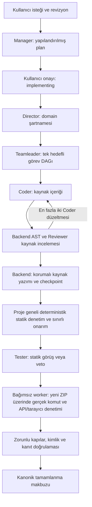

# 📖 XFactor — A'dan Z'ye Kapsamlı Kullanım ve Operasyon Kılavuzu

Depo bakımı ve son kod sadeleştirmeleri için [temizlik/refactor raporuna](docs/REPOSITORY-CLEANUP.md) bakın. Kullanıcı verileri ve üretilen projeler bu temizlikte korunur.

Manager sohbetinde yanıt oluşturma, kısa LLM bağlantı testinden daha uzun sürebilir.
Sohbet isteği genel API çağrılarının 15 saniyelik frontend sınırıyla kesilmez;
Etkin profilin yanıt süresi sınırı geçerlidir (yeni profilde varsayılan 120 saniye; 5–300 saniye arasında ayarlanır). Etkin profil yoksa `LLM_TIMEOUT_MS` ortam ayarı, o da yoksa 60 saniye kullanılır. Yanıt beklerken
aynı mesajı tekrar göndermeyin. Profil testindeki “Başarılı” sonucu kısa test
isteğinin o anda çalıştığını gösterir; tüm üretim isteklerinin başarı garantisi değildir.

Bu kılavuz, **XFactor Otonom AI Ajan Orkestrasyon Platformu**'nun çalışma mantığını, mimari bileşenlerini, arayüz kullanımını ve adım adım uçtan uca yazılım üretim süreçlerini tüm detaylarıyla açıklamaktadır.

---

## 📑 İÇİNDEKİLER

1. [Genel Bakış ve Mimari Felsefe](#1-genel-bakış-ve-mimari-felsefe)
2. [Sistem Gereksinimleri ve İlk Kurulum](#2-sistem-gereksinimleri-ve-ilk-kurulum)
3. [Ajan Rolleri ve Hiyerarşik Görev Dağılımı (6 Seviye)](#3-ajan-rolleri-ve-hiyerarşik-görev-dağılımı-6-seviye)
4. [Uçtan Uca Kullanım Adımları (A'dan Z'ye)](#4-uçtan-uca-kullanım-adımları-adan-zye)
   - [Adım 1: Güvenli Giriş Yapma (Authentication)](#adım-1-güvenli-giriş-yapma-authentication)
   - [Adım 2: Yeni Proje Başlatma](#adım-2-yeni-proje-başlatma)
   - [Adım 3: Manager ile Beyin Fırtınası ve Planlama (Zaman Damgalı Sohbet)](#adım-3-manager-ile-beyin-fırtınası-ve-planlama-zaman-damgalı-sohbet)
   - [Adım 4: Mimari Planı Onaylama ve Canlı Revizyon (`pending_approval`)](#adım-4-mimari-planı-onaylama-ve-canlı-revizyon-pending_approval)
   - [Adım 5: Canlı ReactFlow DAG Akışını ve Log Tablosunu İzleme](#adım-5-canlı-reactflow-dag-akışını-ve-log-tablosunu-izleme)
   - [Adım 6: Canlı Müdahale, Duraklatma ve Kaldığı Yerden Devam Etme (`Pause / Resume`)](#adım-6-canlı-müdahale-duraklatma-ve-kaldığı-yerden-devam-etme-pause--resume)
   - [Adım 7: Doğrulanmış Projeyi ZIP Olarak İndirme](#adım-7-doğrulanmış-projeyi-zip-olarak-indirme)
5. [Yan Menü Proje Yönetimi ve İşlem Menüsü (`...`)](#5-yan-menü-proje-yönetimi-ve-işlem-menüsü-)
6. [Dosya-Bazlı Koordinasyon Protokolü ("Agent = Klasör")](#6-dosya-bazlı-koordinasyon-protokolü-agent--klasör)
7. [Üretilen Projeyi Bilgisayarınızda Çalıştırma Kılavuzu](#7-üretilen-projeyi-bilgisayarınızda-çalıştırma-kılavuzu)
8. [Test Süiti ve Otomasyonun Çalıştırılması (`npm test`)](#8-test-süiti-ve-otomasyonun-çalıştırılması-npm-test)
9. [Sıkça Sorulan Sorular (SSS) ve Sorun Giderme](#9-sıkça-sorulan-sorular-sss-ve-sorun-giderme)
10. [Geliştirici Rehberi: Kod Tabanı Analizi ve Bilgi Grafiği (Graphify)](#10-geliştirici-rehberi-kod-tabanı-analizi-ve-bilgi-grafiği-graphify)
11. [18 Zorunlu Kalite Kapısı ve Temiz Oda Doğrulama Sistemi (Politika 2.0)](#11-18-zorunlu-kalite-kapısı-ve-temiz-oda-doğrulama-sistemi-politika-20)

---

## 1. Genel Bakış ve Mimari Felsefe

Geleneksel yapay zekâ kodlama araçları genellikle tek bir prompt ile tüm uygulamayı tek seferde yazmaya çalışır; bu durum halüsinasyonlara, eksik dosyalara ve kırık bağımlılıklara yol açar.

**XFactor**, bu sorunu iki güçlü dünya standardını birleştirerek çözer:
1. **`msitarzewski/agency-agents` (Uzmanlaşmış Rol Kütüphanesi & Living Docs):** Her rol kendi uzmanlık alanındaki işi yapar. Altı rolün istemi, `x-agents/ORKESTRASYON-TALIMATNAMESI.md` tam metni ile ilgili rol Markdown'ından oluşur. Üretim rolleri modül yüklenirken önbelleğe alınır; politika değişiklikleri planlı backend yeniden başlatması gerektirir. Manager sohbeti istemi yeniden okur. Beş protokol şablonu insan rehberidir; gerçek kayıtları backend üretir.
2. **`coleam00/Archon` (Deterministik DAG Dalga Motoru & Dark Factory):** Tüm görevler matematiksel bir **Yönlü Döngüsüz Çizge (DAG)** yapısında dalgalar (`Execution Waves`) halinde çözülür. Bağımsız görevler paralel çalışırken bağımlı görevler önkoşulları bekler.



Domainler ve takımlar sırayla yürütülür; yalnız aynı takımın bağımsız DAG görevleri en fazla ikili çalışır. Her LLM rolü tam ortak anayasa ve kendi rol talimatını alır. Dosyaları backend yazar; model onayı çalışma kanıtı değildir. Worker yerel profilde ayrı süreç ve iş dizini kullanır; OS izolasyonu Docker profilinden ayrıdır.

---

## 2. Sistem Gereksinimleri ve İlk Kurulum

### Sistem Gereksinimleri
- **İşletim Sistemi:** Windows, macOS veya Linux
- **Node.js:** v22.23.2 ve npm v10.9.8; CI ve Docker bu sürümleri kullanır. Bun için yardımcı komutlar bulunur, ancak üretim doğrulaması Node.js üzerinde yapılır.
- **İnternet Bağlantısı:** Seçtiğiniz LLM sağlayıcısının API adresine erişim için

### 1. Adım: Yapılandırma Dosyasını Hazırlama
İlk açılış `backend/.env.example` dosyasından yerel `backend/.env` dosyasını otomatik oluşturur. Özel ayar yapacaksanız önceden kendiniz kopyalayıp düzenleyebilirsiniz:

```bash
# Windows
cd backend
copy .env.example .env

# macOS / Linux
cd backend
cp .env.example .env
```

Özel ayar gerektiğinde `.env` dosyasını düzenleyin. Varsayılan içerik şöyledir:
```env
PORT=8000
# Kimlik doğrulama anahtarı veya yönetici parolası .env içinde tutulmaz.
ALLOWED_ORIGINS=http://localhost:5173,http://127.0.0.1:5173
ALLOW_MOCK_FALLBACK=false
EXECUTION_WORKER_TOKEN=dev-worker-token-internal
EXECUTION_WORKER_URL=http://127.0.0.1:8099
READINESS_WORKER_TIMEOUT_MS=2000
```

İlk açılışta XFactor her kurulum için ayrı rastgele `LLM_CONFIG_ENCRYPTION_KEY` üretir ve yerel `backend/.env` dosyasına kaydeder; komut çalıştırmanız veya anahtarı elle yazmanız gerekmez. Sağlayıcı API anahtarını, adresini ve modelini `.env` içine koymayın; yönetici oturumuyla **LLM Yönetimi** sayfasında profil olarak kaydedin. Profil dosyası `backend/data/llm-profiles.json` konumunda şifreli tutulur ve Git dışında kalır. Şifreleme anahtarı kaybolur fakat şifreli profiller durursa XFactor yeni anahtar üretmek yerine kurtarma isteyerek açılışı durdurur. `.env` ve profil dosyasını birlikte güvenli biçimde yedekleyin.

### 2. Adım: Bağımlılıklar ve Varsayılan Giriş Hesabı
```bash
# Backend bağımlılıkları
cd backend
npm install
cd ..

# Frontend bağımlılıkları
cd frontend
npm install
cd ..
```

> 🔑 **Hazır Varsayılan Giriş Hesabı:**  
> XFactor, kurulum sonrasında herhangi bir kullanıcı oluşturma komutuna ihtiyaç bırakmaksızın otomatik tanımlanan bir yönetici hesabı ile gelir:
> - **Kullanıcı Adı:** `admin`
> - **Şifre:** `xfactor`
> 
> Giriş alanları boş açılır; varsayılan bilgileri elle girin. İnternete açık kurulumdan önce varsayılan parolayı değiştirin.

#### (Opsiyonel) Yönetici Parolasını Değiştirme veya Sıfırlama
Parolanızı dilediğiniz zaman terminalden güncelleyebilirsiniz (asgari 6 karakter):
```bash
cd backend
npm run create-admin -- admin            # yeni yönetici ekler
npm run create-admin -- admin --renew    # mevcut parolayı doğrulayıp yenisiyle değiştirir
npm run create-admin -- admin --reset    # unutulan parolayı sıfırlar
cd ..
```
### 3. Adım: Uygulamayı Başlatma

#### ⭐ Seçenek A: Kök Dizininden Tek Komutla Başlatma (Önerilen)
Backend ve frontend bağımlılıklarını kurduktan sonra proje kökünde yerel araçları hazırlayın. Normal `npm run dev` platformun üç servisini Docker olmadan başlatır:
```bash
npm run worker:local:setup -- --install
npm run dev
```

| Port | Servis | Açıklama |
|:---:|---|---|
| **`5173`** | **Frontend (Vite / React)** | **Kullanıcı Paneli:** Tarayıcınızda açtığınız ana ekran (`http://127.0.0.1:5173`). |
| **`8000`** | **Backend (Web Orchestrator)** | **Yönetim Beyni:** REST API, SQLite veritabanı, WebSocket telemetrisi ve 6 yapay zekâ ajanı. |
| **`8099`** | **Execution Worker** | **Bağımsız Derleyici/Test İşçisi:** Seçilen yerel veya Docker profilinde gerçek kalite kontrollerini yürütür. Yerel profil OS izolasyonu sağlamaz. |

> ℹ️ **Önemli Not:** `8099` portu doğrudan kullanıcıların tarayıcıdan gezinmesi için değil; Backend'in Bearer token (`EXECUTION_WORKER_TOKEN`) ile izole kod çalıştırma işlerini devrettiği korumalı bir iç servistir. Tarayıcıdan girildiğinde `{"error":"Unauthorized"}` dönmesi bu güvenlik önleminin gereğidir.

> Backend'in `GET /healthz` adresi yalnız süreç canlılığını gösterir. `GET /readyz`, Worker'ın `prepare_dependencies` ve `verify_artifact` kapasitesini de denetler. `READINESS_WORKER_TIMEOUT_MS` temel varsayılanı `2000` ms'dir; yerel geliştirme başlatıcısı ayar verilmemişse `35000` ms kullanır. Açıkça verilen değer korunur; örnekteki `2000` değerini ayarlarsanız daha uzun yerel varsayılan uygulanmaz. Worker gerçek Chromium başlatma ve sayfa çizimini de sınar; soğuk başlangıç bu süreyi aşabilir. Hazır olmayan worker için HTTP 503 döner. `8099` portunda 401 görmek yalnız yetki denetiminin yanıtıdır, hazır olma kanıtı değildir.

> Kısıtlı Windows kurumsal ağlarında `start-project.ps1` betiği üzerinden de doğrudan çalıştırılabilir.
#### Seçenek B: Ayrı Terminallerde Başlatma
* **1. Terminal (Backend):**
  ```bash
  cd backend
  npm run dev
  ```
  > Backend sunucusu `http://127.0.0.1:8000` adresinde hazır olacaktır.
* **2. Terminal (Frontend):**
  ```bash
  cd frontend
  npm run dev
  ```
  > Tarayıcınızda `http://127.0.0.1:5173` adresine giderek uygulamayı kullanmaya başlayabilirsiniz.
* **3. Terminal (Execution Worker):**
  ```bash
  node execution/server.js
  ```
  > Kökteki `npm run dev` varsayılan olarak Docker olmadan yerel profili seçer; `npm run dev:local` aynı akıştır. Docker için `npm run dev:docker` kullanın. Bu doğrudan worker komutu ayrı runtime yapılandırması gerektirir; [paketli yerel worker](docs/LOCAL-WORKER-PACKAGE.md) alternatifini de kullanabilirsiniz. Ayrı başlatmada backend ve worker URL/token ayarlarını eşleştirin. Worker, `http://127.0.0.1:8099` adresinde yalnız yetkili backend isteklerini kabul eder.

> [!CAUTION]
> **Production / VPS Uyarısı:** VPS veya sunucu ortamında backend'i (`8000`) doğrudan internete açmayınız. TLS sonlandırması ve `X-Forwarded-Proto: https` başlığı sağlayan bir Reverse Proxy (Caddy, Nginx vb.) kurunuz. Oturum çerezlerinin güvenliği için HTTPS zorunludur.

---

## 3. Ajan Rolleri ve Hiyerarşik Görev Dağılımı (6 Seviye)

| Ajan Rolü | Unvan | Sorumluluk Kapsamı | Canlı Kural Dosyası |
|---|---|---|---|
| **Manager** | Baş Mimar & Proje Yöneticisi | Boss ile görüşür, gereksinimleri netleştirir, mimariyi çizer, domainlere böler ve Prisma/SQLite projelerinde `.env.example` güvencesini şartnameye bağlar. | `x-agents/manager.md` |
| **Director** | Domain Direktörü | Kendisine atanan domainin teknik mimarisini, kütüphane ve bileşen standartlarını belirler. | `x-agents/director.md` |
| **Teamleader** | Takım Lideri | Direktörün şartnamesini atomik DAG görevlerine böler. **Katı Tek Dosya Atomik Limit (`targetFiles.length === 1`)** kuralını uygular. | `x-agents/teamleader.md` |
| **Coder** | Yazılım Geliştirici | Kendisine verilen atomik görevi alır, hedef dosyaları eksiksiz kodlar. **Bileşen Kompozisyonu** (`@/components` import etme) kuralını uygular. | `x-agents/coder.md` |
| **Reviewer** | Kaynak Kod İnceleme | Üretilen kaynak hakkında yapılandırılmış onay veya geri bildirim verir. Backend önce sözdizimini denetler; ilk çıktıdan sonra en fazla iki Coder düzeltmesine ve toplam üç incelemeye izin verir. Onay yoksa görev **VETO** edilir. | `x-agents/reviewer.md` |
| **Tester** | Statik Kalite İncelemesi | Backend'in hazırladığı manifesto, kabul koşulları ve deterministik denetim özetinden JSON tavsiye/ret üretir. Dosya çalıştırmaz; build, runtime veya ZIP kabul kanıtı üretmez. Onarım döngülerini ve `RAPOR.md`/`README.md` yazımını backend yönetir. | `x-agents/tester.md` |

Bu altı LLM rolünden sonra **bağımsız execution worker** gerçek komutları ve API/tarayıcı kontrollerini çalıştırır. Tamamlanma için zorunlu kapıların geçerli kanıtı ve kalıcı makbuz gerekir. Domainler ve Teamleader'lar sıralı dolaşılır; paralellik takımın DAG dalgası içindeki en fazla iki göreve uygulanır. Bu roller bağımsız kabuk yetkili süreçler değildir; dosya ve durum işlemlerini backend gerçekleştirir.

---

## 4. Uçtan Uca Kullanım Adımları (A'dan Z'ye)

### Adım 1: Hızlı ve Güvenli Giriş Yapma (Authentication)
1. Tarayıcınızda `http://127.0.0.1:5173` adresini açın.
2. README'deki varsayılan bilgileri (**admin** / **xfactor**) boş giriş alanlarına yazın.
3. **Giriş Yap** butonuna tıklayarak yönetim paneline erişebilirsiniz. Tarayıcı 24 saatlik HttpOnly sunucu oturumu kullanır; credential `localStorage` içinde tutulmaz.

### Adım 1a: LLM Sağlayıcı Profillerini Yönetme

1. Yönetici oturumunda sol menüden **LLM Yönetimi** sayfasını açın (`/llm`). Sayfa ve `/api/llm` yalnızca yöneticiye açıktır.
2. Sağlayıcıyı seçin; önerilen API temel adresi ve model kimliğini gerektiğinde elle değiştirin. API anahtarını girip **Profili kaydet** düğmesine basın. **Düzenle** sırasında anahtarı boş bırakırsanız mevcut anahtar korunur.
3. **Bağlantıyı sına** gerçek model çağrısı yapar. Son testin başarılı/başarısız sonucu ve zamanı profil kartında saklanır. Bu, test anının kanıtıdır; sağlayıcının sürekli erişilebilir olduğunu garanti etmez. Profil düzenlenince sonuç temizlenir.
4. Kullanmak istediğiniz pasif profilin **Etkinleştir** düğmesine basın. Aynı anda yalnızca bir profil etkindir; seçili profil üst özette görünür ve kartındaki düğme **Etkin** olarak kapalıdır. Manager sohbeti ve üretim ajanları yeni çağrılarda bu profili kullanır. Etkin profili silerseniz seçili profil kalmaz.

Ayrıntılı kurulum, Xiaomi MiMo örneği ve başka Express uygulamasına taşıma için [LLM yönetimi kılavuzuna](backend/llm-auth/LLM-YONETIMI.md) bakın.
### Adım 2: Yeni Proje Başlatma ve Disk Senkronizasyonu
1. Sol panelin üst kısmında yer alan `+` (Yeni Proje) butonuna tıklayın.
2. Açılan uygulama içi formda **Proje başlığı** alanını doldurun ve **Proje Oluştur** düğmesine basın (Örn: `araba-kiralama-otomasyonu`). Tarayıcının yerel prompt penceresi kullanılmaz. Boş başlık ve çift gönderim engellenir; hata olursa başlık korunarak tekrar deneyebilirsiniz. Oturum kapandığında form kapanır.
3. Proje listesinde projeniz `PLANNING` durumunda belirecek ve ana dizindeki `projects/<proje_id>` klasörüne fiziksel olarak oluşturulacaktır.
4. **Disk Senkronizasyonu:** Backend açılışta `projects/` dizinindeki geçerli, kayıt dışı klasörleri güvenli biçimde keşfeder. Arayüzdeki global **Senkronize Et** işlemini yalnız yönetici kullanıcılar çalıştırabilir; normal kullanıcı isteği veritabanına dokunmadan HTTP 403 alır. Diskte bulunmayan bir klasör veritabanı kaydının veya ZIP'in otomatik silinmesine yol açmaz. Senkronizasyon kaynak klasörleriyle ZIP envanterini birlikte raporlar ve önceden günlüğe alınmış bekleyen karantina işlemlerini tekrar dener; yeni saklama adaylarını kendiliğinden karantinaya almaz. Test runner ve ortak izole DB yardımcısı DB, kaynak, ZIP ve çöp köklerini geçici test dizinlerine ayırır. Önceki doğrudan test çalıştırmalarından kalan dosyalar yeni envanterde ayrıca görülebilir.

### Adım 3: Manager ile Beyin Fırtınası ve Planlama (Zaman Damgalı Sohbet)
1. Proje seçildiğinde doğrudan **Manager Sohbet Paneli (`ChatView`)** açılır.
2. Manager'a geliştirmek istediğiniz uygulamayı doğal dilde anlatın:
   > *"Bana modern TailwindCSS kullanan, Next.js 14 App Router ve Prisma SQLite destekli bir Araba Kiralama ve Rezervasyon Sistemi oluştur."*
3. Manager projenin kapsamını, kullanılacak modelleri (Car, Reservation, User) ve mimariyi sizinle olgunlaştırır.
   - Uygulama kalıcı kayıtlar veya operasyonel işlemler içeriyorsa Manager, siz istemeseniz de yönetim ekranlarını, kaynak başına işlemleri, oturum açmayı ve rolleri önerir. Öneri sohbet ve onaylanacak planda görünür. Yönetim gerekmiyorsa gerekçesini belirtir.
   - Her rolün izinli ve yasak işlemleri ile geliştirme/test için ayrı demo hesabı planda yer alır. Herkese açık kayıt olup olmayacağını ayrıca kararlaştırın; kayıt yükseltilmiş yetki vermez.
4. **Hata teşhis bağlamı:** Duraklatılan veya hata alan projede Manager'a *"Neden durdu?"* diye sorabilirsiniz. Backend son hata, sınırlı loglar ve uygun `RAPOR.md` kayıtlarını temizlenmiş veri olarak Manager'a verir. Kayıtlarda dosya/satır veya kök neden yoksa bunun bilinmediği belirtilmelidir; Manager'ın çalışan dosyalara sınırsız erişimi yoktur. Model açıklaması bağımsız test kanıtı değildir.

### Adım 4: Mimari Planı Onaylama, Sürümlü Sözleşme ve Canlı Revizyon (`pending_approval`)
1. Manager'ın yapılandırılmış planı doğrulandığında sistem `pending_approval` durumuna geçer. Sadece “plan hazır” metni veya etiket bu durumu oluşturmaz. Eksik sözleşme bir kez otomatik düzeltilmeye çalışılır; başarısızsa eksik alan açıklanır ve üretim başlamaz.
2. **Sürümlü Yazılım Sözleşmesi (`PROJECT_CONTRACT`):** Sistem arka planda `project_contracts`, `requirements` ve `contract_elements` tablolarına değişmez bir sözleşme revizyonu ve SHA-256 sözleşme özeti (`contract_hash`) kaydeder.
3. Sohbetin üstünde **"Mimari Plan Hazırlandı — Onayınız Bekleniyor"** kartı belirir. Tam şartname, gereksinimler, roller ve kayıt politikalarını **Planın kapsamını ve kabul kriterlerini incele** bölümünden açabilirsiniz; sohbet uzun JSON'u tekrar göstermez.
4. **"Planı Onayla ve Başlat"** düğmesi veya **“varsayımlarla devam et” / “planı onaylıyorum”** mesajı aynı güvenli onay akışını çalıştırır. Sözleşme onaylanır (`status = approved`), proje `implementing` durumuna geçer ve DAG motoru başlar. Bekleyen geçerli plan tekrar üretilmez; tekrarlanan onay ikinci yürütme oluşturmaz. Yalnız proje sahibi veya yönetici üretimi başlatabilir. Olumsuz ifadeler, sorular ve kapsam değişikliği içeren mesajlar otomatik onay sayılmaz.
5. **Sohbetten Canlı Revizyon ve Hükümsüz Kılma (Supersession):** Tamamlanmış veya durdurulmuş bir projede sohbete girip *"Next.js yerine Vite React ve Tailwind yap"* veya *"Şu modeli ekle"* dediğinizde; Manager yeni bir sözleşme taslağı oluşturur, eski çelişen gereksinimleri `superseded` olarak işaretler ve yeni bir sözleşme revizyonuyla onay butonunu tekrar açar.
### Adım 5: Canlı ReactFlow DAG Akışını ve Süreç Loglarını İzleme (4 Ayrı Sekme)
1. Proje başladığında üst menüdeki 4 bağımsız sekme arasında serbestçe gezinebilirsiniz:
   - **💬 Sohbet & Mimari (`chat`):** Manager ile konuşma, canlı düşünce animasyonu (`Sparkles & Bouncing Dots`) ve otomatik bitiş/müdahale bildirimleri.
   - **📊 Kalite Paneli (`dashboard`):** Doğrulama koşularının durumunu ve her kontrolün makine kanıtını gösterir. Yönetim projelerinde rol girişleri, rol bazlı izinli/reddedilen CRUD işlemleri ve yönetim ekranı etkileşimleri ayrı satırlarda görünür.
   - **📊 Canlı DAG Grafiği (`flow`):** Ekranın tamamını kaplayan, çakışmasız ve kompakt 2 sütunlu hiyerarşik ağaç grafiği.
   - **📜 Canlı Süreç Logları (`logs`):** Arama kutusu, `ERROR` / `VETO` / `FEEDBACK` filtreleri ve anlık bağlantı durumu içeren tam sayfa log izleme ekranı.

Yeni proje açıldığında ilk ekran Sohbet & Mimari olur. Kalite Paneli üstte amacını, kullanım sırasını ve `PASS`/`FAIL`/`BLOCKED` durumlarını açıklar. Solda en yeni doğrulama koşusundan başlayarak geçmişi seçin; sağda kontrollerin neyi sınadığını ve sonucunu görün. Bir kontrole tıklayınca zorunluluk, çıkış kodu, zaman, SHA-256 çıktı özetleri ve gizli bilgiler temizlenmiş `stdout`/`stderr` kayıtları açılır. Panel salt okunurdur; geçmişi değiştirmez.

Panel açıkken geçmiş ve seçili koşunun kanıtları 15 saniyede bir yenilenir. En güncel koşuyu takip ediyorsanız yeni koşu otomatik seçilir; geçmişten özellikle seçtiğiniz koşu, açık log ve yüklenmiş eski sayfalar korunur. Bir geçmiş isteği sürerken eski sayfaları yükleme düğmesi kısa süreliğine bekler; proje değiştirdiğinizde önceki projenin geciken yanıtları ekrana taşınmaz.

Log ekranı ve DAG, veritabanındaki en yeni 500 olay ile canlı WebSocket olaylarını zaman sırasına göre birleştirir. Yeniden yükleme sırasında aynı olay iki kez gösterilmez; diskten kurtarılan tamamlanmış görev kayıtları mevcut olay geçmişine eklenir.

#### Sohbette Kalıcı Aksiyon Denetim İzi

İşlem butonlarından yapılan başarılı aksiyonlar da normal kullanıcı/Manager mesajları gibi proje sohbetine eklenir:

- **İş akışı:** `Planı Onayla ve Başlat`, `Projeyi Devam Ettir (Resume)` ve `Süreci Duraklat` işlemleri, gerçekleşen durum geçişinin hemen ardından kanonik mesaj çifti oluşturur.
- **Yardımcı işlemler:** Disk senkronizasyonu, `Pin / Unpin` ve doğrulanmış `Download ZIP` işlemleri, yalnızca başarıyla tamamlandıktan sonra açıklayıcı mesaj çifti oluşturur.
- **Yenileme ve proje değiştirme:** Bu kayıtlar tarayıcı belleğindeki geçici bildirimler değildir. Sayfayı yenilediğinizde veya başka bir projeye geçip geri döndüğünüzde sohbet geçmişi veritabanından yeniden alınır ve aynı sırada görünür.
- **Hata davranışı:** Yetki, durum, senkronizasyon veya artefakt doğrulama hatasında işlem başarısız olur ve başarı mesajı yazılmaz; mevcut arayüz hata bildirimi (uyarı, banner veya konsol teşhisi) kullanılır.
- **İdempotency:** Aynı ağ isteği aksiyon kimliğiyle tekrarlandığında kayıtlar çoğaltılmaz. Özellikle onay ve devam etme geçişleri idempotenttir; ayrı ve başarılı yardımcı buton tıklamaları ayrı aksiyonlar olarak kaydedilir.

**Projeyi Sil (`Delete`) bu kapsama dahil değildir.** Silme, proje ve ilişkili sohbet geçmişini birlikte kaldırdığı için silinen projenin sohbetine kalıcı “silindi” mesajı yazılmaz.

### Adım 6: Canlı Müdahale, Duraklatma ve Kaldığı Yerden Devam Etme (`Pause / Resume`)

1. Süreç devam ederken üst barda bulunan **"⏸️ Süreci Duraklat"** butonuna tıklayabilirsiniz.
2. Proje `paused` durumundaysa üst bardaki, sohbet bildirim şeridindeki veya süreç logları ekranındaki yeşil **Devam Ettir (Resume)** butonuyla kaldığı yerden devam ettirebilirsiniz.
3. Statik denetim/Tester reddinde proje `verification_failed` olur. Worker reddi veya iş akışı istisnası, kalıcı başarısız doğrulama koşusu korunarak workflow hata yolunda `paused` durumuna alınabilir; proje durumu ile koşu sonucu farklı kayıtlardır. Kapı adları ve kaydedilmiş nedenler sohbet, süreç logları ve Kalite Paneli üzerinden incelenir. `artifact_verified` durumunda son hata kaydı varsa da **Devam Ettir (Resume)** görünür. İş akışı hata bildirimi arayüzü Sohbet sekmesine taşır; düzeltme veya revizyon için kayıtlı nedeni inceleyin.
4. **Diskteki görevlerden kurtarma:** Manager `TODO.md` ve `DURUM.md` dosyaları korunur. Director'ın `ALT-TALIMATNAME.md` dosyası ve Teamleader planları varsa yeniden kullanılır; görevlerin `GOREV.md` dosyasındaki tek hedef dosya ve açıklama geri yüklenir. Disk senkronizasyonu mevcut canlı olayları silmeden, yalnızca tamamlandığına ilişkin kanıtı bulunan eksik görev loglarını DAG'a ekler.
5. **Checkpoint koruması:** Motor aynı onaylı sözleşmeye ait görev checkpoint'lerini plan, bağımlılık ve fiziksel dosya kanıtıyla denetler. Açık kabul onarım kaydı varsa uygun tamamlanmış görevleri yeniden kullanabilir; reddedilmiş veya kanıtsız görevleri bitmiş saymaz. Yeni sözleşme revizyonu eski checkpoint'e dayanmaz.

#### Log ekranında kaldığınız yeri izleme

- **İşlerin son durumu:** Varsayılan görünüm, yüklenmiş kayıtlardan her iş için son durumu gösterir. Gerçek bir tekrar yürütme **Yeniden çalıştırılıyor** olarak görünür; bitmemiş işler tamamlandı sayılmaz.
- **Son çalışma kayıtları:** Son yürütmenin olaylarını gösterir. Önceki yürütmelerin olayları bu akışa tekrar eklenmez.
- **Yüklenen kayıt geçmişi:** Yüklenmiş olayların tümünü incelemek ve hata araştırmak içindir. Görünümler kayıtları silmez veya ajan çağrısı başlatmaz; henüz yüklenmemiş geçmiş kayıtları kapsamaz.

**Devam Ettir** sırasında motor aynı sözleşme, plan, görev kapsamı, bağımlılık girdileri, hedef dosya içerikleri ve kalite kapısı sürümü için geçerli checkpoint bulursa o işin Coder/Reviewer çağrılarını atlar. Dosyası veya kapsamı değişmiş, reddedilmiş ya da checkpoint'i bulunmayan işler yeniden çalışabilir. Log satırları tek başına tamamlanma kanıtı değildir.

Yeni bir Reviewer onayından sonra aynı dosyalar tekrar üretilse bile checkpoint kaydı yenilenebilir. Kalıcı kayıt oluşmadan görev tamamlandı gösterilmez. Checkpoint okuma/yazma hatasında süreç durur; veritabanı veya disk sorunu giderildikten sonra **Devam Ettir** kullanılmalıdır. Depo erişim hatası otomatik olarak baştan üretime dönüşmez. Duraklatma anında devam eden ve checkpoint'i henüz kaydedilmemiş iş için tekrar çalışma gerekebilir; tüm token tüketiminin sıfırlanacağı garantisi verilmez.

Tüm üretim görevleri tamamlandıktan sonra motor `generationCompletion` aşama kaydını oluşturur. **Devam Ettir**, kayıttaki sözleşme kimliği, sözleşme SHA-256 özeti ve plan SHA-256 özeti güncel onayla eşleşirse tamamlanan Coder/DAG üretimini atlar. Mevcut kaynak düzeltmeleri korunur; statik denetim, Tester incelemesi, bağımlılık hazırlığı ve gerçek worker kontrolleri yeniden yürütülerek yeni bir ZIP oluşturulur. Aşama kaydı çalışma zamanı doğrulaması yerine geçmez; eski kalite sonuçları başarı kanıtı olarak taşınmaz. Plan veya sözleşme değiştiğinde normal görev üretimine dönülür. Üretim tamamlanmadan önceki dosya değişiklikleri ise yukarıdaki checkpoint kurallarına tabidir.

Yalnız tarayıcı kabul adımlarını değiştirmek istiyorsanız bunu Manager'a açıkça belirtin. Alanla sınırlı revizyon, onaylı sözleşmeye bağlı olarak yalnız `browser.roleJourneys` alanını günceller; diğer gereksinimler ve rol izinlerini değiştirmez. Eski sözleşmeye dayanan veya başka alanlar içeren güncelleme reddedilir. Yeni taslak tekrar onay bekler. Sohbet mesajları 4000 karakterle sınırlıdır; uzun planı yeniden yapıştırmak yerine değişecek adımları iletin. Geçersiz veya aşırı büyük mesajlar için gösterilen hata LLM bağlantı hatası değildir.

### Adım 7: Doğrulanmış Projeyi ZIP Olarak İndirme
1. Tüm ajanlar görevlerini bitirdiğinde süreç hemen tamamlandı sayılmaz. Bağımsız temiz oda doğrulayıcısı (`artifactVerifier`) devreye girer:
   - Sunucu tarafında ZIP arşivi oluşturulur ve disk SHA-256 özeti hesaplanır (`artifacts`).
   - Arşiv, worker'ın ayrı temiz iş dizininde açılarak 18 zorunlu kalite kapısından geçirilir. Docker profili container izolasyonu sağlar; `local-trusted` profili OS izolasyonu sağlamaz. Zorunlu kontrolün atlanması `BLOCKED` sayılır; yalnızca isteğe bağlı ve uygulanamayan kontrol `NOT_APPLICABLE` olabilir. Servis manifesti ve kaynak dosyalarından uygun API veya tarayıcı denemeleri belirlenir; Prisma şemasında `User` modeli varsa seed edilen kullanıcılar da denetlenir.
   - Yönetim uygulamalarında API denemeleri yetkili rolün kayıt oluşturma, okuma, güncelleme ve silme davranışını; oturumsuz ve yetkisiz rolün reddini; ilişkili kayıtların onaylı saklama kuralını sınar. Tarayıcı akışlarında tıklama, form, görünür sonuç, erişilebilir ad ve dar ekran kanıtı gerekir. Worker güvenilir etkileşim adaptörü sağlayamazsa bu kapı `BLOCKED` olur ve ZIP doğrulanmış olarak sunulmaz.
   - Tüm kontroller eksiksiz PASS olduğunda `completeVerifiedProject` fonksiyonu atomik bir CAS işlemiyle projeyi `COMPLETED` yapar ve `completion_receipts` tablosuna değişmez denetim makbuzu yazar.
2. Doğrulama tamamlandığında üst bardaki **📥 Projeyi (ZIP) İndir** butonuyla sunucuda doğrulanmış ve hash'i eşleşen temiz ZIP paketini bilgisayarınıza indirin. Doğrulanmamış veya diskteki hash'i uyuşmayan hiçbir dosya indirilemez (409 Fail-Closed). Kaynak kodları indirdiğiniz ZIP içinde inceleyebilirsiniz; sohbet ekranında ayrı bir kod editörü açılmaz. Örnek bir proje veya raporun varlığı, o projenin ZIP'inin teslim edilmeye hazır olduğunu göstermez; ilgili paketin güncel kanıtını kontrol edin.
3. Worker hatası normal akışta yerel geliştirme doğrulamasına çevrilmez. Benzer biçimde `DURUM.md` veya `state.json` içindeki tarihsel “tamamlandı” bilgisi PASS kanıtı sayılmaz: disk kurtarma ZIP'i yeniden oluşturabilse bile artefakt `built` ve indirilemez kalır; geçerli Worker koşusu olmadan proje doğrulanmış sayılmaz.

Manager'ın bitiş mesajındaki **Kaydedilen token kullanımı**, projeyle ilgili planlama, üretim, inceleme ve onarım çağrıları için yapay zekâ sağlayıcısının bildirdiği giriş ve çıkış tokenlarının toplamıdır. Sağlayıcı bazı çağrılarda kullanım verisi vermezse mesaj yalnız bilinen **en az** toplamı ve eksik çağrı sayısını söyler. Eski projelerin daha önce kaydedilmemiş kullanımı sonradan hesaplanamaz. Token sayısı ücret hesabı değildir.

## 5. Yan Menü Proje Yönetimi ve İşlem Menüsü (`...`)

Sol kenar çubuğunda her proje kartının yanında üç nokta (`...`) işlem butonu yer alır:
- 📌 **Başa Sabitle / Sabitlemeyi Kaldır (`Pin / Unpin`):** Projeyi listenin en üstüne sabitler veya sabitlemeyi kaldırır.
- ⬇️ **Projeyi (ZIP) İndir (`Download ZIP`):** Tamamlanmış (`COMPLETED`) projeleri doğrudan yan menüden doğrulanmış ZIP paketi olarak bilgisayarınıza indirir.
- 🗑️ **Uygulamayı Kaldır / Projeyi Sil (`Delete`):** Normal silme işlemi, doğrulanmış teslim makbuzu bulunan projeleri korur ve silme isteğini reddeder. Silinebilen projenin kaynak klasörü çöp akışıyla kaldırılır; ilişkili ve hash'i doğrulanmış merkezi ZIP'ler `backend/data/artifacts/.quarantine/` altına taşınmak üzere kalıcı DB günlüğüne alınır. Varsa, kayıtlı bir artifact ile aynı hash'e sahip `projects/<proje-id>.zip` teslim kopyası `projects/.artifact-quarantine/` altına alınır. Özel kökler kullanılıyorsa karantina ilgili kökün altında tutulur. Taşıma tamamlanamazsa işlem `pending` kalır ve tekrar denenir; karantinadaki ZIP kalıcı olarak silinmez.

> **Not:** Diskte fiziksel klasörü bulunmayan projeler yan menüde `(Diskte Bulunamadı)` uyarısıyla gösterilir. Önce klasörün taşınmadığını ve diskin erişilebilir olduğunu kontrol edin. Bu uyarı silme onayı değildir. Tarihsel kalite sonucu başarılı kalabilse de fiziksel ZIP eksikse indirme açılmaz; uygulama paketin bulunamadığını ayrıca bildirir.

### ZIP envanteri ve bakım

Depo kökünde `node backend/scripts/artifact-maintenance.js` yalnızca envanter okur; dosya taşımaz, DB şemasını değiştirmez. Bakım operatörü önce güncel backend'i bir kez açarak migration 16'yı uygulatmalı, sonra backend ve worker'ı durdurmalıdır. `node backend/scripts/artifact-maintenance.js --quarantine --offline` uygun adayları karantinaya alır. `--orphans-only` yalnız yeni aday seçimini kayıt dışı ZIP'lerle sınırlar; önceden günlüğe alınmış bekleyen işlemler de tekrar denenebilir. Çalışan workflow varsa CLI bakım yazımını reddeder; `--offline` servisleri kendisi durdurmaz.

Makbuzla korunmayan `rejected`/`superseded` paketler oluşturulmalarından 7 gün sonra, kayıt dışı ZIP'ler son dosya değişikliğinden 24 saat sonra aday olabilir. Adaylık otomatik silme değildir. Ayrıntılar ve mevcut eksik dosyaların sınırları: [Proje ve ZIP yaşam döngüsü](docs/ARTIFACT-LIFECYCLE.md).

---

## 6. Dosya-Bazlı Koordinasyon Protokolü ("Agent = Klasör")

Backend her rol ve görev için aşağıdaki klasörlerde protokol kayıtları tutar. LLM rolleri bu klasörlerde bağımsız süreç veya dosya aracıyla çalışmaz; okuma, yazma ve durum geçişlerini merkezi backend gerçekleştirir. Klasör ayrımı OS izolasyonu sağlamaz:

```text
projects/<proje_id>/
├── manager/                        # Manager Ajanı ve Tüm Ajan Hiyerarşisi
│   ├── TALIMATNAME.md              # Ana Mimari Şartname
│   ├── TODO.md                     # Manager Seviyesi Görev Çizelgesi
│   ├── DURUM.md                    # Anlık İlerleme Durumu
│   ├── GOREV.md                    # Manager Misyonu
│   │
│   ├── frontend.director/          # Frontend Direktörü
│   │   ├── ALT-TALIMATNAME.md      # Frontend Mimari Şartnamesi
│   │   ├── TODO.md
│   │   └── frontend.teamleader/    # Frontend Takım Lideri
│   │       ├── TODO.md             # Atomik Görevler DAG'ı
│   │       └── task-1-setup-ui/    # Coder Görev Klasörü (GOREV, DURUM, RAPOR)
│   │
│   └── backend.director/           # Backend Direktörü
│       └── backend.teamleader/
│
├── src/                            # Üretilen Temiz Uygulama Kaynak Kodları (app/layout.tsx, app/page.tsx, components, lib)
├── prisma/                         # schema.prisma & seed.ts
├── .env.example                    # Güvenli örnek yapılandırma şablonu
├── Dockerfile                     # Üretilen Projeye Özel Çok Aşamalı Konteyner Dosyası
├── .dockerignore                  # Docker İmajına Girmeyecek Dosyalar Listesi
├── package.json                    # Yığına göre paket politikası; kesin sürümler worker'ın ürettiği package-lock.json içindedir
├── tsconfig.json                   # Path Alias (@/* -> ./src/*) Konfigürasyonu
├── tailwind.config.ts              # Stil Yapılandırması (darkMode: 'class')
├── service-manifest.json           # Otomatik Üretilen Servis & Port Sözleşmesi
├── README.md                       # Otomatik Üretilen Kurulum & Çalıştırma Rehberi
└── RAPOR.md                        # Backend'in yazdığı inceleme raporu; tek başına runtime kabul kanıtı değildir
---

## 7. Üretilen Projeyi Bilgisayarınızda Çalıştırma Kılavuzu

Projenizi ZIP olarak indirdikten veya `projects/<proje_id>` klasörünü açtıktan sonra:

### 1. Adım: Bağımlılıkları Kurun
```bash
npm install
```

### 2. Adım: Veritabanını Oluşturun (Prisma ORM)
> `.env.example` dosyasını `.env` olarak kopyalayıp `NEXTAUTH_SECRET` değerini uzun rastgele bir anahtarla değiştirmeniz gerekir:
```bash
npx prisma generate
npx prisma db push
```

### 3. Adım: (Opsiyonel) Örnek Verileri Yükleyin
```bash
npx prisma db seed
```

### 4. Adım: Uygulamayı Başlatın
```bash
npm run dev
```

### 5. Adım: (Alternatif) Docker ile Tek Komutla Çalıştırma
XFactor, ürettiği her projeye bir **`Dockerfile`** ve **`.dockerignore`** ekler. ZIP'i çıkardığınız uygulama klasöründe, `.env.example` dosyasından kendi `.env` dosyanızı hazırladıktan sonra:
```bash
docker build -t projem .
docker run --rm -p 3000:3000 --env-file .env projem
```
`docker run` komutunu yalnızca `docker build` başarıyla bittikten sonra çalıştırın. Build hata verirse yerel imaj oluşmaz; sonraki `pull access denied` mesajı bunun ikincil sonucudur. Next.js projelerinde `public/` klasörü bulunmasa da güncel Dockerfile bu klasörü derleme aşamasında hazırlar. Önceden indirilmiş bir pakette `COPY . .` satırından sonra `RUN mkdir -p public` satırı yoksa paketin Dockerfile dosyasını güncelleyin veya yeni üretilen paketi indirin. Uygulamanın veritabanı kurulumu ve kalıcı veri gereksinimleri için paketin kendi README dosyasını da izleyin.

Başarılı başlatmadan sonra tarayıcınızda `http://localhost:3000` adresini açın.

---

## 8. Test Süiti ve Otomasyonun Çalıştırılması (`npm test`)

Çekirdek motorlar, güvenlik (CSP, HSTS, rate limiter), RFC 6238 TOTP/MFA, asenkron scrypt doğrulaması, HTTP/WebSocket entegrasyonu, DAG dalgaları, concurrency havuzu, derleyici sınırları (`tsc`, `prisma`), deterministik kalite kapıları, alt süreç kontrolleri, mevcut veritabanı migration'ları, log saklama temizliği ve liveness/readiness probları için backend süitini çalıştırın. Bir testin mock kullanması veya ortam nedeniyle atlanması gerçek derleyici/worker çalıştırma kanıtı sayılmaz; yerel worker entegrasyonu ayrıca çalıştırılır:

```bash
cd backend
npm test
```

Frontend, üretim build'i ve Execution Worker süitlerini ayrıca çalıştırın:

```bash
npm --prefix frontend run test:unit
npm --prefix frontend run build
npm --prefix execution test
```

Docker’sız gerçek worker entegrasyonu için `npm run test:local-worker`, bağımsız paket kabulü için `npm run test:local-worker-package -- --bundle dist/local-worker` çalıştırın. Bunlar gerçek kurulum/build/test, SQLite/API ve Chromium rol yolculuklarını doğrular. Docker izolasyon entegrasyonu ayrı bir testtir ve çalışan Docker daemon gerektirir; Docker kapalıysa açıkça `BLOCKED` raporlanır.
Docker kurulu geliştirme ortamında `npm --prefix backend run test:docker:artifact` komutu temsilî Express ve Next projelerinin son ZIP'inden build ve ilk HTTP yanıtını doğrular. Bu test gerçek kullanıcı projesinin ZIP'ine otomatik uygulanmaz; onu ayrıca doğrulanmış kabul etmeyin.

## 9. Sıkça Sorulan Sorular (SSS) ve Sorun Giderme

### S: `error: Environment variable not found: DATABASE_URL` hatası alırsam ne yapmalıyım?
**C:** XFactor'ın güncel sürümünde `.env.example` dosyası üretilir ve ZIP paketine eklenir; `.env` dosyasını siz oluşturup `NEXTAUTH_SECRET` ile `DATABASE_URL` gibi değerleri doldurmalısınız.

### S: Manager ile konuşurken "Mesaj iletilemedi, lütfen tekrar deneyin" hatası alıyorum, nedeni nedir?
**C:** Önce **LLM Yönetimi** sayfasındaki etkin profili ve son bağlantı testini kontrol edin. Profilin API anahtarı, adresi ve model kimliği aynı sağlayıcıya ait olmalıdır; profili değiştirdiyseniz yeniden sınayın. Son testin başarılı görünmesi yeni bir çağrının mutlaka geçeceği anlamına gelmez. İşletim sistemi veya kısıtlı kurumsal ağ ortamlarında Node.js harici API adresini çözemeyebilir; `backend/networkResolver.js` `ENOTFOUND` durumunda IPv4 çözümlemesine düşer. Sorun sürerse ağ, DNS veya proxy ayarlarını kontrol edin.

### S: LLM profilinde “Bağlantı testi başarısız” görürsem ne yapmalıyım?
**C:** Sağlayıcı adresini, model kimliğini ve API anahtarını kontrol edip **Bağlantıyı sına** düğmesini yeniden kullanın. MiMo Pro gibi düşünme kullanan modeller için test yeterli çıkış bütçesi ayırır; sağlayıcı metin üretmeden token sınırına ulaşırsa bunu ayrı bir hata olarak bildirir. Profil kartındaki sonuç yalnızca son test anını gösterir. Test başarılıysa ve profili üretimde kullanmak istiyorsanız pasif kartın **Etkinleştir** düğmesine basın.

### S: LLM çıktısı token sınırına takılırsa veya Reviewer veto ederse ne olur?
**C:** XFactor'da `finishReason === 'MAX_TOKENS'` kontrolü ve Teamleader'ın "Sayfaları ve büyük UI bileşenlerini atomik alt parçalara bölme" kuralı bulunur. Backend ilk Coder çıktısından sonra en fazla iki düzeltmeye ve toplam üç Reviewer incelemesine izin verir. Onay alınamazsa görev reddedilir ve backend akışı `paused` durumuna alır. Bu durumda sohbetten Manager'a hatayı sorabilir veya üst bardaki **"Devam Et (Resume)"** butonuyla kurtarma kontrollerini başlatabilirsiniz; bu işlem başarı garantisi değildir.

### S: Tamamlanmış veya duraklatılmış bir projeyi sohbetten değiştirebilir miyim?
**C:** Evet. Tamamlanmış, duraklatılmış (`PAUSED`) veya doğrulama hatası almış (`VERIFICATION_FAILED`) bir projede sohbet paneline girip revizyon istediğinizde (örn: *"1"*, *"baştan başla"*, *"şunu ekle"*); Manager yeni mimari şartnameyi hazırlar, yeni bir sözleşme revizyonu açar ve sohbetin altında yeşil **"Planı Onayla ve Başlat"** onay kartını sunar. Onayladığınızda otonom motor yeni plan doğrultusunda temiz üretime geçer.

### S: Log ekranındaki hataları nasıl yorumlamalıyım?
**C:** Log ekranında Türkçe hata kategorileri (`[Hata] LLM Kota ve Bütçe Sınırı Aşıldı`, `[Hata] Bağımlılık Hazırlığı Başarısız`, `[Süreç Hatası]`) gösterilir. Bağımlılık hazırlığı ve doğrulama worker'a devredilir. `dev:local` kullanıyorsanız eksik Node/npm/Chromium araçlarını, paket bütünlüğünü ve backend-worker token eşleşmesini [yerel paket kılavuzuyla](docs/LOCAL-WORKER-PACKAGE.md) kontrol edin; hazır olma hataları üretimi engeller. Docker profilini seçtiyseniz Docker daemon ve `docker build -t xfactor-worker-runtime execution` ile hazırlanan imaj gerekir.

### S: 8099 portu nedir? Tarayıcıdan açtığımda neden `{"error":"Unauthorized"}` hatası alıyorum?
**C:** XFactor, **ayrı worker mimarisi** ile çalışır. Yapay zekânın yazdığı kodların derlenmesi (`tsc`), paketlenmesi (`npm install`) ve çalıştırılması **Execution Worker (`8099`)** servisinde yürütülür. Docker profili container izolasyonu sağlar; `local-trusted` profili ayrı iş dizinleri ve süreç temizliği kullanır ancak kod mevcut kullanıcı yetkileriyle çalışır, OS izolasyonu sağlamaz.
- Bu port Backend ile Worker arasındaki Bearer token ile kimlik doğrulanan API'dir. HTTP tek başına trafiği şifrelemez; farklı makineler arasında TLS kullanın. Üretimde operatöre özel worker token zorunludur.
- Tarayıcınızla doğrudan bu porta istek attığınızda, sistem güvenlik amacıyla isteği reddeder ve `{"error":"Unauthorized"}` cevabı döner.
- Kullanıcının bu portu doğrudan ziyaret etmesi gerekmez. İş akışı olayları Loglar ve DAG ekranlarında izlenir; Kalite Paneli koşu/kanıt geçmişini 15 saniyede bir yeniler ve seçilen kontrolün temizlenmiş kayıtlarını açar. Ham worker terminal çıktısı, WebSocket iş akışı olaylarıyla aynı akış değildir.

---

## 10. Geliştirici Rehberi: Kod Tabanı Analizi ve Bilgi Grafiği (Graphify)

XFactor kod tabanını genişletmek, yeni bir ajan eklemek veya mevcut mimari bağımlılıkları görselleştirmek isteyen geliştiriciler için aşağıdaki analiz araçları ve yöntemleri önerilir:

### 1. Kod Tabanı Bağımlılık Haritası
Proje içindeki modüller arasındaki bağımlılık ilişkileri deterministik olarak şu katmanlara ayrılmıştır:
- **API & Sunucu Katmanı:** `server.js` ➔ `routes/projectRoutes.js` ➔ `sessionAuth.js` / `security.js`
- **Orkestrasyon & DAG Motoru:** `engine/workflow.js`, `engine/dag.js` ile dalgaları ve `engine/fileProtocol.js` ile kayıtları yönetir; bunlar birbirini izleyen bir import zinciri değildir.
- **Kaynak İncelemesi:** `engine/workflow.js` ➔ `engine/selfCorrection.js` ➔ Reviewer ve gerektiğinde Coder düzeltmesi.
- **Statik Kalite:** `engine/workflow.js` ➔ `agents/tester.js` içindeki deterministik denetim yardımcıları ve ayrı Tester LLM çağrısı.
- **Çalıştırılmış Kabul Kanıtı:** `engine/workflow.js` ➔ `verification/verificationCli.js` ➔ `verification/artifactVerifier.js` ➔ `executionClient.js` ➔ bağımsız worker.
- **Veri Kalıcılığı & İzolasyon:** `projectRepository.js` ➔ `db.js`; migration tanımları ve uygulaması `db.js` içindedir.

### 2. Bilgi Grafiği (Graphify) ile Mimari Görselleştirme ve Analiz
XFactor, kaynak dosyalarını AST ile tarayan; elle tanımlı mimari ilişkileri de ekleyen yerel bir **Graphify Bilgi Grafiği Motoru** (`backend/scripts/generate_graph.js`) barındırır. Dinamik query parçaları rota yolundan ayrılır; ham Node HTTP Worker rotaları ve `backend/executionClient.js` istekleri `requests_route` ilişkileriyle eşleştirilir. `npm run graph` haritayı her seferinde güncel kaynak koddan yeniden üretir.

#### Grafiği Üretme ve Güncelleme:
Kök dizinde tek bir komutla tüm bilgi grafiğini ve görsel HTML haritalarını tazeleyebilirsiniz:
```bash
npm run graph
```

Bu komut çalıştığında `graphify-out/` dizini altında şu zengin çıktılar üretilir:
1. **`graphify-out/graph.json`:** Dosya, sınıf, fonksiyon, metot, paket, HTTP rota/istek ve ortam değişkeni adı düğümleri ile statik import/çağrı ve mimari bağlantılar. Ortam değişkeni değerleri kaydedilmez.
2. **`graphify-out/graph.html`:** Arama ve ilişki süzgeçleriyle seçilen düğümün komşuluğunu gösteren etkileşimli harita; tüm bağlantılar sağdaki listede bulunur.
3. **`graphify-out/GRAPH_TREE.html`:** Taranan tüm kaynak ve belge yollarından üretilen aranabilir dosya ağacı.
4. **`graphify-out/GRAPH_REPORT.md`:** Güncel düğüm ve ilişki türlerinin sayıları ile statik analiz sınırları.

#### Çekirdek Odak Düğümleri ("God Nodes"):
Güncel bağlantı sıralaması için her `npm run graph` çalıştırmasından sonra `graphify-out/GRAPH_REPORT.md` dosyasına bakın. Bağlantı sayısı gerçek çalışma sıklığı veya güvenlik ölçüsü değildir.

---

### 3. Ön Yüz (Frontend) Dosya ve Bileşen Mimarisi Tablosu

XFactor kullanıcı arayüzü React 18, TailwindCSS ve Vite üzerine inşa edilmiş olup aşağıdaki modüler bileşenlerden oluşur:

| Dosya / Yol | Türü / Katman | İşlev ve Mimari Sorumluluğu |
|---|:---:|---|
| `frontend/src/App.jsx` | Ana Koordinatör | React uygulamasının kök bileşenidir. Kimlik durumu kontrolü, WebSocket canlı telemetri dinleyicisi, proje seçimi, hata banner'ı ve sekmelerin orkestrasyonunu yürütür. |
| `frontend/src/components/Sidebar.jsx` | Gezinme Menüsü | Sol proje listesi; arama çubuğu, başa sabitleme (`Pin`), tamamlanan projeler için doğrulanmış ZIP indirme butonu, disk senkronizasyon butonu ve güvenli proje silme işlemlerini barındırır. |
| `frontend/src/components/CreateProjectDialog.jsx` | Proje Oluşturma | Tarayıcının `prompt()` penceresi yerine uygulama içi ad formu, klavye/fokus yönetimi ve doğrulama hataları sunar. |
| `frontend/src/components/Header.jsx` | Üst Çubuk | Aktif projenin durumunu, sekme butonlarını (Sohbet, Akış Şeması, Loglar, Kalite Paneli), `paused` / `verification_failed` için devam ettirme eylemini, doğrulanmış ZIP indirme rozetini ve SHA-256 hash özetini sunar. |
| `frontend/src/components/ChatView.jsx` | Sohbet Paneli | Manager (Kıdemli Mimar) ile yapılan gerçek zamanlı sohbet ekranıdır. Beyin fırtınası, şartname oluşturma, plan onaylama (`Planı Onayla ve Başlat`) ve `paused` / `verification_failed` durumlarında devam ettirme veya revizyon taleplerini yönetir. |
| `frontend/src/components/DAGFlowView.jsx` | Canlı Graf | ReactFlow tabanlı canlı DAG (Directed Acyclic Graph) görselleştiricisidir. Görevlerin hiyerarşik durumlarını (`bekliyor`, `çalışıyor`, `tamamlandı`, `veto`) renkli düğümler halinde çizer. |
| `frontend/src/utils/dagLayout.js` | Layout Motoru | 6 gerçek ajan rolünün (`Manager`, `Director`, `Teamleader`, `Coder`, `Reviewer`, `Tester`) ve atomik görevlerin hiyerarşik x/y koordinatlarını hesaplar; dummy düğümleri filtreler. |
| `frontend/src/utils/canResumeProject.js` | Devam Ettirme Kuralı | Sohbet, üst çubuk ve log ekranında `paused`, `verification_failed` veya son hata kaydı olan `artifact_verified` durumları için devam ettirme eylemini sağlayan ortak kuraldır. |
| `frontend/src/components/LogsView.jsx` | Canlı Loglar | Orkestrasyon sırasında ajanların ürettiği satır satır tüm terminal ve eylem loglarını gösterir; filtreleme ve devam ettirilebilir projelerde Resume eylemi sunar. |
| `frontend/src/components/DashboardView.jsx` | Kalite Paneli | 18 kalite kapısını ve bağlı ayrıntı kanıtlarını listeler. Açık panelde geçmiş ve seçili koşu 15 saniyede bir yenilenir; seçilen eski koşu, log ve yüklenmiş sayfalar korunur, aynı yenileme çakıştırılmaz. |
| `frontend/src/components/LoginView.jsx` | Giriş Ekranı | Boş kullanıcı adı/parola alanları ve MFA/TOTP adımlarını destekleyen kullanıcı giriş panelidir. Varsayılan bilgiler README'dedir. |
| `frontend/src/services/api.js` | API İstemcisi | Backend ile iletişim kuran, 24 saatlik HttpOnly oturum çerezi ve CSRF token yönetimini sağlayan, istek zaman aşımı (timeout) korumalı merkezi fetch modülüdür. |

---

### 4. Arka Yüz (Backend) Ana Dizin Dosya Mimarisi Tablosu

`backend/` ana dizinindeki başlıca JavaScript kaynak dosyaları ve rolleri (tam dosya sayımı değildir):

| Dosya Adı | Kategori / Katman | Detaylı İşlev ve Mimari Sorumluluğu |
|---|:---:|---|
| `server.js` | Sunucu / Giriş | REST API ve WebSocket sunucusunu ayağa kaldırır, veritabanını başlatır, `admin/xfactor` kullanıcısını garanti eder ve diskteki projeleri otomatik senkronize eder. |
| `lifecycle.js` | Yaşam Döngüsü | `SIGINT`/`SIGTERM` anında WebSocket bağlantılarını, HTTP sunucusunu kapatan ve SQLite WAL checkpoint'ini diske yazan zarif kapanma (graceful shutdown) koordinatörüdür. |
| `maintenance.js` | Bakım Zamanlayıcı | Varsayılan olarak saatte bir süresi dolmuş ve yeterince eski iptal edilmiş oturumları veritabanından temizler. |
| `productionStatic.js` | Statik Sunucu | Üretim ortamında Vite ile derlenmiş ön yüz dosyalarını sunar; SPA yönlendirmelerini (`isSpaNavigation`) yönetir. |
| `websocketHub.js` | Gerçek Zamanlı İletişim | Proje bazlı WebSocket odaları yönetir; yapay zekâ kod yazarken logları ve DAG durumlarını ön yüze anında canlı akıtır. |
| `networkResolver.js` | Ağ & DNS Kurtarma | Kurumsal veya kısıtlı ağlarda Node.js varsayılan IPv6 DNS çözümü tıkandığında doğrudan yerel IPv4 (`dns.resolve4`) çözümlemesine düşerek LLM bağlantısını korur. |
| `db.js` | Veritabanı Çekirdeği | SQLite veritabanını WAL modunda açar; sıralı ve artımlı şema göçlerini (migrations) ve olay yayıncısını (`dbEvents`) barındırır. Güncel checkpoint aidiyeti migration 17 ile sürümlenir. |
| `projectRepository.js` | Kanonik Depo | Projelerin oluşturulması, okunması, güncellenmesi ve güvenli silinmesi işlemlerinin tek otoritesidir; başlıktan temiz klasör adı ve kısa numara (`slug-no`) üretir. |
| `workflowAttempts.js` | Kilit & Heartbeat | Bir projede birden fazla motorun aynı anda çalışmasını engellemek için `workflow_attempts` üzerinde kiralama (lease) alır ve kalp atışı gönderir; çöken süreçleri kurtarır. |
| `backupRestore.js` | Yedekleme & Kurtarma | WAL verilerini içeren SQLite snapshot'ını, proje ve artefakt dosyalarını `manifest.json` ile SHA-256 doğrulanan bir dizine yedekler. CLI `--offline` kullanımı öncesinde yazan süreçler durdurulmalıdır; restore artefakt yollarını son hedefe taşır. LLM profil/anahtar dosyaları ayrıca güvenli yedeklenmelidir. |
| `auth.js` | Kimlik & RBAC | Parolaları Scrypt ile tuzlayarak hash'ler; Google Authenticator uyumlu RFC-6238 TOTP üretir ve doğrular; proje sahiplik rollerini (`owner`, `editor`, `viewer`) denetler. |
| `security.js` | Güvenlik Kalkanı | Path traversal sızma girişimlerini, CSRF saldırılarını, güvensiz WebSocket isteklerini ve XSS içeriklerini engeller; CSP, Frameguard ve HSTS başlıklarını ekler. |
| `sessionAuth.js` | Oturum Yönetimi | 24 saat geçerli, HttpOnly ve SameSite nitelikli `xfactor_session` çerezini üretir; `createRequireAuth` middleware'i ile yetkisiz istekleri 401 ile keser. |
| `backend/llm.js` | AI Yönlendirici | Etkin şifreli profili her çağrının başında çözer; Google Gemini, Anthropic ve OpenAI uyumlu sağlayıcı çağrılarını yürütür. |
| `backend/llm-auth/` | LLM Profil Yönetimi | Yöneticiye özel sayfa/API; şifreli anahtar saklama, tek etkin profil, bağlantı testi geçmişi ve düzenlenebilir adres/model alanları. |
| `executionClient.js` | Worker İstemcisi | Bağımlılık hazırlığı ve artefakt testlerini `http://127.0.0.1:8099` portundaki bağımsız Execution Worker servisine Bearer token ile delege eder. |
| `config.js` | Yapılandırma | Çalışma zamanı çevre değişkenlerini doğrular; veritabanı yolları, CORS izin listesi, Worker adres/token bilgileri ve `READINESS_WORKER_TIMEOUT_MS` sınırını standardize eder. |
| `projectPaths.js` | Dosya Yolu Muhafızı | `projects/` kök dizinini yönetir; proje kimlik formatını (`/^[a-zA-Z0-9_-]{3,64}$/`) denetler ve klasör dışına taşma ihlallerini engeller. |
| `artifactPaths.js` | Artefakt Yolu | Kalite kapılarından geçen onaylı ZIP paketlerinin saklandığı `backend/data/artifacts/` dizinini izole eder. |
| `artifactInventory.js` | Paket Envanteri | Proje dosyalarını tarayarak temiz oda testleri için gereken göreceli dosya yollarını ve boyutlarını listeler. |
| `artifactLimits.js` | Boyut Sınırları | Üretilen ZIP dosyalarının maksimum boyutunu (24MB arşiv, 20MB açılmış içerik, 500 dosya sınırı) sabitleyen kuralları içerir. |
| `generatedIdentifiers.js` | İsim Normalizatörü | Yapay zekânın ürettiği domain ve görev isimlerindeki geçersiz karakterleri temizleyerek dosya sisteminde güvenle klasör açılmasını sağlar. |
| `observability.js` | Telemetri & Redaction | Sistemdeki tüm logları yapılandırılmış JSON olarak yazar; loglardaki şifreleri, API anahtarlarını ve token'ları `[REDACTED]` olarak otomatik maskeler. |

---

### 5. Arka Yüz (Backend) Alt Klasör Mimarisi Tablosu

`backend/` altında bulunan 12 işlevsel modül klasörü:

| Klasör Adı | Dosya Sayısı | Katman / Görev | Mimari Sorumluluğu |
|---|:---:|:---:|---|
| `backend/agents/` | Değişken | Yapay Zekâ Rolleri | Altı rol (`manager`, `director`, `teamleader`, `coder`, `reviewer`, `tester`), registry, şema doğrulayıcı (`schemas.js`), anayasa köprüsü (`agentLoader.js`) ve güvenilir belge sınırı (`agentPaths.js`). |
| `backend/engine/` | Değişken | Orkestrasyon Motoru | Master iş akışı, DAG, durum, scaffold, kaynak incelemesi, güvenli protokol I/O, nitelikli checkpoint kimliği ve kurtarma yardımcıları. |
| `backend/routes/` | Değişken | REST API Rotaları | Proje CRUD/chat/onay/revizyon, auth/session, artefakt makbuzu ve indirme aksiyon denetimleri. |
| `backend/verification/` | Değişken | 18 Kalite Kapısı | Temiz kurulum, derleme, güvenlik ve veritabanı kanıtlarını bağımsız worker'dan alıp zorunlu kapıları doğrulayan Fail-Closed Veto motoru; yerel profil ayrı makine veya OS sandbox gerektirmez. |
| `backend/services/` | 2 Dosya | Senkronizasyon ve ZIP Yaşam Döngüsü | `reconciliationService.js`: kaynak klasörleri keşfeder ve tarihsel durumu doğrulama kanıtı üretmeden yeniden kurar. `artifactLifecycle.js`: ZIP bulunabilirliği, hash/sahiplik denetimi ve kalıcı günlükle kurtarılabilir karantinayı yönetir. Global HTTP senkronizasyonunu yalnız yönetici tetikleyebilir. |
| `backend/contracts/` | Değişken | Sözleşme & İzlenebilirlik | Sürümlü sözleşme, requirement izlenebilirliği, domain politikası ve `taskProjection.js` ile kalıcı görev/sahiplik projeksiyonu. |
| `backend/repositories/` | 2 Dosya | Veri Deposu | Kalite koşuları (`verificationRepository.js`) ve onaylı ZIP paketlerini (`artifactRepository.js`) veritabanına bağlayan veri erişim katmanı. |
| `backend/crypto/` | 1 Dosya | Şifreleme | `mfaCrypto.js`: TOTP gizli anahtarlarını AES-256-GCM ile şifreleyen ve çözen kriptografik modül. |
| `backend/utils/` | 1 Dosya | Arşiv Yöneticisi | `archive.js`: Projeleri güvenli biçimde ZIP paketine dönüştüren ve Zip-Slip saldırılarını engelleyen arşivleme aracı. |
| `backend/scripts/` | Değişken | CLI Araçları | `generate_graph.js` ve `graphSource.js` (Graphify motoru), `create_admin.js` (yönetici parola aracı), `backup.js` & `restore.js` (yedekleme araçları). |
| `backend/data/` | Değişken | Canlı Veri | SQLite veritabanı dosyaları ve Git dışında tutulan şifreli `llm-profiles.json` profil deposu. |
| `backend/tests/` | Değişken | Test Ekosistemi | Gerçek SQLite, dosya sistemi, kriptografi ve AST üzerinde çalışan süitler; güncel çalıştırılabilir liste `testInventory.js` içinde, master koşucu `test_runner.js` içindedir. |

---

### 6. Diğer Kritik Sistem Klasörleri Tablosu

| Klasör / Yol | Katman | Açıklama ve Görevi |
|---|:---:|---|
| `execution/` | Bağımsız Execution Worker | Port `8099` üzerinde çalışan derleme/test servisi. Docker profili container kullanır; açıkça seçilen yerel profil Node/npm/Playwright/Chromium ile Docker olmadan çalışır ve OS izolasyonu sağlamaz. |
| `e2e/` | Playwright E2E Testleri | Sistemin kullanıcı arayüzünü gerçek Chromium tarayıcısı açarak (giriş yapma, TOTP doğrulama, DAG çizimi, gerçek ZIP indirme) uçtan uca test eden senaryo süitleri. |
| `scripts/` | Operasyonel Betikler | `dev.mjs` (tüm servisleri tek komutla başlatan dev koşucusu) ve CI üretim imaj sözleşme test betikleri (`test-p6-production-image.mjs`). |
| `projects/` | Proje Çalışma Alanı | Kullanıcıların ürettiği tüm uygulamaların fiziksel olarak yaşadığı klasör (`projects/<uygulama-adi>-<no>/`). |
| `x-agents/` | Platform Ajan Talimatları & Şablonlar | Orkestrasyon anayasası, altı rol talimatı ve görev/durum/rapor şablonları. Backend sistem istemlerini yalnız sabit ve izinli bu kaynaktan yükler. |
| `docs/` | Geliştirme & İşletim Belgeleri | Operasyon kılavuzları, tasarım/uygulama planları ve inceleme raporları; ajan sistem istemi kaynağı değildir. |

## 11. 18 Zorunlu Kalite Kapısı ve Temiz Oda Doğrulama Sistemi (Politika 2.0)

XFactor'de yapay zekâ ajanının *"Kusursuz tamamlandı"* demesi projeyi tamamlamaya yetmez. Yalnızca makine tarafından yürütülen ve değişmez kanıt üreten **18 Kalite Kapısı** projeyi onaylayabilir:

| # | Kalite Kapısı | Doğrulama Mekanizması ve Kuralı |
|---|---|---|
| 1 | `package_json` | Bağımlılıkların biçim, sürüm ve çakışma kontrolü. İskele bilinen paketler için uyumlu sürüm haritası kullanır, açıkça belirtilen sürümü korur; tüm paketler için genel bir `^1.0.0` yasağı yoktur. |
| 2 | `lockfile` | Paket yöneticisi kilit dosyasının (`package-lock.json`) varlığı ve tutarlılığı. |
| 3 | `ast_import_inventory` | Kod içinde `import` edilen tüm paketlerin `package.json`'da tanımlı olduğunun AST analiziyle kanıtı. |
| 4 | `clean_install` | Worker'ın ayrı temiz iş dizininde `npm ci` komutunun 0 çıkış koduyla başarıyla tamamlanması; OS izolasyonu seçilen profile bağlıdır. |
| 5 | `typecheck` | Gerçek framework derleyicisi (`tsc --noEmit`) ile tip kontrolü; eksik tip veya kırık export derhal reddedilir. |
| 6 | `framework_build` | Gerçek framework derleme betiğinin (`npm run build`) sandbox içinde başarıyla sonuçlanması. |
| 7 | `requirement_traceability` | Sözleşmedeki her zorunlu gereksinimin (`requirements`) en az bir PASS alan kontrolle kanıtlanması. |
| 8 | `service_manifest` | Frontend/backend port, base URL, proxy ve CORS sözleşmesinin `service-manifest.json` ile çakışmasız yapılandırılması. |
| 9 | `database_verification` | Prisma şemasının (`npx prisma validate`), client üretiminin (`prisma generate`), migration/push (`prisma db push`), tohumlama (`prisma db seed`) ve kullanıcı hesabı varlığının (`prisma_seed_accounts`) izole worker'da doğrulanması. |
| 10 | `api_contract` | Üretilen HTTP API rotalarının gerçek HTTP istekleriyle ve veritabanı yan etkileriyle doğrulanması. |
| 11 | `browser_journey` | Onaylı rol yolculuklarında gerçek tıklama, form doldurma, gönderme ve görünür sonucu etkileşimli tarayıcı adaptörüyle doğrular. Adaptör yoksa zorunlu yönetim yolculuğu `BLOCKED` kalır; sayfa HTML'si tek başına başarı kanıtı değildir. |
| 12 | `smoke_gate` | Projenin bağımsız servis başlatıcı ve sağlık kontrolleriyle uçtan uca ayağa kalktığının doğrulanması. |
| 13 | `test_infrastructure` | Test komutunu izole ortamda çalıştırır; boş, sessiz veya sahte başarı çıktılı test takımlarını reddeder. |
| 14 | `domain_entity_check` | Kullanıcının istediği ana modellerin ve iş akışlarının kod tabanında somut olarak varlığının denetimi. |
| 15 | `placeholder_check` | Sahte kimlik doğrulama, içi boş formlar, işlevsiz butonlar veya stub kodların engellenmesi. |
| 16 | `contamination_check` | Farklı şablonlardan veya alakasız projelerden kalan yabancı metin ve kodların elenmesi. |
| 17 | `security_baseline` | Açık CORS, hard-coded secret, zayıf oturum ve enjeksiyon risklerinin statik ve dinamik denetimi. |
| 18 | `readme_check` | Projede üretilen README.md içindeki kurulum ve çalıştırma komutlarının projeyle birebir uyumu. |

Her kapı, çalıştırılan komutun veya türetilmiş PASS kaynaklarının kanıtını; çıkış kodu, SHA-256 çıktı özetleri (`stdout_digest`, `stderr_digest`) ve ISO UTC zaman damgalarıyla `verification_checks` kayıtlarına yazar. Kanıtı eksik veya sahte olan hiçbir zorunlu kontrol tamamlanma makbuzunu geçemez.
Üretim ve doğrulama sonuçlarını kayıtlı kanıtlarıyla değerlendirin; geçen kapılar ölçtükleri kapsamı kanıtlar, bütün olası kusurların yokluğunu garanti etmez.
## Docker olmadan yerel kalite worker'ı

Platform talimatlarıyla üretilen proje belgelerini karıştırmayın: `x-agents/GOREV.md`, `DURUM.md`, `TODO.md` ve `RAPOR.md` şablondur. Canlı üretim kayıtları `projects/<proje-id>/manager/` ve alt ajan klasörlerinde; uygulamanın README ve `docs/` belgeleri ilgili proje klasöründe bulunur. Backend farklı dizindeki aynı adlı belgeleri sistem talimatı olarak yüklemez. Eksik talimat, geçersiz rol, bağlantılı ajan dosyası veya `x-agents` ile çakışan proje yolu işlemi engeller. [Dosya ayrımı kılavuzu](x-agents/README.md).

Kaynak kurulumu: Node 22.23.2 ve npm 10.9.8 ile `npm run worker:local:setup -- --install`, sonra `npm run dev:local`. İlk komut gözden geçirilmiş backend/execution lockfile'larını kurar ve Chromium indirir; internet bağlantısı gerekir. Linux'ta Chromium sistem kitaplıkları ayrıca sağlanır. Kalite kontrolleri uygulamanın gerçek kurulum, build, test, SQLite/API ve tarayıcı oturumlarını çalıştırır; geçmeyen zorunlu kontroller teslimi engeller.

Yerel geliştirme başlatıcısı, operatör `VERIFICATION_JOB_TIMEOUT_MS` vermemişse yeni doğrulama işleri için 25 dakika ayırır. Diğer başlatmalarda varsayılan 15 dakikadır; pozitif tam sayı ayar mevcut 25 dakika worker sınırını aşamaz. Daha düşük açık ayar korunur, çalışan işin süresi uzatılmaz. Başlatıcı ayarını değiştirdiğinizde servis grubunu yeniden başlatın.

Yerel worker genel npm registry indirme önbelleğini `os.tmpdir()/xfactor-local-cache/npm` altında işler arasında korur. Her işin kaynakları, veritabanı, HOME, npm ayarları ve günlükleri ayrı hazırlanıp temizlenir; ana bilgisayarın npm kimlik bilgileri aktarılmaz. Son 64 komuta ait aşama, çalıştırıcı adı, süre, çıkış kodu, zaman aşımı/kesilme işaretleri ve çıktı SHA-256 özetleri hata tanısı için saklanabilir; komut argümanları, çıktı metinleri ve ortam değerleri bu kayda alınmaz. Bu tanılama kayıtları kalite kapısı başarısı sayılmaz.

Paketli kullanım: `npm run worker:local:package -- --output dist/local-worker` ile mevcut platformun paketini üretin. Hedefte `start-worker.cmd` (Windows) veya `./start-worker.sh` (Linux/macOS) çalıştırın. Paket kendi araçlarını içerir. Backend URL/token bağlantısı ve sorun giderme için [yerel worker paket kılavuzunu](docs/LOCAL-WORKER-PACKAGE.md) izleyin. `npm run worker:local -- --bundle dist/local-worker` kaynak Node kuruluysa alternatif başlatma yoludur.

Kalite paneli seçili yerel koşuda `local-trusted · OS izolasyonu yok` bilgisini gösterir. Bu profil güvenilen kod içindir; uygulama mevcut kullanıcının yetkileriyle çalışır. Kullanıcı/admin giriş bilgileri bu değişiklik kapsamında değiştirilmez. Docker imajını test etmek için Docker ayrıca gerekir.

React/Vite ve Express birlikte üretildiğinde worker web ve API servislerini ayrı
portlarda başlatır; ikisinin hazır olduğunu doğruladıktan sonra testleri yürütür.
Manager'ın yönetim planında her kaynağın gerçek oluşturma/güncelleme verileri
bulunmalıdır. İlişkili kayıtlar için test hazırlığı gerçek API kimliklerini
kullanır; eksik hazırlık veya geçersiz ilişki kalite kontrolünü engeller.
Test girişleri için geçici imza anahtarları yalnız koşu belleğinde oluşturulur;
ZIP'e veya kullanıcı profil ayarlarına yazılmaz.

21 Ekim 2026 Windows otel üretimi Docker olmadan tamamlandı: uygulamanın 22 testi ve 8 tarayıcı yolculuğu geçti; kanonik doğrulama 205 PASS kaydı içerdi. Bunların içinde 18 ana kapı dahil toplam 170 zorunlu kayıt bulunur; her ayrıntı satırı yeni bir kalite kapısı değildir. Koşu kimliği, ZIP özeti ve doğrulamanın kapsamı [güncel kabul kaydındadır](docs/LOCAL-WORKER-VALIDATION-2026-10-21.md). Teslim edilen son ZIP ayrıca açılıp çalıştırılmadı; Windows sonucu Linux/macOS kabulü yerine geçmez.

## Bağımsız LLM yönetimi eklentisi

LLM sayfası ve API artık depodaki `llm-yonetimi/` paketinden sunulur. Başka uygulamalara taşınabilecek bağımsız kopya `F:/projeler/llm-yonetimi` dizinindedir; GitHub kurulumu için depodaki paket yeterlidir. Kurulum, Express entegrasyonu, runtime çağrıları ve güvenlik sorumlulukları [eklenti README dosyasında](llm-yonetimi/README.md) açıklanır. Mevcut profil ve şifreleme anahtarı konumları korunur; paket başka uygulamaya taşınırken bu özel veriler kopyalanmaz.

Profilde yanıt süresi, çıktı token bütçesi ve düşünme ayarı düzenlenebilir. **Bağlantıyı sına** kısa erişim çağrısıdır; **Sohbeti sına** Manager benzeri bir istektir. Test türü, süre ve hata kodu ayrı kaydedilir. Profil değişirse sonuçlar geçersizleşir; eski ekran aynı profili kaydetmeye çalışırsa çakışma bildirilir.

MiMo için otomatik düşünme ayarı Manager sohbetinde düşünmeyi kapatır; üretim ajanlarında sağlayıcının varsayılanını korur. Açıkça seçilen düşünme ayarı korunur. Süre aşımı, kota, sağlayıcı yetkisi, ağ ve kesilmiş yanıt hataları ayrı gösterilir. Token sınırında kesilmiş Manager yanıtı tamamlanmış plan sayılmaz. Model hızı, sağlayıcı yükü, kota, bölge ve ağ koşulları uygulama tarafından garanti edilemez. Uzun planlar daha fazla çıktı ve süre gerektirir.
