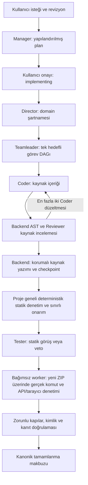

# 📖 XFactor — A'dan Z'ye Kapsamlı Kullanım ve Operasyon Kılavuzu

Geliştirmenin geçmişten bugüne sıralı özeti için [Faz Arşivi](docs/faz-arsiv.md) dosyasını okuyun; P0–P9 ile Ekim Faz 1–4 dizileri burada ayrı adlandırılarak tek zincirde gösterilir.

Depo bakımı, modülerleştirme ve son kod sadeleştirmeleri için [Mimari Yol Haritası](docs/faz-arsiv.md#mimari-fazlar) ve [Faz 4 Tamamlanma Raporuna](docs/faz-arsiv.md#mimari-faz-4) bakın. Kullanıcı verileri ve üretilen projeler bu temizlikte korunur.

Manager sohbetinde yanıt oluşturma, kısa LLM bağlantı testinden daha uzun sürebilir.
Sohbet isteği genel API çağrılarının 15 saniyelik frontend sınırıyla kesilmez;
Etkin profilin yanıt süresi sınırı geçerlidir (yeni profilde varsayılan 120 saniye; 5–300 saniye arasında ayarlanır). Etkin profil yoksa `LLM_TIMEOUT_MS` ortam ayarı, o da yoksa 60 saniye kullanılır. Yanıt beklerken
aynı mesajı tekrar göndermeyin. Profil testindeki “Başarılı” sonucu kısa test
isteğinin o anda çalıştığını gösterir; tüm üretim isteklerinin başarı garantisi değildir.

Bu kılavuz, **XFactor Otonom AI Ajan Orkestrasyon Platformu**'nun çalışma mantığını, mimari bileşenlerini, arayüz kullanımını ve adım adım uçtan uca yazılım üretim süreçlerini tüm detaylarıyla açıklamaktadır.

---

## 📑 İÇİNDEKİLER

1. [Genel Bakış ve Mimari Felsefe](#1-genel-bakış-ve-mimari-felsefe)
2. [Sistem Gereksinimleri ve İlk Kurulum](#ilk-kurulum)
3. [Ajan Rolleri ve Hiyerarşik Görev Dağılımı (6 Seviye)](#3-ajan-rolleri-ve-hiyerarşik-görev-dağılımı-6-seviye)
4. [Uçtan Uca Kullanım Adımları (A'dan Z'ye)](#4-uçtan-uca-kullanım-adımları-adan-zye)
   - [Adım 1: Güvenli Giriş Yapma (Authentication)](#guvenli-giris)
   - [Adım 2: Yeni Proje Başlatma](#yeni-proje)
   - [Adım 3: Manager ile Beyin Fırtınası ve Planlama (Zaman Damgalı Sohbet)](#adım-3-manager-ile-beyin-fırtınası-ve-planlama-zaman-damgalı-sohbet)
   - [Adım 4: Mimari Planı Onaylama ve Canlı Revizyon (`pending_approval`)](#plan-onayi)
   - [Adım 5: Canlı ReactFlow DAG Akışını ve Log Tablosunu İzleme](#canli-izleme)
   - [Adım 6: Canlı Müdahale, Duraklatma ve Kaldığı Yerden Devam Etme (`Pause / Resume`)](#adım-6-canlı-müdahale-duraklatma-ve-kaldığı-yerden-devam-etme-pause--resume)
   - [Adım 7: Doğrulanmış Projeyi ZIP Olarak İndirme](#zip-indirme)
5. [Yan Menü Proje Yönetimi ve İşlem Menüsü (`...`)](#proje-menusu)
6. [Dosya-Bazlı Koordinasyon Protokolü ("Agent = Klasör")](#6-dosya-bazlı-koordinasyon-protokolü-agent--klasör)
7. [Üretilen Projeyi Bilgisayarınızda Çalıştırma Kılavuzu](#7-üretilen-projeyi-bilgisayarınızda-çalıştırma-kılavuzu)
8. [Test Süiti ve Otomasyonun Çalıştırılması (`npm test`)](#8-test-süiti-ve-otomasyonun-çalıştırılması-npm-test)
9. [Sıkça Sorulan Sorular (SSS) ve Sorun Giderme](#9-sıkça-sorulan-sorular-sss-ve-sorun-giderme)
10. [Geliştirici Rehberi: Kod Tabanı Analizi ve Bilgi Grafiği (Graphify)](#10-geliştirici-rehberi-kod-tabanı-analizi-ve-bilgi-grafiği-graphify)
11. [Ana Kalite Kapıları ve Ek Zorunlu Kontroller (Politika 2.0)](#11-18-zorunlu-kalite-kapısı-ve-temiz-oda-doğrulama-sistemi-politika-20)
12. [Üretim İşletimi, Güvenlik ve Yedekleme](#uretim-operasyon)
13. [Bağımsız Yerel Worker Paketi](#yerel-worker-paketi)
14. [ZIP Yaşam Döngüsü, Envanter ve Karantina](#zip-yasam-dongusu)

---

## 1. Genel Bakış ve Mimari Felsefe

Geleneksel yapay zekâ kodlama araçları genellikle tek bir prompt ile tüm uygulamayı tek seferde yazmaya çalışır; bu durum halüsinasyonlara, eksik dosyalara ve kırık bağımlılıklara yol açar.

**XFactor**, bu sorunu iki güçlü dünya standardını birleştirerek çözer:
1. **`msitarzewski/agency-agents` (Uzmanlaşmış Rol Kütüphanesi & Living Docs):** Her rol kendi uzmanlık alanındaki işi yapar. Altı rolün istemi, `x-agents/ORKESTRASYON-TALIMATNAMESI.md` tam metni ile ilgili rol Markdown'ından oluşur. Üretim rolleri modül yüklenirken önbelleğe alınır; politika değişiklikleri planlı backend yeniden başlatması gerektirir. Manager sohbeti istemi yeniden okur. Beş protokol şablonu insan rehberidir; gerçek kayıtları backend üretir.
2. **`coleam00/Archon` (Deterministik DAG Dalga Motoru & Dark Factory):** Tüm görevler matematiksel bir **Yönlü Döngüsüz Çizge (DAG)** yapısında dalgalar (`Execution Waves`) halinde çözülür. Bağımsız görevler paralel çalışırken bağımlı görevler önkoşulları bekler.



Domainler ve takımlar sırayla yürütülür; yalnız aynı takımın bağımsız DAG görevleri en fazla ikili çalışır. Her LLM rolü tam ortak anayasa ve kendi rol talimatını alır. Dosyaları backend yazar; model onayı çalışma kanıtı değildir. Worker yerel profilde ayrı süreç ve iş dizini kullanır; OS izolasyonu Docker profilinden ayrıdır.

29 Ekim 2026 mimari yol haritası (`Faz 1–4`) kapsamındaki 28 bulgu giderimi, Tanrı Modüllerin 7 yeni alt modüle ayrıştırılması ve doğrulama kanıtları [Mimari Yol Haritası](docs/faz-arsiv.md#mimari-fazlar), [Faz 1](docs/faz-arsiv.md#mimari-faz-1), [Faz 2](docs/faz-arsiv.md#mimari-faz-2), [Faz 3](docs/faz-arsiv.md#mimari-faz-3), [Faz 4](docs/faz-arsiv.md#mimari-faz-4) raporlarında ve [Graphify bilgi notunda](graphify-out/graphify-bilgi-notu.md) yer alır.

---

<a id="ilk-kurulum"></a>

## 2. Sistem Gereksinimleri ve İlk Kurulum

### Sistem Gereksinimleri
- **İşletim Sistemi:** Windows, macOS veya Linux
- **Node.js:** v22.23.2 ve npm v10.9.8; CI ve Docker bu sürümleri kullanır. Bun için yardımcı komutlar bulunur, ancak üretim doğrulaması Node.js üzerinde yapılır.
- **İnternet Bağlantısı:** Seçtiğiniz LLM sağlayıcısının API adresine erişim için

### 1. Adım: Yapılandırma Dosyasını Hazırlama
İlk açılış `backend/.env.example` dosyasından yerel `backend/.env` dosyasını otomatik oluşturur. Özel ayar yapacaksanız önceden kendiniz kopyalayıp düzenleyebilirsiniz:

```bash
# Windows
cd backend
copy .env.example .env

# macOS / Linux
cd backend
cp .env.example .env
```

Özel ayar gerektiğinde `.env` dosyasını düzenleyin. Varsayılan içerik şöyledir:
```env
PORT=8000
# Kimlik doğrulama anahtarı veya yönetici parolası .env içinde tutulmaz.
ALLOWED_ORIGINS=http://localhost:5173,http://127.0.0.1:5173
ALLOW_MOCK_FALLBACK=false
EXECUTION_WORKER_TOKEN=dev-worker-token-internal
EXECUTION_WORKER_URL=http://127.0.0.1:8099
READINESS_WORKER_TIMEOUT_MS=2000
```

İlk açılışta XFactor her kurulum için ayrı rastgele `LLM_CONFIG_ENCRYPTION_KEY` üretir ve yerel `backend/.env` dosyasına kaydeder; komut çalıştırmanız veya anahtarı elle yazmanız gerekmez. Sağlayıcı API anahtarını, adresini ve modelini `.env` içine koymayın; yönetici oturumuyla **LLM Yönetimi** sayfasında profil olarak kaydedin. Profil dosyası `backend/data/llm-profiles.json` konumunda şifreli tutulur ve Git dışında kalır. Şifreleme anahtarı kaybolur fakat şifreli profiller durursa XFactor yeni anahtar üretmek yerine kurtarma isteyerek açılışı durdurur. `.env` ve profil dosyasını birlikte güvenli biçimde yedekleyin.

### 2. Adım: Bağımlılıklar ve Varsayılan Giriş Hesabı
```bash
# Backend bağımlılıkları
cd backend
npm install
cd ..

# Frontend bağımlılıkları
cd frontend
npm install
cd ..
```

> 🔑 **Hazır Varsayılan Giriş Hesabı:**  
> Geliştirmede XFactor, kullanıcı oluşturma komutu gerektirmeden otomatik tanımlanan bir yönetici hesabıyla gelir:
> - **Kullanıcı Adı:** `admin`
> - **Şifre:** `xfactor`
> 
> Giriş alanları boş açılır; varsayılan bilgileri elle girin. Üretimde (`NODE_ENV=production`) bu hesap oluşturulmaz. Hiç yönetici yoksa ya da bir yönetici hâlâ `xfactor` parolasını kullanıyorsa backend açılmayı reddeder ve izlenecek `create-admin` komutunu hatada gösterir.

#### (Opsiyonel) Yönetici Parolasını Değiştirme veya Sıfırlama
Parolanızı dilediğiniz zaman terminalden güncelleyebilirsiniz (asgari 6 karakter):
```bash
cd backend
npm run create-admin -- admin            # yeni yönetici ekler
npm run create-admin -- admin --renew    # mevcut parolayı doğrulayıp yenisiyle değiştirir
npm run create-admin -- admin --reset    # unutulan parolayı sıfırlar
cd ..
```
### 3. Adım: Uygulamayı Başlatma

#### ⭐ Seçenek A: Kök Dizininden Tek Komutla Başlatma (Önerilen)
Backend ve frontend bağımlılıklarını kurduktan sonra proje kökünde yerel araçları hazırlayın. Normal `npm run dev` platformun üç servisini Docker olmadan başlatır:
```bash
npm run worker:local:setup -- --install
npm run dev
```

| Port | Servis | Açıklama |
|:---:|---|---|
| **`5173`** | **Frontend (Vite / React)** | **Kullanıcı Paneli:** Tarayıcınızda açtığınız ana ekran (`http://127.0.0.1:5173`). |
| **`8000`** | **Backend (Web Orchestrator)** | **Yönetim Beyni:** REST API, SQLite veritabanı, WebSocket telemetrisi ve 6 yapay zekâ ajanı. |
| **`8099`** | **Execution Worker** | **Bağımsız Derleyici/Test İşçisi:** Seçilen yerel veya Docker profilinde gerçek kalite kontrollerini yürütür. Yerel profil OS izolasyonu sağlamaz. |

> ℹ️ **Önemli Not:** `8099` portu doğrudan kullanıcıların tarayıcıdan gezinmesi için değil; Backend'in Bearer token (`EXECUTION_WORKER_TOKEN`) ile izole kod çalıştırma işlerini devrettiği korumalı bir iç servistir. Tarayıcıdan girildiğinde `{"error":"Unauthorized"}` dönmesi bu güvenlik önleminin gereğidir.

> Backend'in `GET /healthz` adresi yalnız süreç canlılığını gösterir. `GET /readyz`, Worker'ın `prepare_dependencies` ve `verify_artifact` kapasitesini de denetler. `READINESS_WORKER_TIMEOUT_MS` temel varsayılanı `2000` ms'dir; yerel geliştirme başlatıcısı ayar verilmemişse `35000` ms kullanır. Açıkça verilen değer korunur; örnekteki `2000` değerini ayarlarsanız daha uzun yerel varsayılan uygulanmaz. Worker gerçek Chromium başlatma ve sayfa çizimini de sınar; soğuk başlangıç bu süreyi aşabilir. Hazır olmayan worker için HTTP 503 döner. `8099` portunda 401 görmek yalnız yetki denetiminin yanıtıdır, hazır olma kanıtı değildir.

> Depoda ayrı bir `start-project.ps1` betiği yoktur; Windows'ta da kök dizindeki `npm run dev` komutunu veya aşağıdaki ayrı terminal adımlarını kullanın.
#### Seçenek B: Ayrı Terminallerde Başlatma
* **1. Terminal (Backend):**
  ```bash
  cd backend
  npm run dev
  ```
  > Backend sunucusu `http://127.0.0.1:8000` adresinde hazır olacaktır.
* **2. Terminal (Frontend):**
  ```bash
  cd frontend
  npm run dev
  ```
  > Tarayıcınızda `http://127.0.0.1:5173` adresine giderek uygulamayı kullanmaya başlayabilirsiniz.
* **3. Terminal (Execution Worker):**
  ```bash
  node execution/server.js
  ```
  > Kökteki `npm run dev` varsayılan olarak Docker olmadan yerel profili seçer; `npm run dev:local` aynı akıştır. Docker için `npm run dev:docker` kullanın. Bu doğrudan worker komutu ayrı runtime yapılandırması gerektirir; [paketli yerel worker](#yerel-worker-paketi) alternatifini de kullanabilirsiniz. Ayrı başlatmada backend ve worker URL/token ayarlarını eşleştirin. Worker, `http://127.0.0.1:8099` adresinde yalnız yetkili backend isteklerini kabul eder.

> [!CAUTION]
> **Production / VPS Uyarısı:** VPS veya sunucu ortamında backend'i (`8000`) doğrudan internete açmayınız. TLS sonlandırması ve `X-Forwarded-Proto: https` başlığı sağlayan bir Reverse Proxy (Caddy, Nginx vb.) kurunuz. Oturum çerezlerinin güvenliği için HTTPS zorunludur.

---

## 3. Ajan Rolleri ve Hiyerarşik Görev Dağılımı (6 Seviye)

| Ajan Rolü | Unvan | Sorumluluk Kapsamı | Canlı Kural Dosyası |
|---|---|---|---|
| **Manager** | Baş Mimar & Proje Yöneticisi | Boss ile görüşür, gereksinimleri netleştirir, mimariyi çizer, domainlere böler ve Prisma/SQLite projelerinde `.env.example` güvencesini şartnameye bağlar. | `x-agents/manager.md` |
| **Director** | Domain Direktörü | Kendisine atanan domainin teknik mimarisini, kütüphane ve bileşen standartlarını belirler. | `x-agents/director.md` |
| **Teamleader** | Takım Lideri | Direktörün şartnamesini atomik DAG görevlerine böler. **Katı Tek Dosya Atomik Limit (`targetFiles.length === 1`)** kuralını uygular. | `x-agents/teamleader.md` |
| **Coder** | Yazılım Geliştirici | Kendisine verilen atomik görevi alır, hedef dosyaları eksiksiz kodlar. **Bileşen Kompozisyonu** (`@/components` import etme) kuralını uygular. | `x-agents/coder.md` |
| **Reviewer** | Kaynak Kod İnceleme | Üretilen kaynak hakkında yapılandırılmış onay veya geri bildirim verir. Backend önce sözdizimini denetler; ilk çıktıdan sonra en fazla iki Coder düzeltmesine ve toplam üç incelemeye izin verir. Onay yoksa görev **VETO** edilir. | `x-agents/reviewer.md` |
| **Tester** | Statik Kalite İncelemesi | Backend'in hazırladığı manifesto, kabul koşulları ve deterministik denetim özetinden JSON tavsiye/ret üretir. Dosya çalıştırmaz; build, runtime veya ZIP kabul kanıtı üretmez. Onarım döngülerini ve `RAPOR.md`/`README.md` yazımını backend yönetir. | `x-agents/tester.md` |

Bu altı LLM rolünden sonra **bağımsız execution worker** gerçek komutları ve API/tarayıcı kontrollerini çalıştırır. Tamamlanma için zorunlu kapıların geçerli kanıtı ve kalıcı makbuz gerekir. Domainler ve Teamleader'lar sıralı dolaşılır; paralellik takımın DAG dalgası içindeki en fazla iki göreve uygulanır. Bu roller bağımsız kabuk yetkili süreçler değildir; dosya ve durum işlemlerini backend gerçekleştirir.

---

## 4. Uçtan Uca Kullanım Adımları (A'dan Z'ye)

<a id="guvenli-giris"></a>

### Adım 1: Hızlı ve Güvenli Giriş Yapma (Authentication)
1. Tarayıcınızda `http://127.0.0.1:5173` adresini açın.
2. README'deki varsayılan bilgileri (**admin** / **xfactor**) boş giriş alanlarına yazın.
3. **Giriş Yap** butonuna tıklayarak yönetim paneline erişebilirsiniz. Tarayıcı 24 saatlik HttpOnly sunucu oturumu kullanır; credential `localStorage` içinde tutulmaz.

### Adım 1a: LLM Sağlayıcı Profillerini Yönetme

1. Yönetici oturumunda sol menüden **LLM Yönetimi** sayfasını açın (`/llm`). Sayfa ve `/api/llm` yalnızca yöneticiye açıktır.
2. Sağlayıcıyı seçin; önerilen API temel adresi ve model kimliğini gerektiğinde elle değiştirin. API anahtarını girip **Profili kaydet** düğmesine basın. **Düzenle** sırasında anahtarı boş bırakırsanız mevcut anahtar korunur.
3. **Bağlantıyı sına** gerçek model çağrısı yapar. Son testin başarılı/başarısız sonucu ve zamanı profil kartında saklanır. Bu, test anının kanıtıdır; sağlayıcının sürekli erişilebilir olduğunu garanti etmez. Profil düzenlenince sonuç temizlenir.
4. Kullanmak istediğiniz pasif profilin **Etkinleştir** düğmesine basın. Aynı anda yalnızca bir profil etkindir; seçili profil üst özette görünür ve kartındaki düğme **Etkin** olarak kapalıdır. Manager sohbeti ve üretim ajanları yeni çağrılarda bu profili kullanır. Etkin profili silerseniz seçili profil kalmaz.

Ayrıntılı kurulum, Xiaomi MiMo örneği ve başka Express uygulamasına taşıma için [LLM yönetimi kılavuzuna](backend/llm-auth/LLM-YONETIMI.md) bakın.
<a id="yeni-proje"></a>

### Adım 2: Yeni Proje Başlatma ve Disk Senkronizasyonu
1. Sol panelin üst kısmında yer alan `+` (Yeni Proje) butonuna tıklayın.
2. Açılan uygulama içi formda **Proje başlığı** alanını doldurun ve **Proje Oluştur** düğmesine basın (Örn: `araba-kiralama-otomasyonu`). Tarayıcının yerel prompt penceresi kullanılmaz. Boş başlık ve çift gönderim engellenir; hata olursa başlık korunarak tekrar deneyebilirsiniz. Oturum kapandığında form kapanır.
3. Proje listesinde projeniz `PLANNING` durumunda belirecek ve ana dizindeki `projects/<proje_id>` klasörüne fiziksel olarak oluşturulacaktır.
4. **Disk Senkronizasyonu:** Backend açılışta `projects/` dizinindeki geçerli, kayıt dışı klasörleri güvenli biçimde keşfeder; web arayüzünün (`App.jsx`) açılışı ise kendiliğinden disk senkronizasyonu tetiklemez. Arayüzdeki global **Senkronize Et** işlemini yalnız yönetici kullanıcılar çalıştırabilir; normal kullanıcı isteği veritabanına dokunmadan HTTP 403 alır. Diskten canlandırma (`reconciliationService.js`) yalnızca kanonik durum makinesindeki (`PROJECT_STATUS`) geçerli durumları kabul eder, `completed` durumu için geçerli tamamlama makbuzu (`completion_receipts`) ile doğrulanmış (`verified`) ZIP artefaktını zorunlu tutar ve sözleşme şemasını (`requirements` dizisi dahil) denetler. Diskte bulunmayan bir klasör veritabanı kaydının veya ZIP'in otomatik silinmesine yol açmaz. Senkronizasyon kaynak klasörleriyle ZIP envanterini birlikte raporlar ve önceden günlüğe alınmış bekleyen karantina işlemlerini tekrar dener; yeni saklama adaylarını kendiliğinden karantinaya almaz. Test runner ve ortak izole DB yardımcısı DB, kaynak, ZIP ve çöp köklerini geçici test dizinlerine ayırır. Önceki doğrudan test çalıştırmalarından kalan dosyalar yeni envanterde ayrıca görülebilir.

### Adım 3: Manager ile Beyin Fırtınası ve Planlama (Zaman Damgalı Sohbet)
1. Proje seçildiğinde doğrudan **Manager Sohbet Paneli (`ChatView`)** açılır.
2. Manager'a geliştirmek istediğiniz uygulamayı doğal dilde anlatın:
   > *"Bana modern TailwindCSS kullanan, Next.js 14 App Router ve Prisma SQLite destekli bir Araba Kiralama ve Rezervasyon Sistemi oluştur."*
3. Manager projenin kapsamını, kullanılacak modelleri (Car, Reservation, User) ve mimariyi sizinle olgunlaştırır.
   - Uygulama kalıcı kayıtlar veya operasyonel işlemler içeriyorsa Manager, siz istemeseniz de yönetim ekranlarını, kaynak başına işlemleri, oturum açmayı ve rolleri önerir. Öneri sohbet ve onaylanacak planda görünür. Yönetim gerekmiyorsa gerekçesini belirtir.
   - Her rolün izinli ve yasak işlemleri ile geliştirme/test için ayrı demo hesabı planda yer alır. Herkese açık kayıt olup olmayacağını ayrıca kararlaştırın; kayıt yükseltilmiş yetki vermez.
4. **Hata teşhis bağlamı:** Duraklatılan veya hata alan projede Manager'a *"Neden durdu?"* diye sorabilirsiniz. Backend son hata, sınırlı loglar ve uygun `RAPOR.md` kayıtlarını temizlenmiş veri olarak Manager'a verir. Kayıtlarda dosya/satır veya kök neden yoksa bunun bilinmediği belirtilmelidir; Manager'ın çalışan dosyalara sınırsız erişimi yoktur. Model açıklaması bağımsız test kanıtı değildir.

<a id="plan-onayi"></a>

### Adım 4: Mimari Planı Onaylama, Sürümlü Sözleşme ve Canlı Revizyon (`pending_approval`)
1. Manager'ın yapılandırılmış planı doğrulandığında sistem `pending_approval` durumuna geçer. Sadece “plan hazır” metni veya etiket bu durumu oluşturmaz. Eksik sözleşme bir kez otomatik düzeltilmeye çalışılır; başarısızsa eksik alan açıklanır ve üretim başlamaz.
2. **Sürümlü Yazılım Sözleşmesi (`PROJECT_CONTRACT`):** Sistem arka planda `project_contracts`, `requirements` ve `contract_tasks` tablolarına değişmez bir sözleşme revizyonu ve SHA-256 sözleşme özeti (`contract_hash`) kaydeder.
3. Sohbetin üstünde **"Mimari Plan Hazırlandı — Onayınız Bekleniyor"** kartı belirir. Tam şartname, gereksinimler, roller ve kayıt politikalarını **Planın kapsamını ve kabul kriterlerini incele** bölümünden açabilirsiniz; sohbet uzun JSON'u tekrar göstermez.
4. **"Planı Onayla ve Başlat"** düğmesi veya **“varsayımlarla devam et” / “planı onaylıyorum”** mesajı aynı güvenli onay akışını çalıştırır. Sözleşme onaylanır (`status = approved`), proje `implementing` durumuna geçer ve DAG motoru başlar. Bekleyen geçerli plan tekrar üretilmez; tekrarlanan onay ikinci yürütme oluşturmaz. Yalnız proje sahibi veya yönetici üretimi başlatabilir. Olumsuz ifadeler, sorular ve kapsam değişikliği içeren mesajlar otomatik onay sayılmaz.

   **Taslağı reddetme:** Onay kartındaki **"Taslağı Reddet"** düğmesi bekleyen taslağı `rejected` olarak işaretler; reddedilen taslak bir daha onaylanamaz. Proje duraklatılmışken bekleyen bir taslak varsa sohbetin üstünde ayrı bir taslak kartı görünür ve aynı düğme oradan da kullanılabilir. Ret yalnız proje sahibine açıktır ve onay ister. Manager sohbeti ya da bir yürütme sürerken reddedilemez; taslak bu arada değiştiyse `409 CONTRACT_DRAFT_STALE` döner. Onaylı sözleşme, checkpoint'ler ve üretilmiş kaynaklar değişmez. Proje `pending_approval` durumundaysa onaylı sözleşmesi varsa `paused` durumuna, yoksa `planning` durumuna döner. Sohbete ret kaydı düşer. Uç: `POST /api/projects/:id/contracts/:revision/reject` (gövde: `{ contractId }`).
5. **Sohbetten Canlı Revizyon ve Hükümsüz Kılma (Supersession):** Duraklatılmış (`paused`), hata almış (`failed`, `verification_failed`, `capability_blocked`) veya doğrulama sonrası (`runtime_verified`, `acceptance_verified`, `artifact_verified`) durumundaki bir projede sohbete girip *"Şu modeli ekle"* dediğinizde Manager yeni bir sözleşme taslağı oluşturabilir; sözleşme yayını eski gereksinimleri `superseded`, eski checkpoint'leri `invalidated` olarak işaretler ve onay akışını açar. Durum geçişinin de izinli olması gerekir; `completed` güncel durum makinesinde terminaldir, sohbetten yeniden onaya geçiş desteklenmez. Aynı projede eşzamanlı sohbet istekleri çakışma kilidiyle (`409 CHAT_ALREADY_IN_PROGRESS`) korunur.

   **Hata kurtarmada kapsam kaybı engeli:** “Yeni plan hazırla” eski zorunlu işlerin kaldırılması demek değildir. Onaylı zorunlu iş gereksinimlerinin kimlik ve ifadeleri korunur; AuthProvider, seed veya lint gibi onarımlar yeni gereksinimler olarak eklenir. Yönetim kaynaklarının işlemleri, okuma/saklama politikası ve mevcut rol izinleri de korunur; geçerli fixture ve tarayıcı seçicileri düzeltilebilir. Model kapsamı düşürürse sunucu tek düzeltme turu ister; sonuç hâlâ eksikse yeni plan yayımlanmaz. Eski eksik kurtarma taslağını onaylamak `409 MANAGER_PLAN_SCOPE_CHANGED` döndürür; yeni yürütme başlatılmaz. Sohbet ekranı onaylı/taslak ifadelerini karşılaştırır, onay düğmelerini kapatır; **Kapsamı tamamla** düğmesi eksikleri geri isteyen mesajı giriş kutusuna hazırlar. Mesajı inceleyip gönderin. Taslak hazırlamak mevcut proje raporunu silmez. Hata bulunmayan, elle duraklatılmış projede açıkça istenen özellik değişikliği normal revizyon akışında önerilebilir.
<a id="canli-izleme"></a>

### Adım 5: Canlı ReactFlow DAG Akışını ve Süreç Loglarını İzleme (4 Ayrı Sekme)
1. Proje başladığında üst menüdeki 4 bağımsız sekme arasında serbestçe gezinebilirsiniz:
   - **💬 Sohbet & Mimari (`chat`):** Manager ile konuşma, canlı düşünce animasyonu (`Sparkles & Bouncing Dots`) ve otomatik bitiş/müdahale bildirimleri.
   - **📊 Kalite Paneli (`dashboard`):** Doğrulama koşularının durumunu ve her kontrolün makine kanıtını gösterir. Yönetim projelerinde rol girişleri, rol bazlı izinli/reddedilen CRUD işlemleri ve yönetim ekranı etkileşimleri ayrı satırlarda görünür.
   - **📊 Canlı DAG Grafiği (`flow`):** Ekranın tamamını kaplayan, çakışmasız ve kompakt 2 sütunlu hiyerarşik ağaç grafiği.
   - **📜 Canlı Süreç Logları (`logs`):** Arama kutusu, `ERROR` / `VETO` / `FEEDBACK` filtreleri ve anlık bağlantı durumu içeren tam sayfa log izleme ekranı.

Yeni proje açıldığında ilk ekran Sohbet & Mimari olur. Kalite Paneli üstte amacını, kullanım sırasını ve `PASS`/`FAIL`/`BLOCKED` durumlarını açıklar. Solda en yeni doğrulama koşusundan başlayarak geçmişi seçin; sağda kontrollerin neyi sınadığını ve sonucunu görün. Bir kontrole tıklayınca kayıtlı sonuç açıklaması, zorunluluk, çıkış kodu, zaman, SHA-256 çıktı özetleri ve gizli bilgiler temizlenmiş `stdout`/`stderr` kayıtları açılır. Panel salt okunurdur; geçmişi değiştirmez.

Panel açıkken geçmiş ve seçili koşunun kanıtları 15 saniyede bir yenilenir. En güncel koşuyu takip ediyorsanız yeni koşu otomatik seçilir; geçmişten özellikle seçtiğiniz koşu, açık log ve yüklenmiş eski sayfalar korunur. Bir geçmiş isteği sürerken eski sayfaları yükleme düğmesi kısa süreliğine bekler; proje değiştirdiğinizde önceki projenin geciken yanıtları ekrana taşınmaz.

Log ekranı ve DAG, veritabanındaki en yeni 500 olay ile canlı WebSocket olaylarını zaman sırasına göre birleştirir. Yeniden yükleme sırasında aynı olay iki kez gösterilmez; diskten kurtarılan tamamlanmış görev kayıtları mevcut olay geçmişine eklenir.

#### Sohbette Kalıcı Aksiyon Denetim İzi

İşlem butonlarından yapılan başarılı aksiyonlar da normal kullanıcı/Manager mesajları gibi proje sohbetine eklenir:

- **İş akışı:** `Planı Onayla ve Başlat`, `Projeyi Devam Ettir (Resume)` ve `Süreci Duraklat` işlemleri, gerçekleşen durum geçişinin hemen ardından kanonik mesaj çifti oluşturur.
- **Yardımcı işlemler:** Disk senkronizasyonu, `Pin / Unpin` ve doğrulanmış `Download ZIP` işlemleri, yalnızca başarıyla tamamlandıktan sonra açıklayıcı mesaj çifti oluşturur.
- **Yenileme ve proje değiştirme:** Bu kayıtlar tarayıcı belleğindeki geçici bildirimler değildir. Sayfayı yenilediğinizde veya başka bir projeye geçip geri döndüğünüzde sohbet geçmişi veritabanından yeniden alınır ve aynı sırada görünür.
- **Hata davranışı:** Yetki, durum, senkronizasyon veya artefakt doğrulama hatasında işlem başarısız olur ve başarı mesajı yazılmaz; mevcut arayüz hata bildirimi (uyarı, banner veya konsol teşhisi) kullanılır.
- **İdempotency:** Aynı ağ isteği aksiyon kimliğiyle tekrarlandığında kayıtlar çoğaltılmaz. Özellikle onay ve devam etme geçişleri idempotenttir; ayrı ve başarılı yardımcı buton tıklamaları ayrı aksiyonlar olarak kaydedilir.

**Projeyi Sil (`Delete`) bu kapsama dahil değildir.** Silme, proje ve ilişkili sohbet geçmişini birlikte kaldırdığı için silinen projenin sohbetine kalıcı “silindi” mesajı yazılmaz.

### Adım 6: Canlı Müdahale, Duraklatma ve Kaldığı Yerden Devam Etme (`Pause / Resume`)

1. Süreç devam ederken üst barda bulunan **"⏸️ Süreci Duraklat"** butonuna tıklayabilirsiniz.
2. Proje `paused` durumundaysa ve hata yeni Manager revizyonu gerektirmiyorsa üst bardaki, sohbet bildirim şeridindeki veya süreç logları ekranındaki yeşil **Devam Ettir (Resume)** butonuyla kaldığı yerden devam ettirebilirsiniz. `Worker repair requires Manager revision` hatasında Resume gizlenir; API de yeni bir başarısız girişim oluşturmadan `409 MANAGER_REVISION_REQUIRED` döndürür. Önce Manager ile kayıtlı hataları değerlendirin. **Yalnız Yeniden Doğrula** mevcut üretimi değiştirmeden yeni kontrol yapar; hataları onarmaz ve eski açık onarım kayıtlarını çözmez. Yeni bir plan revizyonunu onaylamak görevleri ve kaynakları yeniden üretebilir; mevcut çalışmayı korumak istiyorsanız bunu onarım yapılmış gibi onaylamayın. Salt “düzelteceğim” yanıtı plan veya uygulanmış onarım değildir.
3. Statik denetim/Tester reddinde proje `verification_failed` olur. Worker reddi veya iş akışı istisnası, kalıcı başarısız doğrulama koşusu korunarak workflow hata yolunda `paused` durumuna alınabilir; proje durumu ile koşu sonucu farklı kayıtlardır. Kapı adları ve kaydedilmiş nedenler sohbet, süreç logları ve Kalite Paneli üzerinden incelenir. `artifact_verified` durumunda son hata kaydı varsa ve Manager revizyon engeli yoksa da **Devam Ettir (Resume)** görünür. İş akışı hata bildirimi arayüzü Sohbet sekmesine taşır; düzeltme veya revizyon için kayıtlı nedeni inceleyin. Manager son koşunun hata nedeni ve sınırlı stdout/stderr kesitlerini görür; yalnız durum özetiyle tahmin yürütmesi beklenmez. Çok büyük sözleşme veya kontrol listesi kısaltıldıysa bağlamda açıkça belirtilir.

   Mimari değişikliği ile hata onarımını ayırın: mevcut Next.js çıktısı ile Vite isteği çelişirse motor kaynak dosyalara dokunmadan durur. Aynı projede onarım için mevcut yığını koruyan revizyon hazırlayın; farklı mimariyi ayrı projede üretin. Yeni React + Express kapsamlarında iskelet varsayımı Vite web ve ayrı API servisidir.
4. **Diskteki görevlerden kurtarma:** Manager `TODO.md` ve `DURUM.md` dosyaları korunur. Director'ın `ALT-TALIMATNAME.md` dosyası ve Teamleader planları varsa yeniden kullanılır; görevlerin `GOREV.md` dosyasındaki tek hedef dosya ve açıklama geri yüklenir. Disk senkronizasyonu mevcut canlı olayları silmeden, yalnızca tamamlandığına ilişkin kanıtı bulunan eksik görev loglarını DAG'a ekler.
5. **Checkpoint koruması:** Motor aynı onaylı sözleşmeye ait görev checkpoint'lerini plan, bağımlılık ve fiziksel dosya kanıtıyla denetler. Açık kabul onarım kaydı varsa uygun tamamlanmış görevleri yeniden kullanabilir; reddedilmiş veya kanıtsız görevleri bitmiş saymaz. Yeni sözleşme revizyonu eski checkpoint'e dayanmaz.

#### Log ekranında kaldığınız yeri izleme

- **İşlerin son durumu:** Varsayılan görünüm, yüklenmiş kayıtlardan her iş için son durumu gösterir. Gerçek bir tekrar yürütme **Yeniden çalıştırılıyor** olarak görünür; bitmemiş işler tamamlandı sayılmaz.
- **Son çalışma kayıtları:** Son yürütmenin olaylarını gösterir. Önceki yürütmelerin olayları bu akışa tekrar eklenmez.
- **Yüklenen kayıt geçmişi:** Yüklenmiş olayların tümünü incelemek ve hata araştırmak içindir. Görünümler kayıtları silmez veya ajan çağrısı başlatmaz; henüz yüklenmemiş geçmiş kayıtları kapsamaz.

**Devam Ettir** sırasında motor aynı sözleşme, plan, görev kapsamı, bağımlılık girdileri, hedef dosya içerikleri ve kalite kapısı sürümü için geçerli checkpoint bulursa o işin Coder/Reviewer çağrılarını atlar. Dosyası veya kapsamı değişmiş, reddedilmiş ya da checkpoint'i bulunmayan işler yeniden çalışabilir. Log satırları tek başına tamamlanma kanıtı değildir.

Yeni bir Reviewer onayından sonra aynı dosyalar tekrar üretilse bile checkpoint kaydı yenilenebilir. Kalıcı kayıt oluşmadan görev tamamlandı gösterilmez. Checkpoint okuma/yazma hatasında süreç durur; veritabanı veya disk sorunu giderildikten sonra **Devam Ettir** kullanılmalıdır. Depo erişim hatası otomatik olarak baştan üretime dönüşmez. Duraklatma anında devam eden ve checkpoint'i henüz kaydedilmemiş iş için tekrar çalışma gerekebilir; tüm token tüketiminin sıfırlanacağı garantisi verilmez.

Tüm üretim görevleri tamamlandıktan sonra motor `generationCompletion` aşama kaydını oluşturur. **Devam Ettir**, kayıttaki sözleşme kimliği, sözleşme SHA-256 özeti ve plan SHA-256 özeti güncel onayla eşleşirse tamamlanan Coder/DAG üretimini atlar. Mevcut kaynak düzeltmeleri korunur; genel devam yolunda statik denetim, Tester incelemesi, bağımlılık hazırlığı ve gerçek worker kontrolleri yeni ZIP için yürütülür. Aşağıdaki worker onarım yolunda kaynağa bağlı, tamamlandığı kesin olarak kaydedilmiş inceleme/worker sonuçları tekrar çağrı yapılmadan kurtarılabilir. Aşama kaydı çalışma zamanı doğrulaması yerine geçmez; eski kalite sonuçları yeni kaynak için başarı kanıtı olarak taşınmaz. Plan veya sözleşme değiştiğinde normal görev üretimine dönülür. Üretim tamamlanmadan önceki dosya değişiklikleri ise yukarıdaki checkpoint kurallarına tabidir.

#### Worker reddinden sonra onarım veya revizyon

Kalite Paneli'nde başarısız koşunun nedenini ve kaydedilmiş kontrol logunu inceleyin. Uzun komut çıktısı (ör. test süiti) kayıtta kesilirse çıktının ilk ve son yarısı tutulur, araya `…[kesildi: N bayt]…` işareti girer; hata özeti genellikle sondadır. Kesilmiş çıktı tam kanıt sayılmaz. **Devam Ettir**, yalnız normal tamamlanmış derleyicinin tam TypeScript ürün bulgularını, reddedilen kaynakla eşleşen ve tek sahibi belli olan dosya için otomatik onarıma yönlendirir. Coder yalnız o dosyayı değiştirebilir; ardından taze kaynak denetimi, Reviewer ve Tester kabulü ile yeni bağımsız worker kanıtı gerekir. Patch'in yazılması veya modelin “başarılı” demesi indirme yetkisi vermez.

Onarım çağrıları başlamadan kalıcı olarak rezerve edilir. Dosya sahibi/hedef başına en fazla iki değişen girdi denemesi vardır; aynı kaynakta tüketilmiş veya sonucu belirsiz çağrı yeniden ücretli denemeye çevrilmez. Kaynakla bağlı başarılı incelemeler ve tamamlanmış yeni worker kanıtı kaydedilmişse kurtarma bunları yeniden çağrı yapmadan kullanabilir.

Bağımlılık kurulumunda (`npm ci`) geçici bir ağ/registry hatası (ör. 502/503/504, `ECONNRESET`, `ETIMEDOUT`) olursa worker komutu bir kez yeniden dener. Yine olmazsa kontrol "altyapı" nedeniyle BLOCKED kalır, hiçbir kapı PASS sayılmaz ve kayıt Manager revizyonu istemez; **Devam Ettir** ve **Yalnız Yeniden Doğrula** açık kalır, yeni koşu başlayınca eski altyapı kaydı çözülür. Docker profilinde de aynı yeniden deneme ve sınıflandırma çalışır (Docker adaptörü sıfırdan farklı çıkışta hata fırlatır; doğrulayıcı bunu başarısız sonuca çevirir, zaman aşımı ve `SANDBOX_UNAVAILABLE` hariç). Kurulumun 15 dakikalık süre sınırına takılması (`Command timed out`) yeniden denenmez ve kaynak hatası sayılır; yavaş bir ağda bu, altyapı sorununu kaynak hatası gibi gösterebilir. Docker'ın yanıt vermemesi veya erişilememesi nedeniyle hiçbir komut çalışmadan kapanan doğrulama da aynı şekilde altyapı hatası sayılır ("Worker altyapı hatası nedeniyle doğrulama tamamlanamadı…"); Docker Desktop'ın açık olduğunu kontrol edip **Yalnız Yeniden Doğrula** kullanın. `ERESOLVE`, `ETARGET`, `E404` ve `EINTEGRITY` gerçek bağımlılık hatasıdır; yeniden denenmez ve eskisi gibi başarısız sayılır. Diğer altyapı/bağlantı hatası, zaman aşımı, eksik veya çakışan sahiplik, dışarıdan kaynak değişikliği ya da tükenmiş bütçe **Manager revizyonu gerektirir**. Hata sürerken tekrar tekrar Resume kullanmak yerine kaydedilmiş nedeni Manager'a iletip plan/sözleşme revizyonunu inceleyin ve onaylayın. Onarım geçmişini veya başarısız kanıtı silerek sınırı aşmaya çalışmayın.

Kurtarılan görevler sözleşme/domain/takım/görev kimliğiyle ayrılır; iki takımın `task-1` kaydı aynı iş sayılmaz. Metadata okumaları symlink/junction, proje dışı yol ve dosya başına 2 MiB sınırıyla korunur. Eski ve yeni checkpoint anahtarının çakışması `CHECKPOINT_IDENTITY_CONFLICT` üretirse geçmiş kanıtı silmek yerine yeni onaylı sözleşme revizyonuyla ilerleyin.

Yalnız tarayıcı kabul adımlarını değiştirmek istiyorsanız bunu Manager'a açıkça belirtin. Alanla sınırlı revizyon, onaylı sözleşmeye bağlı olarak yalnız `browser.roleJourneys` alanını günceller; diğer gereksinimler ve rol izinlerini değiştirmez. Eski sözleşmeye dayanan veya başka alanlar içeren güncelleme reddedilir. Yeni taslak tekrar onay bekler. Sohbet mesajları 4000 karakterle sınırlıdır; uzun planı yeniden yapıştırmak yerine değişecek adımları iletin. Geçersiz veya aşırı büyük mesajlar için gösterilen hata LLM bağlantı hatası değildir.

<a id="zip-indirme"></a>

### Adım 7: Doğrulanmış Projeyi ZIP Olarak İndirme
1. Tüm ajanlar görevlerini bitirdiğinde süreç hemen tamamlandı sayılmaz. Bağımsız temiz oda doğrulayıcısı (`artifactVerifier`) devreye girer:
   - Sunucu tarafında ZIP arşivi oluşturulur ve disk SHA-256 özeti hesaplanır (`artifacts`).
   - Arşiv, worker'ın ayrı temiz iş dizininde açılarak ana kalite kapıları ve sözleşmeye bağlı ek zorunlu kontrollerle doğrulanır. Temel politika 18 ana kapı içerir; toplam zorunlu kanıt satırı sayısı bu sayıyla sınırlı değildir. Docker profili container izolasyonu sağlar; `local-trusted` profili OS izolasyonu sağlamaz. Zorunlu kontrolün atlanması `BLOCKED` sayılır; yalnızca isteğe bağlı ve uygulanamayan kontrol `NOT_APPLICABLE` olabilir. Servis manifesti ve kaynak dosyalarından uygun API veya tarayıcı denemeleri belirlenir; Prisma şemasında `User` modeli varsa seed edilen kullanıcılar da denetlenir.
   - Yönetim uygulamalarında API denemeleri yetkili rolün kayıt oluşturma, okuma, güncelleme ve silme davranışını; oturumsuz ve yetkisiz rolün reddini; ilişkili kayıtların onaylı saklama kuralını sınar. Tarayıcı akışlarında tıklama, form, görünür sonuç, erişilebilir ad ve dar ekran kanıtı gerekir. Worker güvenilir etkileşim adaptörü sağlayamazsa bu kapı `BLOCKED` olur ve ZIP doğrulanmış olarak sunulmaz.
   - Tüm kontroller eksiksiz PASS olduğunda `completeVerifiedProject` fonksiyonu atomik bir CAS işlemiyle projeyi `COMPLETED` yapar ve `completion_receipts` tablosuna değişmez denetim makbuzu yazar.
2. Doğrulama tamamlandığında üst bardaki **📥 Projeyi (ZIP) İndir** butonuyla sunucuda doğrulanmış ve hash'i eşleşen temiz ZIP paketini bilgisayarınıza indirin. Doğrulanmamış veya diskteki hash'i uyuşmayan hiçbir dosya indirilemez (409 Fail-Closed). Kaynak kodları indirdiğiniz ZIP içinde inceleyebilirsiniz; sohbet ekranında ayrı bir kod editörü açılmaz. Örnek bir proje veya raporun varlığı, o projenin ZIP'inin teslim edilmeye hazır olduğunu göstermez; ilgili paketin güncel kanıtını kontrol edin.
3. Worker hatası normal akışta yerel geliştirme doğrulamasına çevrilmez. Benzer biçimde `DURUM.md` veya `state.json` içindeki tarihsel “tamamlandı” bilgisi PASS kanıtı sayılmaz: disk kurtarma ZIP'i yeniden oluşturabilse bile artefakt `built` ve indirilemez kalır; geçerli Worker koşusu olmadan proje doğrulanmış sayılmaz.

Manager'ın bitiş mesajındaki **Kaydedilen token kullanımı**, projeyle ilgili planlama, üretim, inceleme ve onarım çağrıları için yapay zekâ sağlayıcısının bildirdiği giriş ve çıkış tokenlarının toplamıdır. Sağlayıcı bazı çağrılarda kullanım verisi vermezse mesaj yalnız bilinen **en az** toplamı ve eksik çağrı sayısını söyler. Eski projelerin daha önce kaydedilmemiş kullanımı sonradan hesaplanamaz. Token sayısı ücret hesabı değildir.

<a id="proje-menusu"></a>

## 5. Yan Menü Proje Yönetimi ve İşlem Menüsü (`...`)

Sol kenar çubuğunda her proje kartının yanında üç nokta (`...`) işlem butonu yer alır:
- 📌 **Başa Sabitle / Sabitlemeyi Kaldır (`Pin / Unpin`):** Projeyi listenin en üstüne sabitler veya sabitlemeyi kaldırır.
- ⬇️ **Projeyi (ZIP) İndir (`Download ZIP`):** Tamamlanmış (`COMPLETED`) projeleri doğrudan yan menüden doğrulanmış ZIP paketi olarak bilgisayarınıza indirir.
- 🗑️ **Uygulamayı Kaldır / Projeyi Sil (`Delete`):** Normal silme işlemi, doğrulanmış teslim makbuzu bulunan projeleri korur ve silme isteğini reddeder. Silinebilen projenin kaynak klasörü çöp akışıyla kaldırılır; ilişkili ve hash'i doğrulanmış merkezi ZIP'ler `backend/data/artifacts/.quarantine/` altına taşınmak üzere kalıcı DB günlüğüne alınır. Varsa, kayıtlı bir artifact ile aynı hash'e sahip `projects/<proje-id>.zip` teslim kopyası `projects/.artifact-quarantine/` altına alınır. Özel kökler kullanılıyorsa karantina ilgili kökün altında tutulur. Taşıma tamamlanamazsa işlem `pending` kalır ve tekrar denenir; karantinadaki ZIP kalıcı olarak silinmez.

> **Not:** Diskte fiziksel klasörü bulunmayan projeler yan menüde `(Diskte Bulunamadı)` uyarısıyla gösterilir. Önce klasörün taşınmadığını ve diskin erişilebilir olduğunu kontrol edin. Bu uyarı silme onayı değildir. Tarihsel kalite sonucu başarılı kalabilse de fiziksel ZIP eksikse indirme açılmaz; uygulama paketin bulunamadığını ayrıca bildirir.

### ZIP envanteri ve bakım

Depo kökünde `node backend/scripts/artifact-maintenance.js` yalnızca envanter okur; dosya taşımaz, DB şemasını değiştirmez. Bakım operatörü önce güncel backend'i bir kez açarak migration 16'yı uygulatmalı, sonra backend ve worker'ı durdurmalıdır. `node backend/scripts/artifact-maintenance.js --quarantine --offline` uygun adayları karantinaya alır. `--orphans-only` yalnız yeni aday seçimini kayıt dışı ZIP'lerle sınırlar; önceden günlüğe alınmış bekleyen işlemler de tekrar denenebilir. Çalışan workflow varsa CLI bakım yazımını reddeder; `--offline` servisleri kendisi durdurmaz.

Makbuzla korunmayan `rejected`/`superseded` paketler oluşturulmalarından 7 gün sonra, kayıt dışı ZIP'ler son dosya değişikliğinden 24 saat sonra aday olabilir. Adaylık otomatik silme değildir. Ayrıntılar ve mevcut eksik dosyaların sınırları: [Proje ve ZIP yaşam döngüsü](#zip-yasam-dongusu).

---

## 6. Dosya-Bazlı Koordinasyon Protokolü ("Agent = Klasör")

Backend her rol ve görev için aşağıdaki klasörlerde protokol kayıtları tutar. LLM rolleri bu klasörlerde bağımsız süreç veya dosya aracıyla çalışmaz; okuma, yazma ve durum geçişlerini merkezi backend gerçekleştirir. Klasör ayrımı OS izolasyonu sağlamaz:

```text
projects/<proje_id>/
├── manager/                        # Manager Ajanı ve Tüm Ajan Hiyerarşisi
│   ├── TALIMATNAME.md              # Ana Mimari Şartname
│   ├── TODO.md                     # Manager Seviyesi Görev Çizelgesi
│   ├── DURUM.md                    # Anlık İlerleme Durumu
│   ├── GOREV.md                    # Manager Misyonu
│   │
│   ├── frontend.director/          # Frontend Direktörü
│   │   ├── ALT-TALIMATNAME.md      # Frontend Mimari Şartnamesi
│   │   ├── TODO.md
│   │   └── frontend.teamleader/    # Frontend Takım Lideri
│   │       ├── TODO.md             # Atomik Görevler DAG'ı
│   │       └── task-1-setup-ui/    # Coder Görev Klasörü (GOREV, DURUM, RAPOR)
│   │
│   └── backend.director/           # Backend Direktörü
│       └── backend.teamleader/
│
├── src/                            # Üretilen Temiz Uygulama Kaynak Kodları (app/layout.tsx, app/page.tsx, components, lib)
├── prisma/                         # schema.prisma & seed.ts
├── .env.example                    # Güvenli örnek yapılandırma şablonu
├── Dockerfile                     # Üretilen Projeye Özel Çok Aşamalı Konteyner Dosyası
├── .dockerignore                  # Docker İmajına Girmeyecek Dosyalar Listesi
├── package.json                    # Yığına göre paket politikası; kesin sürümler worker'ın ürettiği package-lock.json içindedir
├── tsconfig.json                   # Path Alias (@/* -> ./src/*) Konfigürasyonu
├── tailwind.config.ts              # Stil Yapılandırması (darkMode: 'class')
├── service-manifest.json           # Otomatik Üretilen Servis & Port Sözleşmesi
├── README.md                       # Otomatik Üretilen Kurulum & Çalıştırma Rehberi
└── RAPOR.md                        # Backend'in yazdığı inceleme raporu; tek başına runtime kabul kanıtı değildir
```
---

## 7. Üretilen Projeyi Bilgisayarınızda Çalıştırma Kılavuzu

Projenizi ZIP olarak indirdikten veya `projects/<proje_id>` klasörünü açtıktan sonra:

### 1. Adım: Bağımlılıkları Kurun
```bash
npm install
```

### 2. Adım: Veritabanını Oluşturun (Prisma ORM)
> `.env.example` dosyasını `.env` olarak kopyalayıp `NEXTAUTH_SECRET` değerini uzun rastgele bir anahtarla değiştirmeniz gerekir:
```bash
npx prisma generate
npx prisma db push
```

### 3. Adım: (Opsiyonel) Örnek Verileri Yükleyin
```bash
npx prisma db seed
```

### 4. Adım: Uygulamayı Başlatın
```bash
npm run dev
```

### 5. Adım: (Alternatif) Docker ile Tek Komutla Çalıştırma
XFactor, ürettiği her projeye bir **`Dockerfile`** ve **`.dockerignore`** ekler. ZIP'i çıkardığınız uygulama klasöründe, `.env.example` dosyasından kendi `.env` dosyanızı hazırladıktan sonra:
```bash
docker build -t projem .
docker run --rm -p 3000:3000 --env-file .env projem
```
`docker run` komutunu yalnızca `docker build` başarıyla bittikten sonra çalıştırın. Build hata verirse yerel imaj oluşmaz; sonraki `pull access denied` mesajı bunun ikincil sonucudur. Next.js projelerinde `public/` klasörü bulunmasa da güncel Dockerfile bu klasörü derleme aşamasında hazırlar. Önceden indirilmiş bir pakette `COPY . .` satırından sonra `RUN mkdir -p public` satırı yoksa paketin Dockerfile dosyasını güncelleyin veya yeni üretilen paketi indirin. Uygulamanın veritabanı kurulumu ve kalıcı veri gereksinimleri için paketin kendi README dosyasını da izleyin.

Başarılı başlatmadan sonra tarayıcınızda `http://localhost:3000` adresini açın.

---

## 8. Test Süiti ve Otomasyonun Çalıştırılması (`npm test`)

Çekirdek motorlar, güvenlik (CSP, HSTS, rate limiter), RFC 6238 TOTP/MFA, asenkron scrypt doğrulaması, HTTP/WebSocket entegrasyonu, DAG dalgaları, concurrency havuzu, derleyici sınırları (`tsc`, `prisma`), deterministik kalite kapıları, alt süreç kontrolleri, mevcut veritabanı migration'ları, log saklama temizliği ve liveness/readiness probları için backend süitini çalıştırın. Bir testin mock kullanması veya ortam nedeniyle atlanması gerçek derleyici/worker çalıştırma kanıtı sayılmaz; yerel worker entegrasyonu ayrıca çalıştırılır:

```bash
cd backend
npm test
```

Frontend, üretim build'i ve Execution Worker süitlerini ayrıca çalıştırın:

```bash
npm --prefix frontend run test:unit
npm --prefix frontend run build
npm --prefix execution test
```

Docker’sız gerçek worker entegrasyonu için `npm run test:local-worker`, bağımsız paket kabulü için `npm run test:local-worker-package -- --bundle dist/local-worker` çalıştırın. Bunlar gerçek kurulum/build/test, SQLite/API ve Chromium rol yolculuklarını doğrular. Docker izolasyon entegrasyonu ayrı bir testtir ve çalışan Docker daemon gerektirir; Docker kapalıysa açıkça `BLOCKED` raporlanır.
Docker kurulu geliştirme ortamında `npm --prefix backend run test:docker:artifact` komutu temsilî Express ve Next projelerinin son ZIP'inden build ve ilk HTTP yanıtını doğrular. Bu test gerçek kullanıcı projesinin ZIP'ine otomatik uygulanmaz; onu ayrıca doğrulanmış kabul etmeyin.

## 9. Sıkça Sorulan Sorular (SSS) ve Sorun Giderme

### S: `error: Environment variable not found: DATABASE_URL` hatası alırsam ne yapmalıyım?
**C:** XFactor'ın güncel sürümünde `.env.example` dosyası üretilir ve ZIP paketine eklenir; `.env` dosyasını siz oluşturup `NEXTAUTH_SECRET` ile `DATABASE_URL` gibi değerleri doldurmalısınız.

### S: Manager ile konuşurken "Mesaj iletilemedi, lütfen tekrar deneyin" hatası alıyorum, nedeni nedir?
**C:** Önce **LLM Yönetimi** sayfasındaki etkin profili ve son bağlantı testini kontrol edin. Profilin API anahtarı, adresi ve model kimliği aynı sağlayıcıya ait olmalıdır; profili değiştirdiyseniz yeniden sınayın. Son testin başarılı görünmesi yeni bir çağrının mutlaka geçeceği anlamına gelmez. İşletim sistemi veya kısıtlı kurumsal ağ ortamlarında Node.js harici API adresini çözemeyebilir; `backend/networkResolver.js` `ENOTFOUND` durumunda IPv4 çözümlemesine düşer. Sorun sürerse ağ, DNS veya proxy ayarlarını kontrol edin.

### S: LLM profilinde “Bağlantı testi başarısız” görürsem ne yapmalıyım?
**C:** Sağlayıcı adresini, model kimliğini ve API anahtarını kontrol edip **Bağlantıyı sına** düğmesini yeniden kullanın. MiMo Pro gibi düşünme kullanan modeller için test yeterli çıkış bütçesi ayırır; sağlayıcı metin üretmeden token sınırına ulaşırsa bunu ayrı bir hata olarak bildirir. Profil kartındaki sonuç yalnızca son test anını gösterir. Test başarılıysa ve profili üretimde kullanmak istiyorsanız pasif kartın **Etkinleştir** düğmesine basın.

### S: LLM çıktısı token sınırına takılırsa veya Reviewer veto ederse ne olur?
**C:** XFactor'da `finishReason === 'MAX_TOKENS'` kontrolü ve Teamleader'ın "Sayfaları ve büyük UI bileşenlerini atomik alt parçalara bölme" kuralı bulunur. Backend ilk Coder çıktısından sonra en fazla iki düzeltmeye ve toplam üç Reviewer incelemesine izin verir. Onay alınamazsa görev reddedilir ve backend akışı `paused` durumuna alır. Bu durumda sohbetten Manager'a hatayı sorabilir veya üst bardaki **"Devam Et (Resume)"** butonuyla kurtarma kontrollerini başlatabilirsiniz; bu işlem başarı garantisi değildir.

### S: Tamamlanmış veya duraklatılmış bir projeyi sohbetten değiştirebilir miyim?
**C:** Evet. Tamamlanmış, duraklatılmış (`PAUSED`) veya doğrulama hatası almış (`VERIFICATION_FAILED`) bir projede sohbet paneline girip revizyon istediğinizde (örn: *"1"*, *"baştan başla"*, *"şunu ekle"*); Manager yeni mimari şartnameyi hazırlar, yeni bir sözleşme revizyonu açar ve sohbetin altında yeşil **"Planı Onayla ve Başlat"** onay kartını sunar. Onayladığınızda otonom motor yeni plan doğrultusunda temiz üretime geçer.

### S: Log ekranındaki hataları nasıl yorumlamalıyım?
**C:** Log ekranında Türkçe hata kategorileri (`[Hata] LLM Kota ve Bütçe Sınırı Aşıldı`, `[Hata] Bağımlılık Hazırlığı Başarısız`, `[Süreç Hatası]`) gösterilir. Bağımlılık hazırlığı ve doğrulama worker'a devredilir. `dev:local` kullanıyorsanız eksik Node/npm/Chromium araçlarını, paket bütünlüğünü ve backend-worker token eşleşmesini [yerel paket kılavuzuyla](#yerel-worker-paketi) kontrol edin; hazır olma hataları üretimi engeller. Docker profilini seçtiyseniz Docker daemon ve `docker build -t xfactor-worker-runtime execution` ile hazırlanan imaj gerekir.

### S: 8099 portu nedir? Tarayıcıdan açtığımda neden `{"error":"Unauthorized"}` hatası alıyorum?
**C:** XFactor, **ayrı worker mimarisi** ile çalışır. Yapay zekânın yazdığı kodların derlenmesi (`tsc`), paketlenmesi (`npm install`) ve çalıştırılması **Execution Worker (`8099`)** servisinde yürütülür. Docker profili container izolasyonu sağlar; `local-trusted` profili ayrı iş dizinleri ve süreç temizliği kullanır ancak kod mevcut kullanıcı yetkileriyle çalışır, OS izolasyonu sağlamaz.
- Bu port Backend ile Worker arasındaki Bearer token ile kimlik doğrulanan API'dir. HTTP tek başına trafiği şifrelemez; farklı makineler arasında TLS kullanın. Üretimde operatöre özel worker token zorunludur.
- Tarayıcınızla doğrudan bu porta istek attığınızda, sistem güvenlik amacıyla isteği reddeder ve `{"error":"Unauthorized"}` cevabı döner.
- Kullanıcının bu portu doğrudan ziyaret etmesi gerekmez. İş akışı olayları Loglar ve DAG ekranlarında izlenir; Kalite Paneli koşu/kanıt geçmişini 15 saniyede bir yeniler ve seçilen kontrolün temizlenmiş kayıtlarını açar. Ham worker terminal çıktısı, WebSocket iş akışı olaylarıyla aynı akış değildir.

---

## 10. Geliştirici Rehberi: Kod Tabanı Analizi ve Bilgi Grafiği (Graphify)

XFactor kod tabanını genişletmek, yeni bir ajan eklemek veya mevcut mimari bağımlılıkları görselleştirmek isteyen geliştiriciler için aşağıdaki analiz araçları ve yöntemleri önerilir:

### 1. Kod Tabanı Bağımlılık Haritası
Proje içindeki modüller arasındaki bağımlılık ilişkileri deterministik olarak şu katmanlara ayrılmıştır:
- **API & Sunucu Katmanı:** `server.js` ➔ `routes/projectRoutes.js` (ve alt yönlendiricileri `routes/projectObservabilityRoutes.js`, `routes/projectTraceabilityRoutes.js`) ➔ `sessionAuth.js` / `security.js`
- **Orkestrasyon & DAG Motoru:** `engine/workflow.js`, yardımcıları (`engine/workflowSupport.js`), aşama modülleri (`engine/stages/qualityStage.js`, `engine/stages/repairStage.js`, `engine/stages/acceptanceStage.js`, `engine/stages/verificationStage.js`), `engine/dag.js` ile dalgaları ve `engine/fileProtocol.js` ile kayıtları yönetir; şablon üretimi `engine/codeGenerator.js` üzerinden `engine/templates/dockerTemplates.js` ve `engine/templates/prismaTemplates.js` modüllerine ayrılmıştır.
- **Kaynak İncelemesi:** `engine/workflow.js` ➔ `engine/selfCorrection.js` (ve `@babel/parser` AST tabanlı `engine/buildValidator.js`) ➔ Reviewer ve gerektiğinde Coder düzeltmesi.
- **Statik Kalite:** `engine/workflow.js` ➔ `engine/stages/qualityStage.js` ➔ `engine/stages/repairStage.js` ➔ `agents/tester.js` içindeki AST/deterministik denetim yardımcıları ve ayrı Tester LLM çağrısı.
- **Çalıştırılmış Kabul Kanıtı:** `engine/workflow.js` ➔ `engine/stages/acceptanceStage.js` ➔ `verification/verificationCli.js` ➔ `verification/artifactVerifier.js` ➔ `executionClient.js` ➔ bağımsız worker.
- **Veri Kalıcılığı & İzolasyon:** `projectRepository.js` ➔ `db.js`; 18 aşamalı şema göçü (migration) tanımları `db/migrations.js` modülündedir (`db.js` üzerinden de dışa aktarılır) ve tek-yazar kira doğrulaması `workflowAttempts.js` (`assertWorkflowLease`) ile birleştirilmiştir.

### 2. Bilgi Grafiği (Graphify) ile Mimari Görselleştirme ve Analiz
XFactor, kaynak dosyalarını AST ile tarayan; elle tanımlı mimari ilişkileri de ekleyen yerel bir **Graphify Bilgi Grafiği Motoru** (`backend/scripts/generate_graph.js`) barındırır. Dinamik query parçaları rota yolundan ayrılır; ham Node HTTP Worker rotaları ve `backend/executionClient.js` istekleri `requests_route` ilişkileriyle eşleştirilir. `npm run graph` haritayı her seferinde güncel kaynak koddan yeniden üretir.

#### Grafiği Üretme ve Güncelleme:
Kök dizinde tek bir komutla tüm bilgi grafiğini ve görsel HTML haritalarını tazeleyebilirsiniz:
```bash
npm run graph
```

Bu komut çalıştığında `graphify-out/` dizini altında şu zengin çıktılar üretilir:
1. **`graphify-out/graph.json`:** Dosya, sınıf, fonksiyon, metot, paket, HTTP rota/istek ve ortam değişkeni adı düğümleri ile statik import/çağrı ve mimari bağlantılar. Ortam değişkeni değerleri kaydedilmez.
2. **`graphify-out/graph.html`:** Arama ve ilişki süzgeçleriyle seçilen düğümün komşuluğunu gösteren etkileşimli harita; tüm bağlantılar sağdaki listede bulunur.
3. **`graphify-out/GRAPH_TREE.html`:** Taranan tüm kaynak ve belge yollarından üretilen aranabilir dosya ağacı.
4. **`graphify-out/GRAPH_REPORT.md`:** Güncel düğüm ve ilişki türlerinin sayıları ile statik analiz sınırları.

#### Çekirdek Odak Düğümleri ("God Nodes"):
Güncel bağlantı sıralaması için her `npm run graph` çalıştırmasından sonra `graphify-out/GRAPH_REPORT.md` dosyasına bakın. Bağlantı sayısı gerçek çalışma sıklığı veya güvenlik ölçüsü değildir.

---

### 3. Ön Yüz (Frontend) Dosya ve Bileşen Mimarisi Tablosu

XFactor kullanıcı arayüzü React 18, TailwindCSS ve Vite üzerine inşa edilmiş olup aşağıdaki modüler bileşenlerden oluşur:

| Dosya / Yol | Türü / Katman | İşlev ve Mimari Sorumluluğu |
|---|:---:|---|
| `frontend/src/App.jsx` | Ana Koordinatör | React uygulamasının kök bileşenidir. Kimlik durumu kontrolü, WebSocket canlı telemetri dinleyicisi, reaktif `useEffect` DAG türetimi, proje seçimi, hata banner'ı ve sekmelerin orkestrasyonunu yürütür. |
| `frontend/src/components/Sidebar.jsx` | Gezinme Menüsü | Sol proje listesi; arama çubuğu, durum rozetleri (`verification_failed`, `capability_blocked` dahil), başa sabitleme (`Pin`), tamamlanan projeler için doğrulanmış ZIP indirme butonu, yöneticiye özel disk senkronizasyon butonu ve güvenli proje silme işlemlerini barındırır. |
| `frontend/src/components/CreateProjectDialog.jsx` | Proje Oluşturma | Tarayıcının `prompt()` penceresi yerine uygulama içi ad formu, klavye/fokus yönetimi ve doğrulama hataları sunar. |
| `frontend/src/components/Header.jsx` | Üst Çubuk | Aktif projenin durumunu (`DOĞRULAMA HATASI` ve `YETENEK ENGELİ` rozetleri dahil), sekme butonlarını (Sohbet, Akış Şeması, Loglar, Kalite Paneli), `paused` / `verification_failed` için devam ettirme eylemini, doğrulanmış ZIP indirme rozetini ve SHA-256 hash özetini sunar. |
| `frontend/src/components/ChatView.jsx` | Sohbet Paneli | Manager (Kıdemli Mimar) ile yapılan gerçek zamanlı sohbet ekranıdır. Beyin fırtınası, şartname oluşturma, plan onaylama (`Planı Onayla ve Başlat`) ve `paused` / `verification_failed` durumlarında devam ettirme veya revizyon taleplerini yönetir. |
| `frontend/src/components/DAGFlowView.jsx` | Canlı Graf | ReactFlow tabanlı canlı DAG (Directed Acyclic Graph) görselleştiricisidir. Görevlerin hiyerarşik durumlarını (`bekliyor`, `çalışıyor`, `tamamlandı`, `veto`) renkli düğümler halinde çizer. |
| `frontend/src/utils/dagLayout.js` | Layout Motoru | 6 gerçek ajan rolünün (`Manager`, `Director`, `Teamleader`, `Coder`, `Reviewer`, `Tester`) ve atomik görevlerin hiyerarşik x/y koordinatlarını hesaplar; WebSocket loglarında `id` olmadığında `created_at` zaman damgasıyla kronolojik sırayı korur ve dummy düğümleri filtreler. |
| `frontend/src/utils/canResumeProject.js` | Devam Ettirme Kuralı | Sohbet, üst çubuk ve log ekranında `paused`, `verification_failed` veya son hata kaydı olan `artifact_verified` durumları için devam ettirme eylemini sağlayan ortak kuraldır. |
| `frontend/src/components/LogsView.jsx` | Canlı Loglar | Orkestrasyon sırasında ajanların ürettiği satır satır tüm terminal ve eylem loglarını gösterir; filtreleme ve devam ettirilebilir projelerde Resume eylemi sunar. |
| `frontend/src/components/DashboardView.jsx` | Kalite Paneli | 18 kalite kapısını ve bağlı ayrıntı kanıtlarını listeler. Açık panelde geçmiş ve seçili koşu 15 saniyede bir yenilenir; seçilen eski koşu, log ve yüklenmiş sayfalar korunur, aynı yenileme çakıştırılmaz. |
| `frontend/src/components/LoginView.jsx` | Giriş Ekranı | Boş kullanıcı adı/parola alanları ve MFA/TOTP adımlarını destekleyen kullanıcı giriş panelidir. Varsayılan bilgiler README'dedir. |
| `frontend/src/services/api.js` | API İstemcisi | Backend ile iletişim kuran, 24 saatlik HttpOnly oturum çerezi ve CSRF token yönetimini sağlayan, istek zaman aşımı (timeout) korumalı merkezi fetch modülüdür. |

---

### 4. Arka Yüz (Backend) Ana Dizin Dosya Mimarisi Tablosu

`backend/` ana dizinindeki başlıca JavaScript kaynak dosyaları ve rolleri (tam dosya sayımı değildir):

| Dosya Adı | Kategori / Katman | Detaylı İşlev ve Mimari Sorumluluğu |
|---|:---:|---|
| `server.js` | Sunucu / Giriş | REST API ve WebSocket sunucusunu ayağa kaldırır, veritabanını başlatır, geliştirmede `admin/xfactor` kullanıcısını garanti eder, üretimde ise yönetici yokken veya varsayılan parola kullanılırken açılışı reddeder. Diskteki projeleri otomatik senkronize eder. |
| `lifecycle.js` | Yaşam Döngüsü | `SIGINT`/`SIGTERM` anında WebSocket bağlantılarını, HTTP sunucusunu kapatan ve SQLite WAL checkpoint'ini diske yazan zarif kapanma (graceful shutdown) koordinatörüdür. |
| `maintenance.js` | Bakım Zamanlayıcı | Varsayılan olarak saatte bir süresi dolmuş ve yeterince eski iptal edilmiş oturumları veritabanından temizler. |
| `productionStatic.js` | Statik Sunucu | Üretim ortamında Vite ile derlenmiş ön yüz dosyalarını sunar; SPA yönlendirmelerini (`isSpaNavigation`) yönetir. |
| `websocketHub.js` | Gerçek Zamanlı İletişim | Proje bazlı WebSocket odaları yönetir; yapay zekâ kod yazarken logları ve DAG durumlarını ön yüze anında canlı akıtır. |
| `networkResolver.js` | Ağ & DNS Kurtarma | Kurumsal veya kısıtlı ağlarda Node.js varsayılan IPv6 DNS çözümü tıkandığında doğrudan yerel IPv4 (`dns.resolve4`) çözümlemesine düşerek LLM bağlantısını korur. |
| `db.js` | Veritabanı Çekirdeği | SQLite veritabanını WAL modunda açar; `backend/db/migrations.js` içindeki sıralı şema göçlerini (migrations) yürütür ve olay yayıncısını (`dbEvents`) barındırır. Checkpoint aidiyeti migration 17 ile sürümlenir. Migration 18 tablo yeniden kuran migrasyonları FK denetimi kapalıyken çalıştırır ve commit öncesi `foreign_key_check` ile doğrular. |
| `projectRepository.js` | Kanonik Depo | Projelerin oluşturulması, okunması, güncellenmesi ve güvenli silinmesi işlemlerinin tek otoritesidir; başlıktan temiz klasör adı ve kısa numara (`slug-no`) üretir. |
| `workflowAttempts.js` | Kilit & Heartbeat | Bir projede birden fazla motorun aynı anda çalışmasını engellemek için `workflow_attempts` üzerinde kiralama (lease) alır ve çöken süreçleri kurtarır. Kalp atışını `workflowHeartbeatWorker.js` iş parçacığı kendi SQLite bağlantısıyla yazar. Lease kontrolü bir yürütmeyi düşürürse `workflow.lease_check_failed` nedenini ve çağıran kodu, `workflow.heartbeat_write_*` ise bekleyen yazımları loglar. |
| `backupRestore.js` | Yedekleme & Kurtarma | WAL verilerini içeren SQLite snapshot'ını, proje ve artefakt dosyalarını `manifest.json` ile SHA-256 doğrulanan bir dizine yedekler. CLI `--offline` kullanımı öncesinde yazan süreçler durdurulmalıdır; restore artefakt yollarını son hedefe taşır. LLM profil/anahtar dosyaları ayrıca güvenli yedeklenmelidir. |
| `auth.js` | Kimlik & RBAC | Parolaları Scrypt ile tuzlayarak hash'ler; Google Authenticator uyumlu RFC-6238 TOTP üretir ve doğrular; proje sahiplik rollerini (`owner`, `editor`, `viewer`) denetler. |
| `security.js` | Güvenlik Kalkanı | Path traversal sızma girişimlerini, CSRF saldırılarını, güvensiz WebSocket isteklerini ve XSS içeriklerini engeller; CSP, Frameguard ve HSTS başlıklarını ekler. |
| `sessionAuth.js` | Oturum Yönetimi | 24 saat geçerli, HttpOnly ve SameSite nitelikli `xfactor_session` çerezini üretir; `createRequireAuth` middleware'i ile yetkisiz istekleri 401 ile keser. |
| `backend/llm.js` | AI Yönlendirici | Etkin şifreli profili her çağrının başında çözer; Google Gemini, Anthropic ve OpenAI uyumlu sağlayıcı çağrılarını yürütür. |
| `backend/llm-auth/` | LLM Profil Yönetimi | Yöneticiye özel sayfa/API; şifreli anahtar saklama, tek etkin profil, bağlantı testi geçmişi ve düzenlenebilir adres/model alanları. |
| `executionClient.js` | Worker İstemcisi | Bağımlılık hazırlığı ve artefakt testlerini `http://127.0.0.1:8099` portundaki bağımsız Execution Worker servisine Bearer token ile delege eder. |
| `config.js` | Yapılandırma | Çalışma zamanı çevre değişkenlerini doğrular; veritabanı yolları, CORS izin listesi, Worker adres/token bilgileri ve `READINESS_WORKER_TIMEOUT_MS` sınırını standardize eder. |
| `projectPaths.js` | Dosya Yolu Muhafızı | `projects/` kök dizinini yönetir; proje kimlik formatını (`/^[a-zA-Z0-9_-]{3,64}$/`) denetler ve klasör dışına taşma ihlallerini engeller. |
| `artifactPaths.js` | Artefakt Yolu | Kalite kapılarından geçen onaylı ZIP paketlerinin saklandığı `backend/data/artifacts/` dizinini izole eder. |
| `artifactInventory.js` | Paket Envanteri | Proje dosyalarını tarayarak temiz oda testleri için gereken göreceli dosya yollarını ve boyutlarını listeler. |
| `artifactLimits.js` | Boyut Sınırları | Üretilen ZIP dosyalarının maksimum boyutunu (24MB arşiv, 20MB açılmış içerik, 500 dosya sınırı) sabitleyen kuralları içerir. |
| `generatedIdentifiers.js` | İsim Normalizatörü | Yapay zekânın ürettiği domain ve görev isimlerindeki geçersiz karakterleri temizleyerek dosya sisteminde güvenle klasör açılmasını sağlar. |
| `observability.js` | Telemetri & Redaction | Sistemdeki tüm logları yapılandırılmış JSON olarak yazar; loglardaki şifreleri, API anahtarlarını ve token'ları `[REDACTED]` olarak otomatik maskeler. |

---

### 5. Arka Yüz (Backend) Alt Klasör Mimarisi Tablosu

`backend/` altında bulunan 13 işlevsel modül klasörü:

| Klasör Adı | Dosya Sayısı | Katman / Görev | Mimari Sorumluluğu |
|---|:---:|:---:|---|
| `backend/agents/` | Değişken | Yapay Zekâ Rolleri | Altı rol (`manager`, `director`, `teamleader`, `coder`, `reviewer`, `tester`), registry, şema doğrulayıcı (`schemas.js`), anayasa köprüsü (`agentLoader.js`) ve güvenilir belge sınırı (`agentPaths.js`). |
| `backend/db/` | 1 Dosya | Şema Migrasyonları | `migrations.js`: 18 aşamalı versiyonlu SQLite şema migrasyon tanımları, migration 18 değer kümeleri (`MIGRATION_18_VALUES`) ve `columnExists` yardımcısı (`backend/db.js` tarafından yürütülür ve yeniden dışa aktarılır). |
| `backend/engine/` | Değişken | Orkestrasyon Motoru | Master iş akışı (`workflow.js`) ve yardımcıları (`workflowSupport.js`), aşama modülleri (`stages/qualityStage.js`, `stages/repairStage.js`, `stages/acceptanceStage.js`, `stages/verificationStage.js`), şablon üreticileri (`codeGenerator.js`, `templates/dockerTemplates.js`, `templates/prismaTemplates.js`), AST tabanlı `buildValidator.js`, DAG, durum makinesi, kaynak incelemesi, güvenli protokol I/O, nitelikli checkpoint kimliği ve kurtarma yardımcıları. |
| `backend/routes/` | Değişken | REST API Rotaları | Proje CRUD/chat/onay/revizyon (`projectRoutes.js`), gözlemlenebilirlik (`projectObservabilityRoutes.js`), izlenebilirlik ve artefakt indirme (`projectTraceabilityRoutes.js`), auth/session (`authRoutes.js`) denetimleri. |
| `backend/verification/` | Değişken | 18 Kalite Kapısı | Temiz kurulum, derleme, güvenlik ve veritabanı kanıtlarını bağımsız worker'dan alıp zorunlu kapıları doğrulayan Fail-Closed Veto motoru; yerel profil ayrı makine veya OS sandbox gerektirmez. |
| `backend/services/` | 2 Dosya | Senkronizasyon ve ZIP Yaşam Döngüsü | `reconciliationService.js`: kaynak klasörleri keşfeder ve tarihsel durumu doğrulama kanıtı üretmeden yeniden kurar. `artifactLifecycle.js`: ZIP bulunabilirliği, hash/sahiplik denetimi ve kalıcı günlükle kurtarılabilir karantinayı yönetir. Global HTTP senkronizasyonunu yalnız yönetici tetikleyebilir. |
| `backend/contracts/` | Değişken | Sözleşme & İzlenebilirlik | Sürümlü sözleşme, requirement izlenebilirliği, domain politikası ve `taskProjection.js` ile kalıcı görev/sahiplik projeksiyonu. |
| `backend/repositories/` | 2 Dosya | Veri Deposu | Kalite koşuları (`verificationRepository.js`) ve onaylı ZIP paketlerini (`artifactRepository.js`) veritabanına bağlayan veri erişim katmanı. |
| `backend/crypto/` | 1 Dosya | Şifreleme | `mfaCrypto.js`: TOTP gizli anahtarlarını AES-256-GCM ile şifreleyen ve çözen kriptografik modül. |
| `backend/utils/` | 1 Dosya | Arşiv Yöneticisi | `archive.js`: Projeleri güvenli biçimde ZIP paketine dönüştüren ve Zip-Slip saldırılarını engelleyen arşivleme aracı. |
| `backend/scripts/` | Değişken | CLI Araçları | `generate_graph.js` ve `graphSource.js` (Graphify motoru), `create_admin.js` (yönetici parola aracı), `backup.js` & `restore.js` (yedekleme araçları). |
| `backend/data/` | Değişken | Canlı Veri | SQLite veritabanı dosyaları ve Git dışında tutulan şifreli `llm-profiles.json` profil deposu. |
| `backend/tests/` | Değişken | Test Ekosistemi | Gerçek SQLite, dosya sistemi, kriptografi ve AST üzerinde çalışan süitler; güncel çalıştırılabilir liste `testInventory.js` içinde, şablon DB klonlamalı (`XFACTOR_TEMPLATE_DB_PATH`) ve paralel işçi havuzlu (`XFACTOR_TEST_CONCURRENCY`) master koşucu `test_runner.js` içindedir. |

---

### 6. Diğer Kritik Sistem Klasörleri Tablosu

| Klasör / Yol | Katman | Açıklama ve Görevi |
|---|:---:|---|
| `execution/` | Bağımsız Execution Worker | Port `8099` üzerinde çalışan derleme/test servisi. Docker profili container kullanır; açıkça seçilen yerel profil Node/npm/Playwright/Chromium ile Docker olmadan çalışır ve OS izolasyonu sağlamaz. |
| `e2e/` | Playwright E2E Testleri | Sistemin kullanıcı arayüzünü gerçek Chromium tarayıcısı açarak (giriş yapma, TOTP doğrulama, DAG çizimi, gerçek ZIP indirme) uçtan uca test eden senaryo süitleri. |
| `scripts/` | Operasyonel Betikler | `dev.mjs` (tüm servisleri tek komutla başlatan dev koşucusu) ve CI üretim imaj sözleşme test betikleri (`test-p6-production-image.mjs`). |
| `projects/` | Proje Çalışma Alanı | Kullanıcıların ürettiği tüm uygulamaların fiziksel olarak yaşadığı klasör (`projects/<uygulama-adi>-<no>/`). |
| `x-agents/` | Platform Ajan Talimatları & Şablonlar | Orkestrasyon anayasası, altı rol talimatı ve görev/durum/rapor şablonları. Backend sistem istemlerini yalnız sabit ve izinli bu kaynaktan yükler. |
| `docs/` | Geliştirme & İşletim Belgeleri | Operasyon kılavuzları, tasarım/uygulama planları ve inceleme raporları; ajan sistem istemi kaynağı değildir. |

<a id="ic-ve-teshis-api"></a>

### İç ve teşhis API'si

Aşağıdaki uçlar arayüzde hiçbir ekrandan çağrılmaz. Çalışır durumdadırlar ve testlerle korunurlar; operatör teşhisi, betikler ya da ileride eklenecek ekranlar için ayrılmıştır. Hepsi oturum çerezi ister ve proje üyeliğiyle sınırlıdır; durum değiştiren uçlar ayrıca CSRF başlığı (`x-xfactor-csrf`) gerektirir. Yanıt şekilleri `backend/routes/observabilityShapes.js` içinde tanımlıdır.

| Uç | Yetki | Ne döner |
|---|---|---|
| `GET /api/projects/:id/contracts` | viewer | Sözleşme revizyonları: kimlik, durum, özet ve tarih. |
| `GET /api/projects/:id/repair-issues` | viewer | Onarım kayıtları: önem, durum ve çözülme zamanı. |
| `GET /api/projects/:id/artifacts` | viewer | ZIP artefaktları: tür, SHA-256, boyut, durum ve doğrulama koşusu. |
| `GET /api/projects/:id/metrics/gates` | viewer | Kapı bazında koşu, geçen, kalan, bloke sayıları ve ortalama süre. |
| `GET /api/projects/:id/metrics/stacks` | viewer | Yığın bazında başarı oranı ve ortalama süre. |
| `GET /api/projects/:id/metrics/trends` | viewer | Gün bazında koşu sayısı ve başarı oranı. |
| `GET /api/projects/:id/metrics/failures` | viewer | Redakte edilmiş hata parmak izleri ve tekrar sayıları. |
| `GET /api/projects/:id/requirements/:reqId/impact` | viewer | Bir gereksinimden etkilenen görevler, checkpoint'ler ve dosyalar. |
| `POST /api/projects/:id/verify` | owner | Yalnız `implementation_finished` ya da `verification_pending` durumundaki projede doğrulama başlatır; diğer durumlarda 409 döner. |

Arayüzün kullandığı uçlar `frontend/src/services/api.js` içindedir. Yukarıdaki listeye yeni bir ekran bağlanırsa uç bu tablodan çıkarılmalıdır.

<a id="11-18-zorunlu-kalite-kapısı-ve-temiz-oda-doğrulama-sistemi-politika-20"></a>

## 11. Ana Kalite Kapıları ve Ek Zorunlu Kontroller (Politika 2.0)

XFactor'de yapay zekâ ajanının *"Kusursuz tamamlandı"* demesi projeyi tamamlamaya yetmez. Aşağıdaki liste **18 ana politika kapısını** gösterir; bütün zorunlu kontrollerin veya kanıt satırlarının toplamı değildir.

30 Ekim 2026 kaynak denetiminde `backend/verification/qualityPolicy.js:MANDATORY_GATES` ile `backend/projectRepository.js:P4_MANDATORY_GATES` kümelerinin aynı 18 adı içerdiği koddan hesaplanmıştır. Yönetim gereken sözleşmelerde `artifactVerifier.js:isMandatoryArtifactCheck`, ana listede olmayan rol/CRUD/kalıcılık/tarayıcı kontrollerini de `MANDATORY` yapar. `artifactEvidencePolicy.js:assertManagementCoverage` bunları rol, kaynak, işlem ve silme politikasına göre ayrıca zorunlu tutar. Eksik, başarısız, kanıtsız veya OPTIONAL'a düşürülmüş yönetim kaydı tamamlamayı/indirmeyi engeller. Aynı kontrol adı farklı roller ve kaynaklar için birden çok satır üretebilir; toplam sayı yalnız ilgili koşunun `verification_checks` kayıtlarından belirlenir.

Örneğin `execution/tests/localRoundtrip.integration.test.js`, örnek sözleşmesi için 28 ayrı kontrol adının başarıyla üretilmesini bekler; bu sayı tüm projeler için sabit toplam veya 28 ana kapı demek değildir. Test dosyasındaki beklentiyi okumak, gerçek worker entegrasyonunun o anda çalıştırılıp geçtiğini de kanıtlamaz.

| # | Kalite Kapısı | Doğrulama Mekanizması ve Kuralı |
|---|---|---|
| 1 | `package_json` | Bağımlılıkların biçim, sürüm ve çakışma kontrolü. İskele bilinen paketler için uyumlu sürüm haritası kullanır, açıkça belirtilen sürümü korur; tüm paketler için genel bir `^1.0.0` yasağı yoktur. |
| 2 | `lockfile` | Paket yöneticisi kilit dosyasının (`package-lock.json`) varlığı ve tutarlılığı. |
| 3 | `ast_import_inventory` | Kod içinde `import` edilen tüm paketlerin `package.json`'da tanımlı olduğunun AST analiziyle kanıtı. |
| 4 | `clean_install` | Worker'ın ayrı temiz iş dizininde `npm ci` komutunun 0 çıkış koduyla başarıyla tamamlanması; OS izolasyonu seçilen profile bağlıdır. |
| 5 | `typecheck` | Gerçek framework derleyicisi (`tsc --noEmit`) ile tip kontrolü; eksik tip veya kırık export derhal reddedilir. |
| 6 | `framework_build` | Gerçek framework derleme betiğinin (`npm run build`) sandbox içinde başarıyla sonuçlanması. |
| 7 | `requirement_traceability` | Sözleşmedeki her zorunlu gereksinimin (`requirements`) en az bir PASS alan kontrolle kanıtlanması. |
| 8 | `service_manifest` | Frontend/backend port, base URL, proxy ve CORS sözleşmesinin `service-manifest.json` ile çakışmasız yapılandırılması. |
| 9 | `database_verification` | Prisma şemasının (`npx prisma validate`), client üretiminin (`prisma generate`), migration/push (`prisma db push`), tohumlama (`prisma db seed`) ve kullanıcı hesabı varlığının (`prisma_seed_accounts`) izole worker'da doğrulanması. |
| 10 | `api_contract` | Üretilen HTTP API rotalarının gerçek HTTP istekleriyle ve veritabanı yan etkileriyle doğrulanması. |
| 11 | `browser_journey` | Onaylı rol yolculuklarında gerçek tıklama, form doldurma, gönderme ve görünür sonucu etkileşimli tarayıcı adaptörüyle doğrular. Adaptör yoksa zorunlu yönetim yolculuğu `BLOCKED` kalır; sayfa HTML'si tek başına başarı kanıtı değildir. |
| 12 | `smoke_gate` | Projenin bağımsız servis başlatıcı ve sağlık kontrolleriyle uçtan uca ayağa kalktığının doğrulanması. |
| 13 | `test_infrastructure` | Test komutunu izole ortamda çalıştırır; boş, sessiz veya sahte başarı çıktılı test takımlarını reddeder. |
| 14 | `domain_entity_check` | Kullanıcının istediği ana modellerin ve iş akışlarının kod tabanında somut olarak varlığının denetimi. |
| 15 | `placeholder_check` | Sahte kimlik doğrulama, içi boş formlar, işlevsiz butonlar veya stub kodların engellenmesi. |
| 16 | `contamination_check` | Farklı şablonlardan veya alakasız projelerden kalan yabancı metin ve kodların elenmesi. |
| 17 | `security_baseline` | Açık CORS, hard-coded secret, zayıf oturum ve enjeksiyon risklerinin statik ve dinamik denetimi. |
| 18 | `readme_check` | Projede üretilen README.md içindeki kurulum ve çalıştırma komutlarının projeyle birebir uyumu. |

Her kapı, çalıştırılan komutun veya türetilmiş PASS kaynaklarının kanıtını; çıkış kodu, SHA-256 çıktı özetleri (`stdout_digest`, `stderr_digest`) ve ISO UTC zaman damgalarıyla `verification_checks` kayıtlarına yazar. Kanıtı eksik veya sahte olan hiçbir zorunlu kontrol tamamlanma makbuzunu geçemez.
Üretim ve doğrulama sonuçlarını kayıtlı kanıtlarıyla değerlendirin; geçen kapılar ölçtükleri kapsamı kanıtlar, bütün olası kusurların yokluğunu garanti etmez.
## Docker olmadan yerel kalite worker'ı

**Windows çalıştırıcısı:** `spawn UNKNOWN` tek başına uygulama kodunda hata bulunduğunu kanıtlamaz. Önce worker kurulumunu ve işletim sistemi koruma kayıtlarını inceletin. Hazırlık kaydı bulunan yardımcı EXE kaybolmuşsa `LOCAL_HOST_UNAVAILABLE`, dosya özeti değişmişse `LOCAL_HOST_INTEGRITY` ile durulur; otomatik yeniden derleme yapılmaz. Eşzamanlı hazırlıklar kilitle sıralanır; `LOCAL_HOST_BUSY` durumunda yarıda kalmış kurulumu inceletin. Kilit otomatik devralınmaz. Cache, atomik kayıt için hardlink destekleyen bir dosya sisteminde tutulur. Hazırlık kaydı dosyanın imzasını veya zararsızlığını doğrulamaz. Plan onayı kaynakları yeniden üretebileceğinden, çalışma ortamı hatasını uygulama onarımıyla karıştırmayın. 1 Kasım incelemesinin algılama/karantina kanıtı ve kalan işler [faz arşivinde](docs/faz-arsiv.md#halka-29--1-kasım-kaldığı-yer-denetimi-ve-gerçek-başlangıç-hatası) kayıtlıdır.

Platform talimatlarıyla üretilen proje belgelerini karıştırmayın: `x-agents/GOREV.md`, `DURUM.md`, `TODO.md` ve `RAPOR.md` şablondur. Canlı üretim kayıtları `projects/<proje-id>/manager/` ve alt ajan klasörlerinde; uygulamanın README ve `docs/` belgeleri ilgili proje klasöründe bulunur. Backend farklı dizindeki aynı adlı belgeleri sistem talimatı olarak yüklemez. Eksik talimat, geçersiz rol, bağlantılı ajan dosyası veya `x-agents` ile çakışan proje yolu işlemi engeller. [Dosya ayrımı kılavuzu](x-agents/README.md).

Kaynak kurulumu: Node 22.23.2 ve npm 10.9.8 ile `npm run worker:local:setup -- --install`, sonra `npm run dev:local`. İlk komut gözden geçirilmiş backend/execution lockfile'larını kurar ve Chromium indirir; internet bağlantısı gerekir. Linux'ta Chromium sistem kitaplıkları ayrıca sağlanır. Kalite kontrolleri uygulamanın gerçek kurulum, build, test, SQLite/API ve tarayıcı oturumlarını çalıştırır; geçmeyen zorunlu kontroller teslimi engeller.

Kaynak geliştirme başlatıcısının Docker ve yerel profilleri, operatör `VERIFICATION_JOB_TIMEOUT_MS` vermemişse yeni doğrulama işleri için 25 dakika ayırır. Diğer başlatmalarda varsayılan 15 dakikadır; pozitif tam sayı ayar mevcut 25 dakika worker sınırını aşamaz. Daha düşük açık ayar korunur, çalışan işin süresi uzatılmaz. Temiz kurulumun kendi varsayılan sınırı toplam iş sınırı içinde 15 dakikadır; Prisma motorları ilk kez indirilirken doğrulama fazı en çok 5 dakika sürer. Kurulum başarısızsa servis ve davranış testleri başlatılmaz; engellenmiş sonuç başarı sayılmaz. Başlatıcı ayarını değiştirdiğinizde servis grubunu yeniden başlatın.

Yerel worker genel npm registry indirme önbelleğini `os.tmpdir()/xfactor-local-cache/npm` altında işler arasında korur. Her işin kaynakları, veritabanı, HOME, npm ayarları ve günlükleri ayrı hazırlanıp temizlenir; ana bilgisayarın npm kimlik bilgileri aktarılmaz. Son 64 komuta ait aşama, çalıştırıcı adı, süre, çıkış kodu, zaman aşımı/kesilme işaretleri ve çıktı SHA-256 özetleri hata tanısı için saklanabilir; komut argümanları, çıktı metinleri ve ortam değerleri bu kayda alınmaz. Bu tanılama kayıtları kalite kapısı başarısı sayılmaz.

Paketli kullanım: `npm run worker:local:package -- --output dist/local-worker` ile mevcut platformun paketini üretin. Hedefte `start-worker.cmd` (Windows) veya `./start-worker.sh` (Linux/macOS) çalıştırın. Paket kendi araçlarını içerir. Backend URL/token bağlantısı ve sorun giderme için [yerel worker paket kılavuzunu](#yerel-worker-paketi) izleyin. `npm run worker:local -- --bundle dist/local-worker` kaynak Node kuruluysa alternatif başlatma yoludur.

Kalite paneli seçili yerel koşuda `local-trusted · OS izolasyonu yok` bilgisini gösterir. Bu profil güvenilen kod içindir; uygulama mevcut kullanıcının yetkileriyle çalışır. Kullanıcı/admin giriş bilgileri bu değişiklik kapsamında değiştirilmez. Docker imajını test etmek için Docker ayrıca gerekir.

Next.js veya React/Vite arayüzü Express ile birlikte üretildiğinde scaffold web ve API servislerini ayrı tanımlar. Worker bu servisleri ayrı
portlarda başlatır; ikisinin hazır olduğunu doğruladıktan sonra testleri yürütür.
Üretilen `npm run start:services` komutu manifestteki servisleri birlikte çalıştırır;
servislerden biri durursa diğerleri de kapatılır. Karma servis Docker şablonu bu
komutu kullanır. Varsayılan Express scaffold'u açıkça izin verilen arayüz kökenini
kullanır; mevcut uygulama kodundaki CORS hatalarını gizlemez.
Manager'ın yönetim planında her kaynağın gerçek oluşturma/güncelleme verileri
bulunmalıdır. İlişkili kayıtlar için test hazırlığı gerçek API kimliklerini
kullanır; eksik hazırlık veya geçersiz ilişki kalite kontrolünü engeller.
Test girişleri için geçici imza anahtarları yalnız koşu belleğinde oluşturulur;
ZIP'e veya kullanıcı profil ayarlarına yazılmaz.

Worker veya onun içe aktardığı doğrulama dosyalarını değiştirdikten sonra geliştirme
servis grubunu aktif iş yokken yeniden başlatın. Backend'in `--watch` ile yeniden
yüklenmesi ayrı worker'ı yenilemez. `/readyz` yanıtında `executionCapacity: ready`
olduğunu doğrulayın. Kalite panelindeki geçmiş hatalar eski koşuya aittir; yeni
kodu kullanarak yapılan yeni doğrulama sonuçlarıyla karşılaştırın. Manager bir
kontrolün kayıtlı nedenini başka bir kontrolün kök nedeni olarak sunmamalıdır;
manifest veya çalışan sürüm kanıtı yoksa bu ayrım belirsizdir.

**Yalnız Yeniden Doğrula:** Duraklatılmış veya yeni taslağı onay bekleyen bir projede,
tamamlanmış üretim kaydı mevcut onaylı sözleşmeyle eşleşiyorsa sohbet ekranında bu
eylem görünür. Aynı sözleşmenin mevcut kaynakları yeni bir worker koşusunda sınanır;
Director/Coder çalışmaz, checkpoint'ler ve kaynaklar değişmez. Yeni lockfile yalnız
doğrulama paketinde hazırlanır. Bekleyen taslak onaylanmaz ve eski onarım kayıtları
silinmez. Sonuç kalite paneline yeni koşu olarak eklenir; bu tanılama işlemi tek
başına teslimi açmaz. Yeni plan onayı ise görev önbelleğini yenileyip kaynakları
yeniden üretebilir; mevcut üretimi koruma eylemiyle karıştırmayın.

**Kalite panelinde bekleme ve canlı ilerleme:** Koşu geçmişi yüklenemediğinde hata,
henüz koşu olmadığında boş geçmiş, seçilen koşu alınamadığında ayrıntı hatası görünür.
Bu durumlar sonsuz yükleniyor göstergesine dönüşmez; başarılı yenilemede eski hata
kalkar. Çalışan koşuda henüz kontrol satırı bulunmayabilir: nihai kanıtlar worker işi
bitince yazılır. Ayrı Canlı Worker ilerlemesi alanı bağımlılık hazırlığı, kurulum,
Prisma, derleme, test ve tarayıcı fazlarının gözlenen komut durumlarını gösterir.
Bu bilgiler PASS veya teslim kabulü değildir. Argüman, ortam ve ham çıktı taşınmaz;
güncel girişimle eşleşmeyen ilerleme gösterilmez. Anlık ilerleme sunucu belleğindedir;
kalıcı geçmişin yerine geçmez. Bağlantı hatasında kayıtlı geçmişi inceleyebilir ve
sonraki otomatik yenilemeyi bekleyebilirsiniz.

1 Kasım başlangıç düzeltmesiyle kalite rotaları, veritabanı açılmadan yakalanan boş
bağlantıyı kullanmaz; hazır bağlantıyı istek sırasında alır. "Son kontrol ne zaman,
şu anda ne eksik?" gibi durum sorularında Manager kayıttaki gerçek tarihi ve kontrol
sonuçlarını sade biçimde gösterir. Böyle bir soru yeni kontrol, yeni plan veya üretim
başlatmaz. Teknik terim veya komut vermeniz gerekmez; tarihli eski test yeni yapılmış
gibi sunulmaz. Onarım talepleri bu salt durum sorgusundan ayrıdır.

21 Ekim 2026 Windows otel üretimi Docker olmadan tamamlandı: uygulamanın 22 testi ve 8 tarayıcı yolculuğu geçti; kanonik doğrulama 205 PASS kaydı içerdi. Bunların içinde 18 ana kapı dahil toplam 170 zorunlu kayıt bulunur; her ayrıntı satırı yeni bir kalite kapısı değildir. Koşu özeti ve doğrulamanın kapsamı [yerel worker paket kılavuzundadır](#yerel-worker-paketi). Teslim edilen son ZIP ayrıca açılıp çalıştırılmadı; Windows sonucu Linux/macOS kabulü yerine geçmez.

## Bağımsız LLM yönetimi eklentisi

LLM sayfası ve API artık depodaki `llm-yonetimi/` paketinden sunulur. Başka uygulamalara taşınabilecek bağımsız kopya `F:/projeler/llm-yonetimi` dizinindedir; GitHub kurulumu için depodaki paket yeterlidir. Kurulum, Express entegrasyonu, runtime çağrıları ve güvenlik sorumlulukları [eklenti README dosyasında](llm-yonetimi/README.md) açıklanır. Mevcut profil ve şifreleme anahtarı konumları korunur; paket başka uygulamaya taşınırken bu özel veriler kopyalanmaz.

Profilde yanıt süresi, çıktı token bütçesi ve düşünme ayarı düzenlenebilir. **Bağlantıyı sına** kısa erişim çağrısıdır; **Sohbeti sına** Manager benzeri bir istektir. Test türü, süre ve hata kodu ayrı kaydedilir. Profil değişirse sonuçlar geçersizleşir; eski ekran aynı profili kaydetmeye çalışırsa çakışma bildirilir.

MiMo için otomatik düşünme ayarı Manager sohbetinde düşünmeyi kapatır; üretim ajanlarında sağlayıcının varsayılanını korur. MiniMax'te otomatik ayar, Manager çağrılarında ve düşük düşünme isteyen çağrılarda (sınırlı onarım Coder'ı ve bağımsız incelemeler) en düşük düşünmeyi ister. `MiniMax-M3.1-Flash` düşünmeyi kapatamadığı için `reasoning_effort: "low"` alır; diğer MiniMax modelleri `thinking: disabled` alır. Bu ayar olmadan model varsayılan olarak en yüksek düşünme seviyesinde çalışır ve uzun istemlerde süre ya da token sınırına takılır. Açıkça seçilen düşünme ayarı korunur. Süre aşımı, kota, sağlayıcı yetkisi, ağ ve kesilmiş yanıt hataları ayrı gösterilir. Token sınırında kesilmiş Manager yanıtı tamamlanmış plan sayılmaz. Model hızı, sağlayıcı yükü, kota, bölge ve ağ koşulları uygulama tarafından garanti edilemez. Uzun planlar daha fazla çıktı ve süre gerektirir.


---

<a id="uretim-operasyon"></a>

## 12. Üretim İşletimi, Güvenlik ve Yedekleme

Bu bölüm dağıtım operatörü içindir; belirli bir kurulumun üretim kabul kanıtı değildir. Platform tek-node tasarlanmıştır. Aynı SQLite/dosya yollarında iki web instance'ı çalıştırmayın. Çok node için ortak SQL, proje/ZIP depolaması, dağıtık oturum veya uygun sticky routing/ortak CSRF politikası ve WebSocket pub/sub gerekir.

### Kalıcı veri ve üretim güvenliği

| Ayar | Varsayılan / görev |
| --- | --- |
| `DB_PATH` | `backend/data/projects.db` |
| `PROJECTS_ROOT` | Depo kökündeki `projects/` |
| `ARTIFACTS_ROOT` | `backend/data/artifacts/` |
| `EXECUTION_WORKER_URL`, `EXECUTION_WORKER_TOKEN` | Güvenilen worker bağlantısı |
| `LLM_CONFIG_PATH`, `LLM_CONFIG_KEY_PATH` | Özel profil/anahtar yolları |

Üretimde `TRUST_PROXY=loopback`, HTTPS `ALLOWED_ORIGINS`, açık `MFA_ENCRYPTION_KEY` ve geliştirme varsayılanından farklı worker token'ı gerekir. Ayrıca en az bir yönetici gerekir ve hiçbir yönetici varsayılan `xfactor` parolasını kullanamaz. Bu koşullar sağlanmazsa backend açılmaz. Yöneticiyi açılıştan önce `npm run create-admin -- <kullanıcı>` ile oluşturun. Geliştirme başlatıcısı (`npm run dev`, `dev:local`, `dev:docker`) her açılışta backend ve worker arasında paylaşılan rastgele bir worker token'ı üretir. Servisler token verilmeden elle ayrı terminallerde başlatılırsa backend ile worker yalnız loopback üzerinde geliştirme yedeğine düşer; üretim bu yedeği reddeder. Worker, iş durumunu ve iptalini yalnız işin sahibi olan `projectId` ile kabul eder.

**Şema sürümü 18 (6 Kasım 2026):**
- Proje yetkisi yalnız `project_owners` tablosundan okunur; `projects.owner_id` sütunu kaldırıldı. Geçersiz bir rol, `viewer`'a düşürülmez; hata verir.
- Proje, sözleşme, attempt, onarım ve sohbet durumları/rolleri CHECK kısıtıyla sınırlıdır. Attempt, koşu ve mesaj bağlantıları FK ile korunur.
- Onarım kayıtları kökenlerini `origin` alanında açıkça taşır.

Mevcut bir kurulumu yükseltmeden önce backend'i durdurup veritabanını yedekleyin. Migrasyon, kanonik kümelerin dışında bir değer, sahibi bulunamayan bir proje, kökeni belirsiz bir onarım kaydı ya da veri içeren kullanılmayan bir tablo bulursa değeri adıyla bildirerek durur ve değişikliği geri alır. Yarım bir şema bırakmaz. Reverse proxy TLS sonlandırır; güvensiz HTTP/WebSocket `426 HTTPS_REQUIRED` alır. Güvenli yanıtlarda kısıtlayıcı CSP ve bir yıllık `includeSubDomains` HSTS bulunur. Worker'ı özel ağda tutun; makineler arasında TLS kullanın, Bearer token HTTP'yi şifrelemez.

LLM profil/anahtarını erişimi sınırlı kalıcı depoda saklayın. `LLM_CONFIG_ENCRYPTION_KEY`, mevcut ortam dosyasındaki anahtar veya profil yanındaki `llm-encryption.key` kullanılır; yeni kurulum anahtarı veri dizinine 0600 moduyla yazar. Anahtar kaybolursa profiller çözülemez. Etkin profil yokken eski ortam fallback'i bulunabilir; yeni kurulum profil seçmelidir. Sağlayıcı socket bağlantısında tüm DNS yanıtları denetlenir; özel IP/redirect reddedilir, yerel HTTP yalnız geliştirmede loopback içindir.

Parolalar 64 baytlık `scrypt$salt$derived` hash'iyle, asenkron/zamanlama güvenli doğrulanır. MFA parola ardından 6 rakamlı RFC 6238 TOTP ister (30 saniye, ±1 pencere, HMAC-SHA1). Oturum token'ı DB'de SHA-256'dır; 24 saatlik çerez HttpOnly/SameSite=Lax, üretimde Secure'dür. Giriş hız sınırı ve mutasyonlarda Origin/CSRF kontrolü uygulanır.

MFA sırları `v1:<iv-hex>:<tag-hex>:<ciphertext-hex>` AES-256-GCM zarfındadır. Anahtar yenilemede yeni 32 baytlık anahtar üretin, eskiyi `MFA_PREVIOUS_ENCRYPTION_KEYS`, yeniyi `MFA_ENCRYPTION_KEY` yapıp backend'i yeniden başlatın. Eskiyle çözülen sır doğrulama sırasında yeni anahtarla şifrelenir; şema migrasyonu gerekmez. `JWT_SECRET` üzerinden türetme yalnız geliştirme fallback'idir.

### Yedekleme, geri yükleme ve bakım

Backend/worker dahil yazıcıları durdurun. `--offline` servis durdurmaz, operatörün durdurduğunu bildirir. Aynı dağıtımın DB/proje/artefakt yollarını birlikte yedekleyin:

```bash
node backend/scripts/backup.js --offline --db ABSOLUTE_DB_PATH --projects ABSOLUTE_PROJECTS_ROOT --artifacts ABSOLUTE_ARTIFACTS_ROOT --output ABSOLUTE_EMPTY_DESTINATION
node backend/scripts/restore.js --snapshot ABSOLUTE_SNAPSHOT --target ABSOLUTE_TARGET
```

Snapshot tar.gz değil; byte sayıları/SHA-256 içeren `manifest.json`, `db`, `projects`, `artifacts` dizinidir. `VACUUM INTO` commit edilmiş WAL sayfalarını içerir. Yeni hedefe restore artefakt DB yollarını son konuma yazar ve makbuz hash'lerini denetler. Gömülü kullanım yazıcıları duraklatan lifecycle koordinatörü sağlamalıdır. **LLM profil/anahtarı snapshot'a dahil değildir; ayrıca yedekleyin.** Kalıcı worker job-store JSON'u bozulursa açılış durur; işleri atmak yerine sağlam yedekten kurtarın.

Backend SIGINT/SIGTERM'de WebSocket/HTTP/DB'yi kapatıp WAL checkpoint yapar; varsayılan `SHUTDOWN_TIMEOUT_MS=3000` ms. Saatlik bakım süresi dolmuş oturumları ve iptalinden yedi gün geçmiş kayıtları temizler.

### Worker, sağlık ve CI

Yerel profil OS sandbox değildir. Docker `--cpus 2.0`, `--memory 1g`, `--memory-swap 1g`, `--pids-limit 100`, `--security-opt no-new-privileges:true`, `--cap-drop ALL`, `--tmpfs /tmp:rw,noexec,nosuid,size=64m` ve loopback port yayını uygular. `docker build -t xfactor-worker-runtime execution` kendi Chromium/Playwright'ını içeren imajı hazırlar. Kapasite eksikliği PASS veya sessiz profil değişimi üretmez. Rol testleri geçici hesap/yeni browser context ile oturum, görünür sonuç, klavye erişimi ve mobil taşmayı ölçer.

`/healthz` canlılığı; `/readyz` DB, depolama, üretim frontend'i ve worker'ın iki iş tipine kapasitesini denetler, eksiklikte 503 döner. Üretim Docker HEALTHCHECK'i 30 saniyede bir `/healthz` çağırır. Backend worker readiness bütçesi 2000 ms, yerel başlatıcıda boşsa 35000 ms'dir. Araç çözümlemesi 30 saniyelik Chromium renderer/DOM probundan önce gelir; toplam soğuk süre daha uzun olabilir. 401 hazır olma kanıtı değildir. Güvenli tanı yalnız izinli phase/name/code içerir; mesaj/stack/yol/token göstermez. Deadline alt süreçleri de iptal eder. Doğrulama bütçesi [paket bölümündedir](#yerel-worker-paketi).

CI otoritesi `.github/workflows/ci.yml` ve `backend/tests/test_p8_ci_contract.js` sözleşmesidir. `test`: 60 saniyelik engelleyici backend/frontend `npm audit --audit-level=high`, `P8_REQUIRE_DOCKER_LIMITS=1` backend, frontend birim/build, Chromium E2E ve gerçek Docker worker doğrulaması. Browser container'ları init ile çocukları toplar; GPU/zygote kapalı, yolculuk başına yeni tek süreçli browser kullanılır. `production-image`, `test` işine bağlıdır ve continue-on-error olmadan HTTPS yüzeyini sınar. `local-worker` Windows/Linux/macOS kaynak entegrasyonu, paket ve aktif kapanışı sınar; matris tanımı başarılı platform kabulü değildir.

### Mevcut çalışmayı koruyarak sınırlı onarım

Kalite Paneli canlı komut durumunu yaklaşık 5 saniyede bir, kalıcı koşu ve kontrol geçmişini 15 saniyede bir yeniler. Yükleme hatasında bağlantı uyarısını, koşu yoksa boş geçmişi, çalışan koşuda kanıt henüz yazılmadıysa bekleme açıklamasını gösterir. Canlı komutun çıkış kodu, tek başına teslim kanıtı değildir.

Duraklatılmış projede “Mevcut çalışmayı koruyan onarım önerisi hazırla” seçeneği, son kayıtlı kontrol sonuçlarına göre değişecek dosyaları listeler. Hazırlamak dosyaları değiştirmez. Kapsam bağlantısı eksik öneri başlatılamaz. Manager'a teknik komut yazmanız gerekmez; “Çalışmamı kaybetmeden kalan eksikleri gider” gibi günlük bir açıklama yeterlidir.

Manager öneriyi yazarken mevcut kaynakların sınırlı bir bölümünü (yaklaşık 96 KiB) salt okunur bağlam olarak görür. Bütçe şu sırayla dolar:
1. Başarısız ya da engellenmiş kontrollerin çıktısında adı geçen dosyalar. Örneğin bir tip hatasının işaret ettiği test yardımcısı, test dosyası olmasa da alınır.
2. Teşhis edilen testler.
3. Servisler ve validasyonlar.
4. Yapılandırma, seed ve oturum dosyaları.
5. Kontrolcüler.
6. Rota dosyaları.

Bütçeye sığmayan dosyalar adıyla listelenir ama içerikleri gönderilmez. `.env`, `.npmrc` ve kilit dosyaları hiçbir zaman bağlama girmez. Başarısız bir test süitinin başarısız vakaları (`not ok` blokları, hata ve yığın satırlarıyla) öneriye ayrıca gönderilir; kontrol çıktısının baş ve son kısmından oluşan kısa özet bunları kaçırsa da Manager hatanın tam yerini görür. Öneri çağrısı en az 4 dakika bekler. Etkin LLM profilinin süresi daha uzunsa o süre kullanılır, ama LLM katmanının sınırı olan 5 dakikayı geçmez.

“Listelenen dosyaları onar ve yeniden kontrol et” yalnız listelenmiş hedefler üzerinde ayrı onarım başlatır; onaylı sözleşmeyi, tarihsel görevleri ve checkpoint'leri korur. Normal yeni plan onayından ayrıdır. Başarı önceden garanti edilmez. Birkaç dosya değiştikten sonra işlem durursa tamamlanan değişiklikler kayıtlı kalır; belirsiz veya kesilmiş model yanıtı dosyaya yazılmaz. Coder yanıtı istenen JSON biçiminde değilse (örneğin kod çitine sarılmış ham kod), modele kendi yanıtı ve tam biçim bir kez açıkça geri gönderilir. İkinci yanıt da işlenemezse onarım durur; başka bir tekrar yapılmaz. Kesilmiş yanıtlar hiç tekrar denenmez.

Manager'ın önerisi kurallara uymazsa (örneğin bir hedefin referansları Coder bağlamını aşıyorsa), model kesin ret nedenini ve önceki turların ret nedenlerini görerek en çok iki kez düzeltme yapar. Bağlam aşımında hedefin ve otomatik eklenen dosyaların gerçek boyutu da bildirilir. Hedefler öneri sırasıyla yazılır; bir hedefin bağlamına giren ve aynı turda daha önce oluşturulacak ya da yeniden yazılacak her dosya için 16 KB büyüme payı ayrılır. Böylece bağlamı sınıra yakın bir plan, dosyalar yazılmaya başlamadan reddedilir. Düzeltilemeyen öneri kaydedilmez. Onarım geçmişi doğrulanamazsa öneri yine kaydedilmez ve hata nedeni gösterilir; uzun geçmişin eski kayıtları doğrulanarak tek bir kontrol noktasında toplanır.

Coder'ın JS/TS çıktısı yazılmadan önce ayrıştırılır; sözdizimi hatası olan çıktı modele bir kez geri gönderilir, ikinci hatada onarım durur. Değiştirilmeden dönen hedef kaydedilir ve onarım sürer. TypeScript projelerinde, inceleme başlamadan önce worker onarılan kaynakları `tsc --noEmit` ile sınar; hata alan dosya hata satırlarıyla bir kez daha Coder'a gider. Bu sınama yalnız yol göstericidir, doğrulama kanıtı sayılmaz; worker'a ulaşılamazsa adım atlanır. Onarım Coder'ı ve bağımsız incelemeler 4 dakikalık bir süre alır ve düşük düşünme ister. Sonraki öneri güncel kaynak ve yeni kontrol sonucuna bağlanır; önceki onarımın geçmişi kaybolmaz.

Worker, uygulamanın kendi test süitini (`npm test`) 5 dakikalık bir sınırla çalıştırır. Testler gerçek seed ve rol girişi yapabilsin diye koşunun ürettiği demo parolaları (`XFACTOR_DEMO_PASSWORD_<ROL>`) yalnız bu adıma verilir; ana makinenin parola içeren ortam değişkenleri yine aktarılmaz. Docker'da başarısız testin tam çıktısı kontrol kaydında saklanır.

“Yalnız Yeniden Doğrula” mevcut dosyaları değiştirmeden yeni worker kontrolü yapar. Açık hataları onarmaz ve teslimi tek başına onaylamaz. Kaynaklar onarıldıktan sonra görünürse “Mevcut düzeltmeleri incele ve yeniden kontrol et” aynı kaynak için yeni bağımsız inceleme alır; yeni kod yazdırmaz. Ekranlardan toplanan dil gözlemleri, inceleme tamamlanmadan kabul kanıtı sayılmaz.

Kalite panelindeki canlı faz/komut ilerlemesi ile kalıcı PASS/FAIL kayıtları ayrıdır. Çalışan koşuda henüz kontrol kaydı bulunmaması, geçmişin kaybolduğu anlamına gelmez. Geçmiş koşuyu seçerek ayrıntı ve hata nedenlerini okuyabilirsiniz. Test sırasında kapanan servis için, kontrollü kapatma başlamadan alınmış sınırlı kapanış çıktısı da sonuçlara eklenir. Tamamlanma ancak güncel kaynaklara ait bütün zorunlu kanıtlar ve kalıcı teslim makbuzuyla gerçekleşir.

### Ajan talimatları ve kurtarma işletimi

Üretim rolleri tam anayasa/rol metnini modül yüklenirken önbellekler; Manager sohbeti yeniden okur. `x-agents/` değişince tüm rolleri yenilemek için planlı backend restart gerekir. Dockerfile dizini root sahipliğinde `/app/x-agents` altına kopyalar; veri volume'lerini buraya bağlamayın. Proje yolları doğrudan/link üzerinden bu dizinle çakışamaz. Rapor/başlık/loglar sınırlandırılmış, redakte kullanıcı verisidir, sistem politikası değildir; bu modelin etkilenmezliğini garanti etmez.

Protokol I/O dosya başına 2 MiB, link/proje dışı yol reddi ve source fence uygular. TODO düzenlemesi süreç içinde dosya başına sıralanır; süreçler arası otorite ortak SQLite lease'idir. SQLite kilidi çok dosyalı filesystem rollback/fsync garantisi vermez. Kısmi kaynak yazımı hata verir, checkpoint yayımlanmaz; crash sonrası gerçek içerik denetlenir. Migration 17 aidiyeti sürümler, geçmiş kanıtı başka göreve etiketlemez. Teamleader görev/gereksinim izdüşümü güncel sözleşme/lease transaction'ında yenilenir; runtime kanıtı veya tarihsel toplu backfill değildir.

[Devam etme kurallarına](#adım-6-canlı-müdahale-duraklatma-ve-kaldığı-yerden-devam-etme-pause--resume) ek olarak worker onarım bütçesi çağrıdan önce ayrılır: parti başına 8 hedef/64 bulgu, sahip/hedef başına 2 değişen girdili deneme, sözleşme başına 64 Coder denemesi. Rezervasyon `contract.id`, `contract.contract_hash`, `owner.spec`, `target`, `currentHash`, `fingerprints`, `digest(currentContext)` ile bağlı ve tek sağlayıcı çağrılıdır. Bozuk worker ret kaydı da devamı engeller; tüketilmiş belirsiz rezervasyon revizyon ister, ledger silinmez. Taşıma hatası/süresi dolan doğrulama controller blocker'dır, doğrulanmış worker kanıtı değildir. [Faz 2 raporu](docs/faz-arsiv.md#mimari-faz-2) tarihsel ayrıntıları içerir.

---

<a id="yerel-worker-paketi"></a>

## 13. Bağımsız Yerel Worker Paketi

Paket worker'ı aynı OS/mimarideki bilgisayara taşır; tam XFactor değildir. `local-trusted` üretilen kodu worker hesabının yetkileriyle çalıştırır, OS izolasyonu sağlamaz ve Docker'a kendiliğinden geçmez. Gerektiğinde ayrı hesap/makine kullanın.

### Araçlar ve üretim

Node 22.23.2, npm 10.9.8, Playwright Core 1.62.1 ve onun Chromium revision'ı gerekir; Python gerekmez. Mutlak araç yolları:

| Değişken | Varsayılan |
| --- | --- |
| `XFACTOR_LOCAL_NODE` | Çalışan Node executable |
| `XFACTOR_LOCAL_NPM_CLI` | Node yanındaki `node_modules/npm/bin/npm-cli.js` veya `../lib/node_modules/npm/bin/npm-cli.js` |
| `XFACTOR_LOCAL_PLAYWRIGHT` | `execution/node_modules/playwright-core/index.mjs` |
| `XFACTOR_LOCAL_CHROMIUM` | Eşleşen headless-shell, yoksa Playwright tam Chromium executable |
| `PLAYWRIGHT_BROWSERS_PATH` | İsteğe bağlı browser cache yolu |

```bash
node scripts/setup-local-worker.mjs
node scripts/setup-local-worker.mjs --install
node scripts/package-local-worker.mjs --output dist/local-worker
```

İlk komut yalnız araçları denetler. İndirme seçeneği `--install`, gözden geçirilmiş backend/execution lockfile'larına `npm ci --ignore-scripts` ve Chromium kurulumu uygular; global paket, müşteri projesi veya admin/parola değiştirmez. Linux sistem kitaplıklarını operatör sağlar; ayrıcalıklı kurulum otomatik yapılmaz.

Yeni hedef seçin; uygulama kaynakları (`docs`, `x-agents` dahil) altına paket yazılamaz. Paket Node, tam npm, Playwright/Chromium, gerekli execution/backend kaynak/bağımlılıkları ve dosya SHA-256/OS/mimari/sürüm manifesti içerir. `.env`, canlı veri, test, admin betiği, credential, workspace ve platform ajan Markdown'ları dışarıda kalır; tam backend dağıtımında `x-agents/` korunmalıdır. Bu birleşik kılavuz pakete README olarak kopyalanır; diğer bölümleri tam uygulamayı anlatır. Yarım paket geçersizdir; düzeltip yeni hedef seçin.

### Başlatma ve bütünlük

Tüm dizini aynı OS/mimariye kopyalayıp Windows'ta `start-worker.cmd`, Linux/macOS'ta `./start-worker.sh` çalıştırın. Komut isteminden başlatırken `NoDefaultCurrentDirectoryInExePath` ile sertleştirilmiş Windows'ta dosya adını `.\start-worker.cmd` olarak yazın. Boşluklu yollar ve Node kurulu olmayan hedef desteklenir. Başlatıcı hash/araç/sürüm denetler. Kaynak paketi worker hesabına salt okunur tutun. SHA-256 bozulmayı ölçer; manifest ile paketin birlikte kötü niyetle değiştirilmesini doğrulayamaz, güvenilir dağıtım kaynağı gerekir.

Chromium doğrulanmış paketten state altında benzersiz `browser-runtime-*` kopyasına alınır, kopya hash'leri tekrar denetlenir. Windows çocukları executable yanında erken log oluşturabildiği için tüm prob/işler bu yazılabilir kopyayı kullanır; ek browser dizini kadar alan/kopyalama süresi gerekir. Normal kapanış/açılış hatası temizler; ani launcher çöküşü operatör temizliği gerektirebilir. Log/crash dosyaları kaynak pakete dahil edilmez; kabul testi işlerden sonra immutable manifest'i tekrar denetler.

Windows Chromium sandbox'ı çalışma kopyasında `S-1-15-2-1`, `S-1-15-2-2` için read/execute ister. ACL yalnız doğrulanmış sahipli browser kopyasında hazırlanır; sahibi ACL değiştirebilmelidir, hata açılışı engeller. Operatör browser'ı, immutable paket ve uygulama verisinin izinleri değiştirilmez. Chromium sandbox açık kalır; Node kodunu host hesabından izole etmez.

### State, backend bağlantısı ve süreler

Worker `127.0.0.1:8099` dinler; `EXECUTION_WORKER_PORT` değiştirir. Başlatıcı `EXECUTION_WORKER_RUNTIME=local`, `EXECUTION_WORKER_TRUST_LOCAL_CODE=1` ayarlar. Kalıcı iş/rastgele token paket dışında `~/.xfactor/local-worker`, alternatif `XFACTOR_LOCAL_WORKER_DATA` altındadır. Windows ACL'sini worker hesabıyla sınırlayın; Unix owner-only mod kullanılır. Token yazdırılmaz. Ctrl+C IPC ile iptal/süreç temizliği bekler; 60 saniyelik fallback yanıt vermeyen worker'ı sonlandırır. HTTP iptal tek işi durdurur. Kapanışta yeni işler başlamaz, kesilen aktif iş failed_interrupted olur; Windows helper beklenmeyen worker kapanışında çocukları da sonlandırır.

Kaynak kurulumunda `npm run worker:local:setup -- --install`, ardından `npm run dev`/`dev:local` yerel profil/token paylaşımı yapar; devralınan ortam Docker dese de yereli seçer. Docker için dev:docker kullanın. Doğrudan `node execution/server.js` runtime/token'ı ayrıca ister. Paketli backend'e `EXECUTION_WORKER_URL=http://127.0.0.1:8099` ve state'teki worker-token dosyasından güvenli okunan aynı token'ı `EXECUTION_WORKER_TOKEN` olarak verin. Alternatif: iki sürece aynı bağımsız üretilmiş en az 32 karakterlik sır. Git/loga yazmayın, backend'i yeniden başlatın. Paket frontend/backend dağıtımı veya admin bilgilerini değiştirmez; bundled Node mevcut backend'i de çalıştırabilir.

`READINESS_WORKER_TIMEOUT_MS` varsayılan 2000 ms, kaynak yerel başlatıcıda boşsa 35000 ms. `VERIFICATION_JOB_TIMEOUT_MS` varsayılan 900000 ms (15 dakika), kaynak başlatıcının Docker/yerel profilinde boşsa 1500000 ms (25 dakika); üst sınır 25 dakika, geçersiz değer reddedilir. Daha düşük açık ayar ve komut sınırları korunur. Yeni prepare/verify işleri içindir; restart gerekir, aktif deadline uzamaz. Kaynak başlatıcısı kullanılmayan backend'de değerleri açıkça yapılandırın.

### Test, kaynak sınırları ve tanı

```bash
npm --prefix execution test
npm run test:local-worker
npm run test:local-worker-package -- --bundle dist/local-worker
npm --prefix execution run test:docker
```

Bunlar birim, gerçek yerel HTTP/SQLite/API/browser ve olumsuz test-suite vakaları, gerçek paket kabulü, Docker entegrasyonudur. `node scripts/test-local-worker-package.mjs --bundle dist/local-worker` da geçerlidir: geçici state/rastgele port ve bundled araçlarla auth/manifest, dependency prepare, gerçek build/test, SQLite read/write, manager/viewer API, dört Chromium rol yolculuğu ve aktif kapanışı sınar; Docker çağırmaz. `--readiness-only` proje işleri olmadan açılış/auth/güven metadata'sını denetler. Tam koşu gizli bilgi içermeyen `.tmp/local-worker-package-result.json` yazar ve sahipli job/state dizinlerini temizler.

HOME/npmrc/npm log/geçici kaynak/DB iş başına ayrılır/temizlenir; host npm kimlik bilgileri aktarılmaz. Registry `https://registry.npmjs.org` sabittir. Public paket cache'i `os.tmpdir()` veya `XFACTOR_LOCAL_WORKER_DATA` altında xfactor-local-cache/npm olarak kalır; kaynak/kalite sonucu cache'i değildir. Windows helper cache'i ayrıdır. Windows Job Objects basit projede 1 GiB/100 süreç, domain uygulamasında 4 GiB/250 süreç varsayar; `XFACTOR_LOCAL_JOB_MEMORY_BYTES`, `XFACTOR_LOCAL_JOB_PIDS` değiştirir, geçersiz değer engellenir. Windows 10+/Server 2016+, ilk helper derlemesinde PowerShell 5/.NET Framework gerekir. Atomik Job ataması iptal/başlangıç yarışında yetim askıda çocuk bırakmaz; helper derlemesi iptal/deadline'a tabidir. Unix owned process group temizliği kullanır; Windows bellek/PID sınırları Unix için iddia edilmez.

Son 64 komut iş/lease sınırıyla aşama, executable adı, zaman, exit code, timeout/kesilme tanısı tutar; argüman/ortam/ham çıktı içermez, PASS kanıtı değildir. Eksik dosya, yanlış hash/sürüm, desteklenmeyen OS/mimari, eksik browser kitaplığı veya başarısız browser açılışı engelleyicidir; kontrolleri kaldırmadan güvenilir kaynaktan onarın/yeniden paketleyin.

Tarihsel Windows kabulü 129 kaynak testi, 33 paket kontrolü, dört Chromium yolculuğu, aktif kapanış ve iş sonrası manifest denetimi kaydetmiştir; güncel sayılar [Faz 4 raporundadır](docs/faz-arsiv.md#mimari-faz-4). 21 Ekim otel üretimi yukarıdaki 205 PASS/170 zorunlu ayrıntı kaydıyla ayrı kabul örneğidir; teslim ZIP'i sonradan açılıp çalıştırılmadı. Windows sonucu Linux/macOS kabulü değildir; her OS/mimari kendi kaynak/paket/prepare/verify/browser kabulünü gerektirir. Docker build/run ayrı altyapı kontrolüdür.

---

<a id="zip-yasam-dongusu"></a>

## 14. ZIP Yaşam Döngüsü, Envanter ve Karantina

Bu bölüm `backend/services/artifactLifecycle.js`, silme/senkronizasyon ve `backend/scripts/artifact-maintenance.js` işletimini açıklar. Kaynak klasörü, DB ve fiziksel ZIP ayrıdır. Benzer adlar farklı denemelerden gelebilir; sahiplik/silinebilirlik kanıtı değildir.

### Bulunabilirlik ve kalite

| Bulunabilirlik | Anlamı |
| --- | --- |
| available | Normal dosya, kayıtlı boyut/hash ile eşleşir; kalite onayı değildir. |
| missing | Dosya yok; tarihsel verified korunur. |
| hash_mismatch | Boyut/içerik eşleşmiyor. |
| quarantined | Kaynak boş; günlükteki karantina dosyası boyut/hash ile eşleşir; indirme onayı değildir. |
| quarantine_missing | Tamamlanmış karantina dosyası eksik/okunamıyor/eşleşmiyor. |
| unsafe_path | Yanlış tür veya sembolik bağlantı. |
| unreadable | Erişim hatası. |

Proje yanıtı doğrulanmış aday yoksa none, dosya mevcut fakat kanıt geçersizse invalid_evidence bildirebilir. İndirme güncel sözleşme, worker/kapı/makbuz ve eşleşen dosya ister. Eksik ZIP'i yeniden paketlemek eski kanıtı geri getirmez; yeniden doğrulama gerekir. Oturum/viewer korumalı `GET /api/projects/:id/contracts/:contractId/artifacts/:artifactId/download`, sunucu dosyasını gönderir; istemci listesinden ZIP üretmez. Başarı sohbet kaydı transfer callback'i başarılı olunca yazılır; eksik dosya/kopuk transfer başarı değildir.

Kaynak klasörün taşınması/silinmesi DB/ZIP'i otomatik silmez. Kök disk erişilemiyorsa envanter hata verir; toplu temizlik yapmaz, önce disk/kökü kontrol edin. Makbuzlu proje normal silmeye kapalıdır. İzinli silmede kayıtlı ZIP yolları/hash'leri artifact_maintenance günlüğüne silme transaction'ında yazılır; journal INSERT hatası rollback eder, günlük proje silinince cascade ile kaybolmaz. Eksik/bozuk dosyanın kaydı korunur, işlem pending kalır; kök erişilemezse sahiplik kayıtları silinerek ilerlenmez.

### Karantina ve kontrollü bakım

| Dosya | Hedef |
| --- | --- |
| Merkezi ZIP | `ARTIFACTS_ROOT/.quarantine/<işlem-kimliği>.zip` |
| `PROJECTS_ROOT/<proje-id>.zip` teslim kopyası | `PROJECTS_ROOT/.artifact-quarantine/<işlem-kimliği>.zip` |

Teslim kopyası kayıtlı artifact hash'iyle eşleşmelidir. Taşıma kaynak filesystem'inde kalır; kökler ayrı disklerde olabilir. DB commit sonrası taşıma denenir; açılış/senkronizasyon pending işlemleri tekrarlar. Günlük kaynak/hedef/hash/hata ve pending/quarantined durumunu tutar. Taşıma sonrası DB güncellemesi yarım kalırsa hedef hash'iyle kurtarılır. Hash değişmesi veya koruma kazanılması taşımayı engeller. **Kalıcı purge/otomatik geri yükleme komutu yoktur; karantina ve DB günlüğünü birlikte koruyun.**

Depo kökünde, backend ile aynı DB_PATH/PROJECTS_ROOT/ARTIFACTS_ROOT ortamını kullanın; CLI backend .env dosyasını kendiliğinden yüklemez:

```bash
# Salt okunur envanter
node backend/scripts/artifact-maintenance.js
# Uygun yeni adaylar ve bekleyen kurtarma
node backend/scripts/artifact-maintenance.js --quarantine --offline
# Yalnız yeni kayıt dışı adayları seç; eski pending işlemleri de kurtar
node backend/scripts/artifact-maintenance.js --quarantine --offline --orphans-only
```

Salt okunur komut migration/klasör oluşturma/taşıma yapmaz; proje, bulunabilirlik, kayıt dışı ZIP, günlük ve adayları JSON raporlar. Yazımdan önce güncel backend'i bir kez açıp migration 16'yı uygulatın; backend/worker ve aynı depodaki yazıcıları durdurup envanteri inceleyin. --offline servis durdurmaz; running workflow varsa yazım reddedilir. --orphans-only eski diğer pending kurtarmalarını engellemez.

- Kayıtlı rejected/superseded: DB oluşturulmasından 7 gün geçmiş, hash doğru, makbuz koruması yok, proje kayıtlı ve çalışmıyor/silinmiyor olmalı.
- Kayıt dışı ZIP: dosya değişikliğinden 24 saat geçmiş ve hiçbir workflow çalışmıyor olmalı; .tmp, link/kök dışı kapsam dışıdır.
- Pending/quarantined çoğaltılmaz. Taşıma DB yazma kilidinde referans/makbuz/durum/workflow/sahiplik/hash denetler; Windows yol harf farkı normalleştirilir.

Eşikler otomatik temizlik takvimi değildir. Senkronizasyon yeni saklama adayı seçmez; günlüklenmiş bekleyenleri tekrarlar. Önceden kaybolmuş ZIP'leri kurtarmaz.

### 21–22 Ekim 2026 tarihsel bakım kaydı

21 Ekim'de 26 merkezi ZIP/33 DB artifact vardı. 13 kayıt dışı ZIP eski doğrudan test_project_state_rehydration.js koşularından kalmıştı; test yardımcısı artık DB/projects/artifacts/trash köklerini birlikte izole eder. Eksik 20 kayıtlı ZIP'in 5'i tarihsel verified idi. projects/backend/data/.tmp aramasında alternatif bulunmadı; silinme nedeni veya başka disk/yedeklerin durumu kanıtlanmadı.

22 Ekim'de servisler durdurulup DB, 26 ZIP ve before/after envanteri Git dışındaki `backend/data/maintenance-backups/2026-10-22-artifact-lifecycle/` altına alındı (projects.db, artifacts/, inventory-before.json, inventory-after.json). Hassas kullanıcı/proje verisi içerir; erişimi sınırlayın, Git/herkese açık yere yüklemeyin. .tmp temizliğinden etkilenmez; tüm kaynaklar veya LLM profil/anahtarlarının tam yedeği değildir.

13 test kalıntısı ve emlak-yonetim-1 için 5 eski rejected olmak üzere 18 ZIP karantinaya taşındı; merkezde otelin 8 ZIP'i kaldı. Kayıt dışı/pending/hata 0, karantinadaki kayıtlı artifact 5 idi. Eksik 20 ZIP/5 verified kurtarılmadı; karantinadaki 18 dosyadan ayrıdır. Kalıcı silme yapılmadı. Merkezi otel paketi ve teslim kopyası yalnız hash kontrolünden geçti; açılmadı/çıkarılmadı/çalıştırılmadı:

```text
b209f6f4cb4b0aae6e8274b03a853090fd635828d72bc035919b11611e83eb1a
```

O tarihte restart sonrası şema 16, backend/worker hazır, frontend HTTP 200; 146 backend süiti ve 118 frontend testi/build başarılı, Docker cgroup/timeout atlandı. Eski sohbet testi metin/şema beklentileri güncellendi; rollback, yarım taşıma, Windows harf farkı, aktif üretim, kök/link/sahiplik korumaları sınandı. Yedek karşılaştırmasında 5 proje, 16 sözleşme, 33 artifact, 4 makbuz korundu; 18 karantina hash'i eşleşti, kaynak kopyaları kalmadı. Bunlar canlı envanter/güncel şema veya yeni Docker kabulü değildir; güncel durumu CLI/günlükten, son testleri [Faz 4 raporundan](docs/faz-arsiv.md#mimari-faz-4) okuyun.
